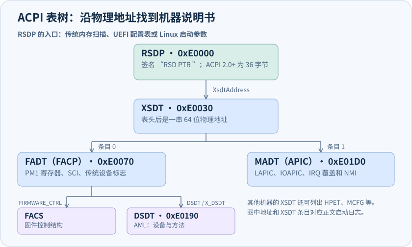
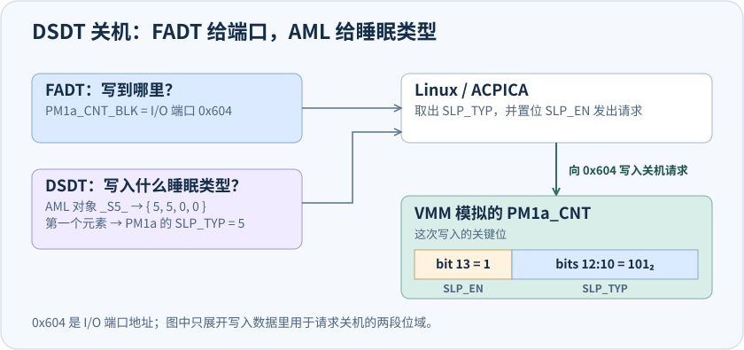
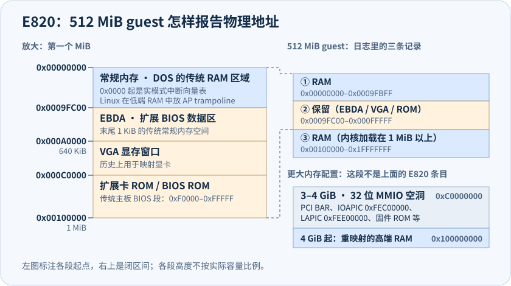
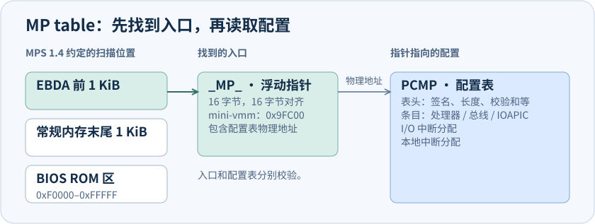
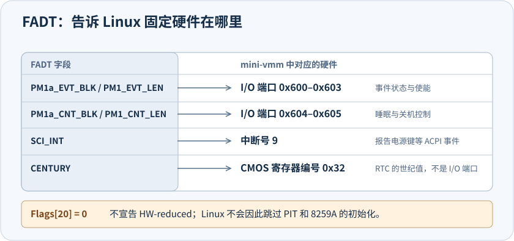
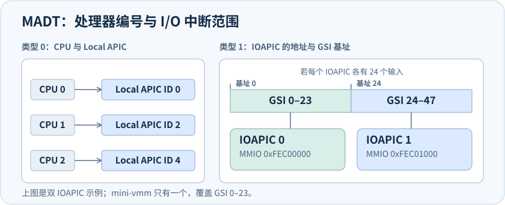
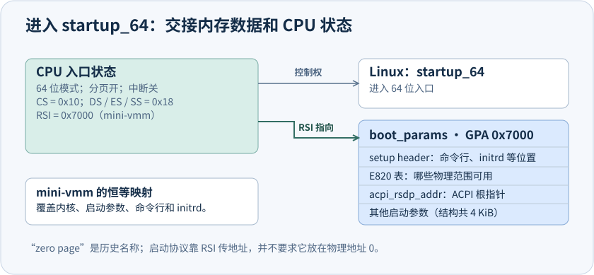

## 一、从开机到关机：Linux 怎么认识这台机器

### 1.1 明明配了 4 个 vCPU，Linux 怎么知道另外 3 个在哪？

用 mini-vmm 启动一台配有 4 个虚拟 CPU（vCPU）的机器。Linux 的串口日志里，有两行都提到了 4 个 CPU：

```
[    0.070792] CPU topo: Allowing 4 present CPUs plus 0 hotplug CPUs
...
[    0.588896] smp: Brought up 1 node, 4 CPUs
```

第一行说的是「**内核识别到 4 个已配置的 CPU**」；第二行才是「**4 个 CPU 都启动了**」。为什么中间还隔了一步？

开机时，mini-vmm 只让一个 vCPU 从 Linux 的入口开始执行。它叫**启动处理器（BSP）**，另外三个还在等唤醒。Linux 要通过这颗 CPU 向另外三颗发送启动消息，但得先知道消息该发给谁。这里的收件人编号叫 **APIC ID**。启动处理器可以读出自己的编号，却不能靠读自己的寄存器列出另外三颗。

#### 先找清单，再唤醒 CPU

在实机上，BIOS 或 UEFI 负责把主板设计和启动时探测到的信息整理成表，留给操作系统。mini-vmm 直接启动 Linux，不运行虚拟机自己的 BIOS。于是**创建 vCPU 的程序（VMM）也负责写清单**，把它留在虚拟机的内存里。

这份清单叫 **MADT**。在这个 4 vCPU 的例子里，清单有四条已启用的 CPU 记录，APIC ID 分别是 0、1、2、3。Linux 先读清单、登记 CPU，再向那三个尚未启动的 vCPU 发唤醒消息。**清单说「它们在哪」，不会替 Linux 唤醒它们。**

**ACPI 是约定这些信息怎么写、怎么找、怎么用的一套规范**，不是某一张表，也不是负责启动 Linux 的程序。MADT 只是其中的一张表。它还告诉 Linux 中断控制器在哪：比如 IOAPIC（接收设备中断的控制器）映射到哪个物理地址。CPU 清单和 IOAPIC 的位置都取决于机器的布置，不像 PCI 设备那样有一套通用的总线枚举接口。

#### 清单已经写好了，Linux 从哪里开始找？

最简单的办法是给 Linux 一个入口地址。mini-vmm 把 **RSDP** 的地址写进启动参数。RSDP 自己不列 CPU，它只告诉 Linux 去哪里找目录；目录叫 **XSDT**，里面列着各张顶层表的地址。Linux 要找 CPU 清单，就沿着「**入口 → 目录 → MADT**」这条路走。



读图时先只看通往右边 MADT 的那根线。左边的 FADT 和 DSDT 此刻可以跳过，等关机时再回来。图里的箭头表示「前一个结构存着后一个结构的物理地址」，不是执行顺序。

#### 谁把 Linux 跑起来，又是谁告诉它机器长什么样？

在 Linux 执行第一条指令之前，VMM 已经把内核和参数放进 guest 内存，设好启动 vCPU 的状态，再让它进内核入口。Linux x86 **启动协议**约定了这一步：开头的寄存器应该是什么状态、启动参数放在哪。比如 Linux 从 `RSI` 得到参数块 `boot_params` 的地址，再从参数块里取出 RSDP 的地址。

同一个参数块里还有 **E820 内存地图**。它直接列出哪些物理地址能当 RAM 用，**不必为了读它去查 ACPI**。把这三件事分开：**启动协议**约定怎么把控制权交给 Linux；**E820** 告诉它哪块内存能用；**ACPI** 描述 CPU、中断控制器和电源管理等平台硬件。

#### 最后敲下 `poweroff`：还是同一份机器说明书

启动完成后，在 guest 里执行 `poweroff`。Linux 知道要关机，但「写哪个端口、用哪个值」不是所有 PC 都一样。现在回头看 ACPI 树的左支：

- **FADT 给地址**：mini-vmm 的电源控制寄存器 `PM1a_CNT` 从 I/O 端口 `0x604` 开始。
- **DSDT 给类型值**：它的 `_S5_` 对象告诉 Linux，这台机器请求关机要用类型值 `5`。Linux 把它填进寄存器，再置位「执行请求」的那一位。



写入到达 VMM 模拟的寄存器时，VMM 打印了这行：

```
[INFO] guest requested poweroff via ACPI S5 (port 0x604, value 0x3401)
```

随后停下的是**这台虚拟机**，不是宿主机。开机时，读到 CPU 清单不等于已经唤醒 CPU；关机时，读到端口和值也不等于已经关机。**ACPI 提供描述，Linux 根据描述采取行动。**

到这里就可以停下：第一次读懂这条线，不必记表头或位号。下面按内存地图、旧式备选方案、ACPI 字段和启动入口拆开，供对照代码或日志时查阅。

### 1.2 E820：哪些物理地址能当 RAM？

有可读写的物理地址，不等于那里就是 RAM：写进去再读回来，也可能是在操作一个设备寄存器。**E820 内存图**替 Linux 划清这条线。名字来自 BIOS 服务 `int 0x15` 的功能号 `AX=0xE820`，每次调用返回一个地址范围和类型。类型 1 是可用 RAM，类型 2 是保留；另有 ACPI 可回收、ACPI NVS 等类型。

mini-vmm 不走 BIOS 调用，直接把条目放进 `boot_params`。对一台 512 MiB 的 guest，Linux 一开始就打印出三段：**低端 RAM → 保留区 → 1 MiB 以上的 RAM**。

```
[    0.000000] BIOS-e820: [mem 0x0000000000000000-0x000000000009fbff]  System RAM
[    0.000000] BIOS-e820: [mem 0x000000000009fc00-0x00000000000fffff]  device reserved
[    0.000000] BIOS-e820: [mem 0x0000000000100000-0x000000001fffffff]  System RAM
```



第一个 1 MiB 保留了 PC 的历史布局。常规内存的最后 1 KiB 留给 **EBDA**（扩展 BIOS 数据区）；640 KiB 到 1 MiB 的传统上位内存区曾放显存窗口和 ROM。mini-vmm 不管那里有没有实际的 VGA 或 ROM，都把从 `0x9FC00`（EBDA 起点）到 1 MiB 的整段报成保留。

**低端 RAM 也和那三颗待唤醒的 CPU 有关。** Linux 要在 1 MiB 以下放一小段启动代码（real-mode trampoline）。其余 vCPU 收到启动消息后，先从这段代码执行，再进入 64 位模式。如果低端没有可用空间，内核就不能按这条路径正常准备启动代码。

**3–4 GiB 是另一件事。** mini-vmm 在这个地址区间给 MMIO 留空间，例如 IOAPIC 在 `0xFEC00000`、LAPIC 在 `0xFEE00000`。一处地址不能同时是设备寄存器和 RAM。若 guest 的 RAM 超过低地址窗口的容量，超出的部分放到 4 GiB 以上；空洞本身不写成一条 E820 记录。图右下是这个较大内存配置，不是上面 512 MiB 日志的第四项。

### 1.3 MP table：没有 ACPI 时，CPU 清单还有一份

ACPI 不是 x86 上唯一能交 CPU 和中断清单的办法。较早的 **Intel MP table** 也能说明有多少 CPU、IOAPIC 在哪、设备中断接哪根线。它不描述 ACPI 关机，只是中断拓扑的备选方案。



Intel MultiProcessor Specification 1.4 定义了两个结构：

- **浮动指针 `_MP_`**：16 字节，按 16 字节对齐，内含配置表的物理地址。可放在 EBDA 的前 1 KiB、常规内存末尾的 1 KiB（没有 EBDA 时），或 BIOS ROM 区 `0xF0000`–`0xFFFFF`。mini-vmm 把它放在 `0x9FC00`。
- **配置表 `PCMP`**：表头后有五种条目：处理器（APIC ID、BSP 标志）、总线、IOAPIC、I/O 中断分配、本地中断分配（LAPIC 的 LINT0 / LINT1 接什么）。

两部分各自用校验和检查完整性：把所覆盖的字节相加，低 8 位应为 0。这条路还取决于 guest 内核是否启用了 `CONFIG_X86_MPPARSE`；关掉它，写得再正确的 MP table 也不会被采用。

### 1.4 ACPI 细读：目录、清单和 AML

#### 1.4.1 在日志里找到入口和目录

ACPI 全称 *Advanced Configuration and Power Interface*。通过它能交付两种信息：**固定格式的字段**，例如 CPU 的 APIC ID、寄存器的端口；以及 **AML 字节码**，能定义对象和方法，例如 `_S5_` 就是一个对象。固件或 VMM 提供 AML，Linux 内置的 ACPICA 负责解释；AML 不是 CPU 从固件区直接取来执行的机器码。编写 AML 时通常先写 ASL（ACPI Source Language），再编译成字节码。

下面是早期 mini-vmm 的一段日志，地址与指针树中的标注一致。先认两处名字：`FACP` 是 FADT 在内存里的签名，`APIC` 是 MADT 的签名。

```
[    0.010742] ACPI: RSDP 0x00000000000E0000 000024 (v02 MINVMM)
[    0.012395] ACPI: XSDT 0x00000000000E0030 000034 (v01 MINVMM MINIVMM  00000001 MVMM 00000001)
[    0.014814] ACPI: FACP 0x00000000000E0070 000114 (v06 MINVMM MINIVMM  00000001 MVMM 00000001)
[    0.017196] ACPI: DSDT 0x00000000000E0190 000032 (v02 MINVMM MINIVMM  00000001 MVMM 00000001)
[    0.019567] ACPI: APIC 0x00000000000E01D0 00005E (v05 MINVMM MINIVMM  00000001 MVMM 00000001)
```

- **入口 RSDP**：签名是 `"RSD PTR "`（最后一字节是空格）。mini-vmm 用 `boot_params.acpi_rsdp_addr` 直接告诉 Linux 入口地址；它也把 RSDP 放在 `0xE0000`，传统 BIOS 扫描能在按 16 字节对齐的地址上找到它（EBDA 前 1 KiB 或 `0xE0000`–`0xFFFFF`）。UEFI 则可以通过配置表交付入口。
- **目录 XSDT**：表头后是一串 64 位物理地址。上面的 `0x34`（52 字节）正好是 36 字节表头加两个 8 字节地址：一条指向 FADT，一条指向 MADT。**DSDT 不占 XSDT 的条目**，它由 FADT 里的指针指向。FADT 也可以指向固件控制结构 FACS，FACS 没有通用表头。
- **表头和校验**：XSDT、FADT、MADT、DSDT 等以 36 字节通用表头开头，有签名、长度、版本、校验和、OEM 及创建者信息。整张表所有字节相加的低 8 位应为 0。RSDP 是另一种结构：版本 0 对应 ACPI 1.0 的 RSDT（32 位地址）；版本 2 增加了 XSDT 地址。版本 2 的入口结构为 36 字节，前 20 字节及整个结构分别校验。

日志里的数字不是固定地址表：它们取决于 VMM 生成了哪些内容。这次的 DSDT 长 `0x32`（50）字节，扣除 36 字节表头，只剩 14 字节 AML，因为这个早期版本只放了关机对象。加入 PCI 描述后，DSDT 会更长，排在后面的 MADT 地址也会跟着变。

#### 1.4.2 FADT：端口、中断号和机器能力

FADT（签名 `FACP`）告诉操作系统怎样访问平台的固定硬件，例如电源管理寄存器。几个常见字段如下：



- `DSDT` / `X_DSDT`：指向 DSDT 的 32 位 / 64 位物理地址字段。
- `SCI_INT`：发生 ACPI 事件时用的中断号，例如按电源键。mini-vmm 用 9。
- `PM1a_EVT_BLK` / `PM1a_CNT_BLK` 和 `PM1_EVT_LEN` / `PM1_CNT_LEN`：PM1 事件块、控制块的端口和长度。关机写的是控制块，不是事件块。
- `SMI_CMD`：传统 PC 用来请求切换到 ACPI 模式的端口。mini-vmm 填 0，不提供这个切换入口；模拟的 PM1 设备直接报告 `SCI_EN = 1`。
- `CENTURY`：CMOS 世纪寄存器的编号。`IAPC_BOOT_ARCH`：一组 x86 平台标志，第 0 位是传统设备标志，第 1 位表示有 8042 键盘控制器。
- `Flags`：一组硬件能力标志，包括第 20 位 `HW_REDUCED_ACPI`。

#### 1.4.3 为什么 mini-vmm 不宣告硬件精简模式？

设 `HW_REDUCED_ACPI` 不是告诉 Linux「这台是虚拟机，可以少做点事」，而是告诉它「这台平台采用硬件精简的 ACPI 接口」。Linux 在 x86 上会据此跳过传统定时器初始化，改用空的 8259A 接口（`arch/x86/kernel/acpi/boot.c`）：

```c
void __init acpi_generic_reduced_hw_init(void)
{
    /*
     * Override x86_init functions and bypass legacy PIC in
     * hardware reduced ACPI mode.
     */
    x86_init.timers.timer_init   = x86_init_noop;
    x86_init.irqs.pre_vector_init = x86_init_noop;
    legacy_pic                    = &null_legacy_pic;
}
```

这对靠 PIT 校准时钟的 guest 有实际影响：没用 kvmclock 时，Linux 可能需要 PIT 校准 TSC；拿不到 TSC 频率时，也可能用 PIT 中断校准 LAPIC 定时器。mini-vmm 提供这些传统硬件，所以 FADT 不设置这一位，并提供非精简路径所需的 PM1 寄存器。**设备做了却不如实描述，Linux 可以选择不用；表里宣称有、实际没有，Linux 访问时就没人响应。**

#### 1.4.4 MADT：中断清单怎么变成 Linux 看见的拓扑？

MADT 的固定部分给出 LAPIC 的物理地址（mini-vmm 为 `0xFEE00000`）和标志字。`PCAT_COMPAT` 是第 0 位，表示还有兼容的 8259A，Linux 切换到 APIC 模式时要处理这套旧控制器。固定部分之后是变长的记录，每条以一个类型字节和一个长度字节开始：

| 类型 | 名称 | 内容 |
|---|---|---|
| 0 | Processor Local APIC | ACPI 处理器 ID、APIC ID、标志（第 0 位：已启用） |
| 1 | I/O APIC | IOAPIC ID、物理地址、GSI 基址 |
| 2 | Interrupt Source Override | “ISA IRQ x 实际接在 GSI y 上，触发方式/极性为……” |
| 3 | NMI Source | 某个 GSI 是 NMI |
| 4 | Local APIC NMI | 某颗（或所有）CPU 的 LINT0/LINT1 接的是 NMI |
| 9 | Processor Local x2APIC | 32 位 APIC ID 的 CPU |

最容易混淆的是 **CPU 编号不是 APIC ID**，以及 **IOAPIC 的地址不是 GSI**。GSI 是系统给中断输入用的统一编号；每个 IOAPIC 占从其基址开始的一段。下面故意用一个双 IOAPIC 的例子，把编号与地址拆开：



mini-vmm 只有一个 IOAPIC。它在 MADT 里填入地址和 GSI 基址 0，**没在表里写「24 个引脚」**。Linux 找到该地址后，再读 IOAPIC 的版本寄存器：从其中的最大重定向项算出 24 个输入，然后和基址拼出 GSI 0–23。

```
[    0.066602] ACPI: LAPIC_NMI (acpi_id[0xff] dfl dfl lint[0x1])
[    0.069251] IOAPIC[0]: apic_id 4, version 17, address 0xfec00000, GSI 0-23
[    0.072602] ACPI: Using ACPI (MADT) for SMP configuration information
...
[    0.092471] CPU topo: Allowing 4 present CPUs plus 0 hotplug CPUs
```

除了每个 vCPU 的类型 0 记录和一个 IOAPIC 的类型 1 记录，mini-vmm 还提供一条类型 4 记录，让所有 CPU 的 LINT1 接 NMI。这里没有类型 2 的中断源覆盖记录；ISA IRQ 的默认编号直接对应同号 GSI，与这个虚拟平台的接线一致。日志里的版本 `17`（十六进制 `0x11`）来自设备寄存器，不是 MADT 的表版本。

#### 1.4.5 `_S5_`：对象提供值，不负责写端口

这里是 DSDT 里关机对象的 ASL 写法。实际交给 Linux 的是等价的 AML。现在的 DSDT 还描述 PCI 主桥等对象，但并不改变这段关机定义：

```
Name (_S5, Package () { 5, 5, 0, 0 })
```

ACPI 名字不足四个字符时用下划线补齐，因此 `_S5` 在 AML 里是 `_S5_`。这里的 `Package` 可以看成四项列表，前两项分别给出 PM1a 和 PM1b 的睡眠类型。mini-vmm 的关机路径用第一项：Linux 把 `5` 填进 `PM1a_CNT` 的 `SLP_TYP`（位 12:10），并置位 `SLP_EN`（第 13 位）来发出请求。**S5 是关机状态的名称；类型值恰好为 5，是这台虚拟机的约定。**

`ACPI: PM: (supports S0 S5)` 表示 Linux 找到了 S5 支持。关机日志里的 `0x3401` 才是写入寄存器的完整值：`5 << 10` 给出睡眠类型，`0x2000` 置位 `SLP_EN`，最低位是 Linux 读回并保留的 `SCI_EN`。

### 1.5 Linux 为什么发现了 MP table，却用了 MADT？

可以用同一台虚拟机做对照：正常启动时，Linux 从 ACPI 认出四颗 CPU；加上 `acpi=off`，如果内核支持 MP table，仍可认出四颗 CPU，却不能走 ACPI 关机。**退路保住的是 CPU 和中断清单，不是整套 ACPI。**

Linux 的启动日志可以同时有 `found SMP MP-table at [mem 0x0009fc00-0x0009fc0f]` 和 `ACPI: Using ACPI (MADT) for SMP configuration information`。前者是扫描找到结构，后者是最终采纳的数据来源。Linux 在 `setup_arch()` 早先扫描 MP table、随后解析 ACPI；等走到 `mpparse_get_smp_config()` 时，如果 LAPIC 和 IOAPIC 都已经由 ACPI 登记，就跳过 MP 配置表：

```c
    /*
     * MPS doesn't support hyperthreading, aka only have
     * thread 0 apic id in MPS table
     */
    if (acpi_lapic && acpi_ioapic)
        return;
```

下表针对本文的 mini-vmm x86 配置。「MADT 可用」指它给出了这两部分信息：

| guest 看到的固件表 | Linux 的行为 | 结果 |
|---|---|---|
| ACPI MADT 可用 | 用 MADT，忽略 MP table | 正常：symmetric I/O 模式，多核，ACPI 关机 |
| 无 ACPI（`acpi=off` 或未编译），有 MP table，开了 `CONFIG_X86_MPPARSE` | 用 MP table | 多核和 IOAPIC 正常；但 FADT 也没了，**不能 ACPI 关机**，`poweroff` 之后 VMM 收不到 S5 写入，只能靠别的途径退出（比如 `reboot=k` 的 i8042 复位） |
| 无 ACPI，有 MP table，没开 `CONFIG_X86_MPPARSE` | 两份都用不上 | 打印 `APIC: ACPI MADT or MP tables are not detected`，退回 virtual wire 模式，**关闭 SMP**，只剩一颗 CPU |
| 两份都没有 | 同上 | 同上 |

这也是为什么 ACPI 和 MP table 不能各写各的。两份表里的 CPU 数量、APIC ID、IOAPIC ID 和地址、设备中断的接法，都必须和实际模拟的机器一致。如果两份拓扑都用不上，典型表现不是第一条指令就失败，而是系统能启动，`nproc` 却只报 1，设备中断也留在传统 PIC 路径。

### 1.6 启动协议：Linux 第一条指令之前要准备什么？

ACPI 规定了平台信息的格式；**Linux x86 启动协议**规定的是 VMM 该以什么 CPU 状态、带什么参数进入 Linux。即便禁用了 ACPI，入口约定也一样要遵守。



`struct boot_params` 是 4 KiB 的参数块，也叫 **zero page**，名字不代表它必须在地址 0。mini-vmm 放在 guest 物理地址 `0x7000`，由 `RSI` 交给内核。结构里既有 E820 表和 RSDP 地址，也有 **setup header**，后者带着命令行和 initrd（初始内存盘）的位置等字段。对 bzImage，VMM 先从镜像里读出原有的 setup header，再填由加载方提供的字段。

x86 Linux 的 [64 位启动协议](https://docs.kernel.org/arch/x86/boot.html) 要求入口执行在 64 位模式、分页开启、中断关闭。内核初始化所需的范围、参数块和命令行要有恒等映射；`CS` 用选择子 `0x10`，`DS`、`ES`、`SS` 用 `0x18`。mini-vmm 进入 `startup_64` 前设好这些状态。这个阶段出错，Linux 可能还来不及打印日志；ACPI 表填错则是下一阶段的问题。

### 1.7 小结

- **开机**：VMM 让一颗 vCPU 进 Linux；Linux 沿 ACPI 入口找到 MADT，读到另外三颗的身份，再去唤醒它们。
- **交接**：启动协议规定 CPU 状态和 `boot_params` 的传法；参数块直接带着 E820 内存地图，只存一根指向 ACPI 的指针。
- **关机**：Linux 从 FADT 得到地址、从 DSDT 得到类型值；它写入 VMM 模拟的寄存器，VMM 停掉虚拟机。提供说明、读取说明和执行动作，是三个不同的角色。
