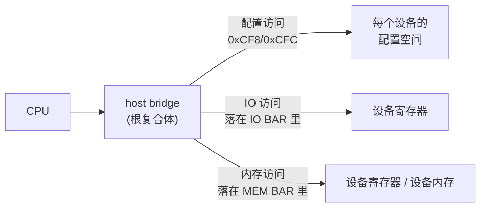
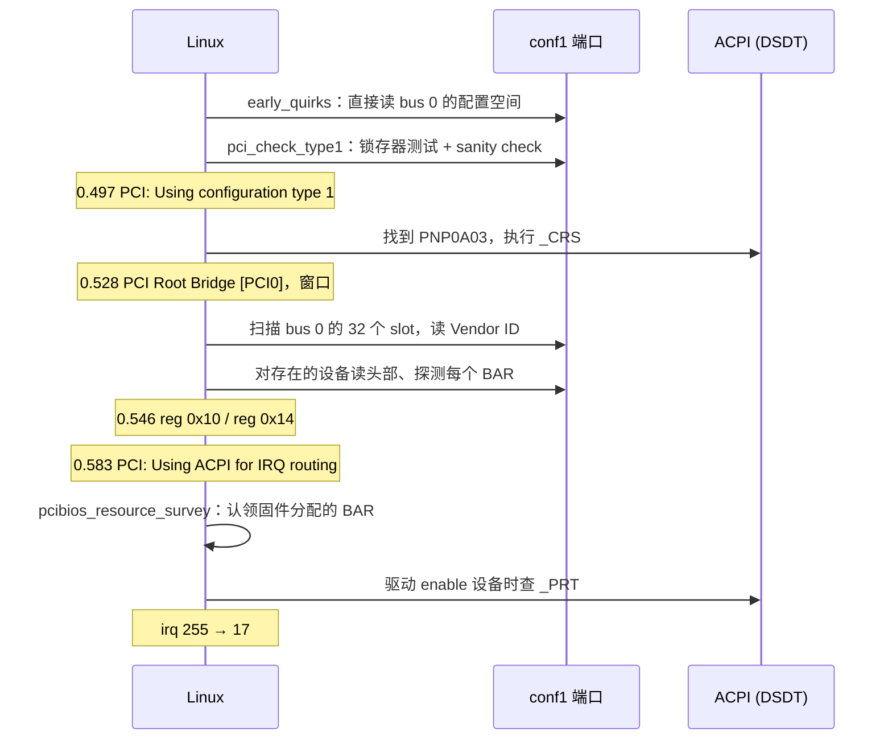

## 一、为什么需要 PCI：一条可以枚举的总线

### 1.1 传统设备的问题：地址是写死的

《传统设备·原理篇》里的设备都有一个共同点：地址是几十年前约定好的。串口在 `0x3F8`，键盘控制器在 `0x60`/`0x64`，CMOS 在 `0x70`/`0x71`，中断号也是固定的（串口 4、键盘 1、RTC 8）。驱动不需要问任何人，直接往这些端口读写就行。

这套做法有两个硬伤：

- **地址冲突只能靠人避开。** 两块 ISA 卡如果出厂时都用了 `0x300`，插在一起就互相干扰，用户只能拨卡上的跳线改地址，再把新地址告诉驱动。
- **驱动不知道机器上有什么。** 内核没有办法问“这台机器插了哪些卡”，只能往可能的地址上盲探（《传统设备·原理篇》讲过 8250 驱动对 COM2-COM4 的探测，就是这种盲探）。

PCI（Peripheral Component Interconnect）的解法是把这两件事都交给软件：

- **每个设备自带一份标准格式的自我介绍**，叫配置空间（configuration space）。里面有厂商 ID、设备 ID、设备类别，以及“我需要多大的地址空间、需要哪种地址空间”。软件扫一遍总线就知道插了什么。
- **设备的工作地址由软件分配。** 设备只声明需要多大，具体放在哪里由固件或操作系统决定，再写回设备。两个设备永远不会冲突，因为分配者会避开。

对写 VMM 的人来说，PCI 是之后几乎所有设备的地基：全模拟的 e1000 网卡和 AHCI 磁盘控制器是 PCI 设备，VirtIO 设备最常见的形态是 VirtIO-PCI，VFIO 直通的也是 PCI 设备。这一篇讲 PCI 的规则本身，《PCI·实现篇》讲 mini-vmm 怎样实现它。

### 1.2 三种地址空间

PCI 设备能被访问的地方分三种，后面所有内容都围绕它们展开：

| 地址空间 | x86 上怎么访问 | 用途 | 谁决定地址 |
|---|---|---|---|
| 配置空间 | 通过一对固定端口间接访问（第三章） | 识别设备、分配资源、控制设备开关 | 由设备在总线上的位置决定，不可改 |
| IO 空间 | `in`/`out` 指令，64K 端口 | 设备寄存器（老式做法） | 软件写进设备的 BAR |
| 内存空间 | 普通的内存读写指令（MMIO） | 设备寄存器、设备内存 | 软件写进设备的 BAR |

配置空间是“元数据”，IO 和内存空间是“干活的地方”。软件先通过配置空间认识设备、给它分配 IO/内存地址，之后驱动就只在分到的地址上和设备打交道。



图里的 host bridge 是 CPU 和 PCI 总线之间的桥。CPU 发出的访问先到它，它决定这次访问要不要转发到 PCI 总线上、转给谁。第五章会看到，“转发哪些地址”本身也是一份需要固件告诉操作系统的信息。

## 二、配置空间：设备的自我介绍

### 2.1 设备的地址：bus、device、function

PCI 设备在总线上的位置用三个数描述：

- **bus**（总线号，0-255）：一台机器可以有多条 PCI 总线，通过 PCI-PCI 桥连在一起。最靠近 CPU 的一条是 bus 0。
- **device**（设备号，也叫 slot，0-31）：一条总线上最多 32 个设备。
- **function**（功能号，0-7）：一个物理设备可以包含多个独立的功能，比如一块芯片同时是网卡和串口。只有一个功能的设备只用 function 0。

Linux 里把它们写成 `domain:bus:device.function`，例如 `0000:00:01.0` 就是 domain 0、bus 0、device 1、function 0。domain（也叫 segment）是 PCIe 时代为了支持超过 256 条总线加的一层，本篇只涉及 domain 0。device 和 function 常合在一起叫 devfn，占 8 位：高 5 位是 device，低 3 位是 function。

配置空间按这三个数寻址，**它的地址由设备插在哪里决定，软件改不了**。这是 PCI 能被枚举的根本：软件按顺序把每个 bus/device/function 都问一遍，有回答的就是存在的设备。

### 2.2 type 0 配置空间头

每个 function 有 256 字节的配置空间（PCIe 扩展到 4096 字节）。前 64 字节是规范规定格式的头部，普通设备用 type 0 格式，PCI-PCI 桥用 type 1 格式。type 0 的布局如下（PCI Local Bus Spec 3.0 第 6.1 节）：

```
偏移   31            16 15             0
0x00  | Device ID     | Vendor ID     |
0x04  | Status        | Command       |
0x08  | Class Code (24 位) | Revision |
0x0C  | BIST | Header Type | Latency Timer | Cache Line Size |
0x10  | BAR0                          |
0x14  | BAR1                          |
0x18  | BAR2                          |
0x1C  | BAR3                          |
0x20  | BAR4                          |
0x24  | BAR5                          |
0x28  | CardBus CIS Pointer           |
0x2C  | Subsystem ID  | Subsystem Vendor ID |
0x30  | Expansion ROM Base Address    |
0x34  | 保留                  | Cap Ptr |
0x38  | 保留                          |
0x3C  | Max_Lat | Min_Gnt | Interrupt Pin | Interrupt Line |
```

拿一个真实的例子对照。下面是 mini-vmm 的测试设备 `pci-test` 在 guest 里读出的前 64 字节（`od -An -tx1 -N64 /sys/bus/pci/devices/0000:00:01.0/config`，小端，每行 16 字节）：

```
 34 12 02 00 03 00 00 00 00 00 00 ff 00 00 00 00
 00 00 00 c0 01 10 00 00 00 00 00 00 00 00 00 00
 00 00 00 00 00 00 00 00 00 00 00 00 00 00 00 00
 00 00 00 00 00 00 00 00 00 00 00 00 ff 01 00 00
```

逐项翻译：

| 偏移 | 字节 | 含义 |
|---|---|---|
| 0x00 | `34 12` | Vendor ID = 0x1234 |
| 0x02 | `02 00` | Device ID = 0x0002 |
| 0x04 | `03 00` | Command = 0x0003：IO 和 Memory 的 decode 都打开了（2.3 节） |
| 0x08 | `00` | Revision = 0 |
| 0x09 | `00 00 ff` | Class Code = 0xFF0000：“不属于任何已定义类别” |
| 0x0E | `00` | Header Type = 0：type 0 头，单功能设备 |
| 0x10 | `00 00 00 c0` | BAR0 = 0xC0000000：一个内存 BAR，位置在 3GiB |
| 0x14 | `01 10 00 00` | BAR1 = 0x00001001：最低位 1 表示 IO BAR，端口地址 0x1000 |
| 0x3C | `ff` | Interrupt Line = 0xFF（6.1 节） |
| 0x3D | `01` | Interrupt Pin = 1，即 INTA |

**Vendor ID 是存在性的标志。** 0xFFFF 不是合法的厂商号，规范保证真实设备不会用它。下一节会看到，访问一个不存在的设备会读回全 1，所以 Vendor ID 读出 0xFFFF 就表示“这里没有设备”。

**Class Code 让操作系统不认识设备也能知道它是什么。** 它分三个字节：基类、子类、编程接口。0x06/0x00 是 host bridge，0x02/0x00 是以太网控制器，0x01/0x06/0x01 是 AHCI 接口的 SATA 控制器。Linux 按 Vendor/Device ID 匹配专用驱动，按 Class Code 匹配通用驱动（比如所有 AHCI 控制器都能用同一个 `ahci` 驱动）。

### 2.3 Command 寄存器：设备的总开关

Command 寄存器（偏移 0x04）里和本篇相关的几位：

| 位 | 名字 | 置 1 的含义 |
|---|---|---|
| 0 | I/O Space | 设备响应落在它 IO BAR 里的 IO 访问 |
| 1 | Memory Space | 设备响应落在它内存 BAR 里的内存访问 |
| 2 | Bus Master | 设备可以主动发起访问（DMA） |
| 10 | Interrupt Disable | 禁止设备拉 INTx 中断线 |

前两位叫 **decode 使能**。BAR 里写着地址还不够，Command 的对应位打开之后，设备才真正在那个地址上应答。这两个位和 BAR 的值一起决定了“此刻哪些地址归这个设备”，第四章的大小探测会利用这一点。

### 2.4 只读位与可写位

配置空间里的每一位，要么是只读的（由硬件决定，写了也不变），要么是软件可写的。规范逐个寄存器规定了哪些位可写：

- Vendor ID、Device ID、Class Code、Header Type 全部只读。
- Command 里只有设备真正具备的功能位可写。没有 IO BAR 的设备，I/O Space 位就固定为 0；不会做 DMA 的设备，Bus Master 位固定为 0（规范第 6.2.2 节）。
- Interrupt Pin 只读，Interrupt Line 可写。
- BAR 的情况最特别，可写位的分布本身就编码了 BAR 的大小，第四章专门讲。

“写了也不变”不是一个可以忽略的细节，软件依赖它探测设备能力。Linux 判断设备支不支持 Interrupt Disable 位，就是先写一次、再读回来看它变没变。

### 2.5 访问不存在的设备：全 1

软件枚举时会访问大量不存在的 bus/device/function。在 PCI 总线上，没有设备应答的配置读叫 **master abort**，host bridge 对 CPU 返回全 1。这和《传统设备·原理篇》里未注册端口读回 0xFF 是同一个道理：没有设备驱动数据线，总线被上拉成全 1。

所以 Linux 读一个位置的 Vendor ID，拿到 0xFFFF 就跳过；对不存在的设备的写入则直接丢弃。VMM 实现配置空间时必须遵守这个约定，否则 guest 会以为某个空位置上有设备。

## 三、怎样访问配置空间：Type 1 配置机制

### 3.1 两个端口：CONFIG_ADDRESS 和 CONFIG_DATA

配置空间不在 IO 空间也不在内存空间里，x86 CPU 没有专门访问它的指令。PC 平台的办法是在 IO 空间里留一对端口，由 host bridge 把对它们的访问翻译成配置访问。这叫 **配置机制 1**（Configuration Mechanism #1，下文简称 conf1，PCI 3.0 第 3.2.2.3.2 节）：

- **CONFIG_ADDRESS**，端口 `0xCF8`，32 位。先往这里写“要访问谁的哪个寄存器”。
- **CONFIG_DATA**，端口 `0xCFC`-`0xCFF`，再从这里读写那个寄存器所在的 dword。

CONFIG_ADDRESS 的位布局：

```
 31  30      24 23      16 15    11 10     8 7        2 1 0
| E | 保留     | bus      | device | func   | register | 0 0 |
```

- bit 31 是使能位，必须为 1，否则 CONFIG_DATA 不做配置访问。
- register 字段只有 bit 7:2，选中的是一个 4 字节对齐的 dword。bit 1:0 固定为 0。
- 想访问 dword 里的某一个字节或某两个字节，就访问 CONFIG_DATA 里对应偏移的端口：`0xCFC + (reg & 3)`。

例子：读 `00:01.0` 的 BAR0（偏移 0x10）。

```
outl(0x80000810, 0xCF8);   // E=1, bus 0, device 1, function 0, register 0x10
x = inl(0xCFC);            // 读回 0xC0000000
```

地址 `0x80000810` 的拆法：`0x80000000` 是使能位；device 1 在 bit 15:11，即 `1 << 11 = 0x800`；register 0x10 在低 8 位。

再看读 Command 寄存器（偏移 0x04，2 字节）：

```
outl(0x80000804, 0xCF8);
cmd = inw(0xCFC);          // 偏移 4 & 3 = 0，所以从 0xCFC 读
```

读 Interrupt Pin（偏移 0x3D，1 字节）则是 `outl(0x8000083C, 0xCF8)` 选中 0x3C 这个 dword，再 `inb(0xCFD)` 取其中第 1 个字节。Linux 的 `pci_conf1_read()`（`arch/x86/pci/direct.c`）就是这样写的：

```c
outl(PCI_CONF1_ADDRESS(bus, devfn, reg), 0xCF8);
switch (len) {
case 1: *value = inb(0xCFC + (reg & 3)); break;
case 2: *value = inw(0xCFC + (reg & 2)); break;
case 4: *value = inl(0xCFC);             break;
}
```

一次配置读要两次端口访问。在虚拟机里，每次端口访问都是一次 VM exit，一次配置读就是两次 exit。整个启动阶段 Linux 枚举 PCI 产生的配置访问有好几百次，第七章会给出实测数字。

### 3.2 CONFIG_ADDRESS 只认 32 位访问

规范规定：只有对 `0xCF8` 的 32 位访问才是在访问 CONFIG_ADDRESS。对 `0xCF8`-`0xCFB` 的 8 位、16 位访问不碰这个寄存器，按普通 IO 访问处理，往下游转发。原因是这几个端口在 PCI 之前就被别的设备用过，规范要求和它们共存。

Linux 判断 conf1 是否存在，正是利用了这个规则（`pci_check_type1()`）：

```c
outb(0x01, 0xCFB);                 // 8 位写：不应影响 CONFIG_ADDRESS
tmp = inl(0xCF8);
outl(0x80000000, 0xCF8);           // 32 位写：真正写 CONFIG_ADDRESS
if (inl(0xCF8) == 0x80000000 && pci_sanity_check(&pci_direct_conf1))
        works = 1;
outl(tmp, 0xCF8);
```

判据是“写进去的 0x80000000 能原样读回来”，这要求 `0xCF8` 是一个真正可读写的 32 位锁存器。没有 PCI 的机器上 `0xCF8` 没人应答，读回全 1，判定失败。《对照日志把Linux跑起来》里那行 `PCI: Fatal: No config space access function found` 就是这么来的。

conf1 之外还有一个配置机制 2，用 `0xCF8` 的一个字节做使能、`0xC000`-`0xCFFF` 的端口映射配置空间。它只在很早期的芯片组上出现，`pci_check_type2()` 也会试，但现代机器（包括虚拟机）都只用 conf1。

### 3.3 一个容易漏掉的检查：pci_sanity_check

锁存器测试通过之后，Linux 还要做一次 `pci_sanity_check()`：

```c
if (dmi_get_bios_year() >= 2001)
        return 1;

for (devfn = 0; devfn < 0x100; devfn++) {
        if (o->read(0, 0, devfn, PCI_CLASS_DEVICE, 2, &x))
                continue;
        if (x == PCI_CLASS_BRIDGE_HOST || x == PCI_CLASS_DISPLAY_VGA)
                return 1;
        ...
}
return 0;
```

BIOS 日期在 2001 年以后的机器直接通过。否则要在 bus 0 上找到一个 class 是 host bridge 或 VGA 的设备，才承认 conf1 真的可用。

BIOS 日期来自 SMBIOS（DMI）表。直接启动内核的 VMM 没有提供 SMBIOS，`dmi_get_bios_year()` 拿不到年份，于是一定会走下面的扫描。**这意味着 bus 0 上必须有一个 host bridge 设备**，哪怕它什么都不做。真实主板上 bus 0 device 0 通常就是 host bridge，所以这条检查在真机上从不失败，在 VMM 里却很容易漏掉。

### 3.4 保留位：AMD 的扩展寄存器号

CONFIG_ADDRESS 的 bit 30:24 规范定为保留。PCIe 把每个 function 的配置空间扩大到 4096 字节，寄存器号需要 12 位，而 conf1 的 register 字段只有 8 位。AMD 的做法是把 bit 27:24 当作寄存器号的高 4 位，叫 IO ECS（Extended Configuration Space）。

Linux 在 AMD family 0x10 及以后的 CPU 上（海光的 CPU 也算在内）默认认为这个扩展存在（`arch/x86/pci/amd_bus.c` 的 `pci_io_ecs_init()`），然后用 conf1 访问 256 字节以上的配置空间。这台 guest 跑在 AMD 兼容的 host 上，启动日志里可以看到：

```
[    0.497110] PCI: Using configuration type 1 for base access
[    0.497399] PCI: Using configuration type 1 for extended access
```

第二行就是这个扩展。它的地址拼法（`arch/x86/pci/direct.c`）：

```c
#define PCI_CONF1_ADDRESS(bus, devfn, reg) \
        (0x80000000 | ((reg & 0xF00) << 16) | (bus << 16) \
        | (devfn << 8) | (reg & 0xFC))
```

读偏移 0x100 时，`(0x100 & 0xF00) << 16 = 0x01000000`，落在 bit 24。只有 256 字节配置空间的设备如果忽略这些位，就会把对 0x100 的访问当成对 0x00 的访问；如果是写，就会改坏 Command 或 BAR。正确做法是：保留位非 0 时按“没有这个寄存器”处理，读全 1、写丢弃。

PCIe 定义的标准做法是 ECAM（Enhanced Configuration Access Mechanism）：把所有配置空间平铺映射到一段内存地址上，每个 function 占 4KiB，一次普通的内存读写就是一次配置访问，不再需要两步。ECAM 的位置由 ACPI 的 MCFG 表告诉操作系统。这是后面 pcie-ecam 里程碑的内容。

## 四、BAR：设备向软件要地址

### 4.1 BAR 的格式

BAR（Base Address Register）是配置空间里偏移 0x10-0x24 的 6 个 32 位寄存器。每个 BAR 描述设备的一块寄存器区域，最低几位是只读的类型位（PCI 3.0 第 6.2.5.1 节）：

```
内存 BAR:  31                         4   3    2 1   0
          | 基址                       | P | 类型 | 0 |
                                         类型 00 = 32 位地址，10 = 64 位地址
                                         P = 1 表示可预取

IO BAR:    31                            2   1   0
          | 基址                          | 0 | 1 |
```

- bit 0 区分种类：0 是内存，1 是 IO。
- 内存 BAR 的 bit 2:1 是地址宽度。64 位 BAR 占两个相邻的 BAR 寄存器，后一个放高 32 位。
- 内存 BAR 的 bit 3 是可预取（prefetchable）：读没有副作用、可以合并和提前读的区域（比如显存）才置 1。设备寄存器读一次可能就改变状态（比如读走一个 FIFO 里的字节），所以寄存器区域都是不可预取的。

上一章的例子里，BAR0 是 `0xC0000000`，低 4 位全 0：32 位、不可预取的内存 BAR。BAR1 是 `0x00001001`，bit 0 为 1：IO BAR，端口地址 0x1000。

### 4.2 大小怎么探测：写全 1，读回来

BAR 只放了一个地址，大小写在哪里？答案是：**大小由 BAR 里哪些位不可写来表达**。

一个大小为 4KiB 的内存 BAR，地址必须按 4KiB 对齐（规范要求 BAR 地址按自身大小对齐），所以地址的低 12 位永远是 0。硬件干脆把这 12 位做成只读的 0。软件往 BAR 写全 1，读回来时低 12 位还是 0，高位都是 1：

```
写入    0xFFFFFFFF
读回    0xFFFFF000          低 12 位不可写，地址位里低位的 0 有 12 个
屏蔽类型位后取反加 1：~0xFFFFF000 + 1 = 0x1000 = 4KiB
```

IO BAR 同理。一个 16 字节的 IO BAR：

```
写入    0xFFFFFFFF
读回    0x0000FFF1          bit 0 是只读的 1（IO 类型），bit 3:2 不可写
屏蔽类型位（低 2 位）后取最低的 1：0xFFF0 → 大小 0x10 = 16 字节
```

这里高 16 位也读回 0，是因为 x86 的 IO 空间只有 64K，设备不实现更高的地址位。Linux 在算 IO BAR 大小时也只看低 16 位（`IO_SPACE_LIMIT`）。规范还规定 IO BAR 最大只能 256 字节，IO 空间太小，不允许一个设备占太多。

这个设计很省硬件：设备只需要一个地址比较器，比较的位数由 BAR 大小决定，“不可写的低位”自然就出现了。软件也只需要一个统一的探测方法，不用认识设备就能知道它要多少地址。

一个没实现的 BAR 全部位都不可写，写全 1 读回 0，大小为 0，软件就知道这个 BAR 不存在。

### 4.3 Linux 的探测顺序：先关 decode

写全 1 的那一刻，BAR 指向的是 `0xFFFFF000`。如果此时设备的 decode 是打开的，它就会去响应 4GiB 下面最后那 4KiB 的地址，和那里的其他设备冲突（x86 上那一段通常是固件 ROM）。所以 Linux 探测前要先关 decode（`drivers/pci/probe.c` 的 `__pci_read_base()`）：

```c
/* No printks while decoding is disabled! */
if (!dev->mmio_always_on) {
        pci_read_config_word(dev, PCI_COMMAND, &orig_cmd);
        if (orig_cmd & PCI_COMMAND_DECODE_ENABLE)
                pci_write_config_word(dev, PCI_COMMAND,
                        orig_cmd & ~PCI_COMMAND_DECODE_ENABLE);
}

pci_read_config_dword(dev, pos, &l);        /* 原值 */
pci_write_config_dword(dev, pos, l | mask); /* 全 1 */
pci_read_config_dword(dev, pos, &sz);       /* 读回大小 */
pci_write_config_dword(dev, pos, l);        /* 写回原值 */
...
if (!dev->mmio_always_on && (orig_cmd & PCI_COMMAND_DECODE_ENABLE))
        pci_write_config_word(dev, PCI_COMMAND, orig_cmd);
```

那行注释“No printks while decoding is disabled!”说的是：decode 关掉的这段时间里，如果这个设备恰好是控制台（比如显卡），打印会访问一个此刻不响应的设备。

用 `--trace-pio` 录下 guest 探测 `pci-test` 的 BAR0，能看到和这段代码一一对应的端口访问：

```
pci-conf1-addr W4 80000804      选中 Command
pci-conf1-data R2 0003          读原值：IO 和 Memory decode 都开着
pci-conf1-addr W4 80000804
pci-conf1-data W2 0000          关 decode
pci-conf1-addr W4 80000810      选中 BAR0
pci-conf1-data R4 c0000000      读原值
pci-conf1-addr W4 80000810
pci-conf1-data W4 ffffffff      写全 1
pci-conf1-addr W4 80000810
pci-conf1-data R4 fffff000      读回：4KiB
pci-conf1-addr W4 80000810
pci-conf1-data W4 c0000000      写回原值
pci-conf1-addr W4 80000804
pci-conf1-data W2 0003          恢复 Command
```

这个序列对每个 BAR 都做一遍。BAR1 的序列出现在稍后（中间隔着打印 `reg 0x10` 那行日志的串口输出），读回的是 `0000fff1`。对 VMM 来说这意味着：BAR 在探测过程中会短暂地被写成全 1，decode 会被关掉又打开，VMM 必须在每一次写之后都正确更新“这个设备此刻在哪里响应”。

### 4.4 BAR 的值决定位置，Command 决定是否响应

把 2.3 节和这一章合起来：一个 BAR 此刻响应哪段地址，由两样东西共同决定。

| Command 对应位 | BAR 的值 | 设备的行为 |
|---|---|---|
| 0 | 任意 | 不响应。访问落空，读回全 1 |
| 1 | `0xC0000000` | 响应 `[0xC0000000, 0xC0001000)` |
| 1 | 改成 `0xC0100000` | 立刻改为响应 `[0xC0100000, 0xC0101000)`，旧地址落空 |

最后一行很关键：**BAR 的地址是活的**。操作系统随时可以改写 BAR 把设备搬走，热插拔时为了腾地方也确实会这么做。真实硬件里地址比较器直接比较 BAR 寄存器的当前值，自然是实时的；VMM 则要在 BAR 或 Command 每次被写时重新计算地址，把访问的路由改过去。

## 五、谁来分配 BAR：固件还是操作系统

### 5.1 固件先分，操作系统沿用

BAR 的地址由软件分配，但“软件”有两个候选：固件和操作系统。

PC 平台的传统是**固件分配**。BIOS 或 UEFI 在启动阶段（POST）就枚举了 PCI 总线，因为它自己就要用 PCI 设备：从磁盘控制器读引导扇区、在显卡上显示画面。它给每个 BAR 分配好地址、打开 decode，然后把机器交给操作系统。

Linux 在 x86 上默认**沿用固件的分配**，只在固件的分配有问题时才自己动手。负责这件事的是 `pcibios_resource_survey()`（`arch/x86/pci/i386.c`），它对每个 BAR 尝试“认领”（claim）：

```c
if (!r->start)          /* Address not assigned at all */
        continue;
...
if (pci_claim_resource(dev, idx) < 0) {
        /* We'll assign a new address later */
        pcibios_save_fw_addr(dev, idx, r->start);
        r->end -= r->start;
        r->start = 0;
}
```

认领的意思是把这段地址登记到上级资源下面（`/proc/iomem` 和 `/proc/ioports` 里的那棵树）。认领失败的 BAR 被清零，之后由 `pci_assign_unassigned_resources()` 重新分配一个地址。认领失败的常见原因是 BAR 不在上级桥转发的地址窗口里（下一节），或者和别的资源冲突。

注意第一行：**Linux 把值为 0 的 BAR 当作“没分配”**。规范本身没有这条规定，0 是一个合法地址。这是 Linux 的约定，因为固件不会把设备放在地址 0。

### 5.2 host bridge 的地址窗口

host bridge 并不是把所有地址都转发给 PCI 总线。内存地址里有 RAM、有 IOAPIC 和 LAPIC 这样的平台设备，这些访问不该进 PCI。host bridge 只转发落在**窗口**里的地址，窗口外的访问由别的部件处理。

窗口的范围由芯片组的寄存器决定，没有统一的读法，所以又是一份需要固件告诉操作系统的信息（《固件与启动协议·原理篇》1.1 节说的“问不出来”的那类）。ACPI 的描述方法是：在 DSDT 里放一个代表 host bridge 的设备对象，`_HID` 是 `PNP0A03`（PCI 总线；PCIe 是 `PNP0A08`），它的 `_CRS`（Current Resource Settings）方法返回窗口列表。

`_CRS` 返回的是一串**资源描述符**（ACPI 6.4 第 6.4 节）。描述 host bridge 窗口用的是 Address Space Descriptor，按地址宽度有 Word（16 位）、DWord（32 位）、QWord（64 位）三种，资源类型分内存、IO、总线号三种。每个描述符里有一个容易忽略的标志位：**ResourceProducer 还是 ResourceConsumer**。host bridge 的窗口是它向下游设备提供的地址空间，必须标成 Producer。Linux 只把 Producer 的范围当作桥窗口（`drivers/acpi/resource.c` 的 `acpi_decode_space()` 只给它们打上 `IORESOURCE_WINDOW` 标记）。

mini-vmm 给出的窗口，Linux 启动时原样打印出来：

```
ACPI: PCI Root Bridge [PCI0] (domain 0000 [bus 00-ff])
PCI host bridge to bus 0000:00
pci_bus 0000:00: root bus resource [io  0x0000-0x0cf7 window]
pci_bus 0000:00: root bus resource [io  0x0d00-0xffff window]
pci_bus 0000:00: root bus resource [mem 0xc0000000-0xfebfffff window]
pci_bus 0000:00: root bus resource [bus 00-ff]
```

guest 里的 `/proc/iomem` 和 `/proc/ioports` 显示的就是以这些窗口为根的资源树：

```
c0000000-febfffff : PCI Bus 0000:00
  c0000000-c0000fff : 0000:00:01.0
fec00000-fec003ff : IOAPIC 0
```

```
0000-0cf7 : PCI Bus 0000:00
  0000-001f : dma1
  ...
  03f8-03ff : serial
  0600-0603 : ACPI PM1a_EVT_BLK
  0604-0605 : ACPI PM1a_CNT_BLK
0cf8-0cff : PCI conf1
0d00-ffff : PCI Bus 0000:00
  1000-100f : 0000:00:01.0
```

`pci-test` 的 BAR0 挂在内存窗口下面，BAR1 挂在第二段 IO 窗口下面，两者都被成功认领。

### 5.3 窗口为什么是这几个数

**内存窗口 `0xC0000000`-`0xFEBFFFFF`。** 起点是《内存基础》里留出的 3GiB-4GiB 空洞：RAM 到 3GiB 为止，空洞就是给设备留的。终点停在 `0xFEC00000` 之前，是因为从那里开始依次是 IOAPIC（`0xFEC00000`）、HPET、LAPIC（`0xFEE00000`）和固件 ROM，这些地址由 CPU 和芯片组直接处理，不经过 PCI 总线。窗口要是包含了它们，Linux 就可能把某个 BAR 分到 IOAPIC 的地址上。

**IO 窗口挖掉 `0xCF8`-`0xCFF`。** 这 8 个端口是 conf1 自己，host bridge 不会把它们转发下去。所以 IO 窗口被切成两段。

**传统设备的端口也在 IO 窗口里。** 串口的 `0x3F8`、键盘的 `0x60` 都落在 `0x0000`-`0x0CF7` 这一段里。这不是错误：在真实的 PC 上，这些传统设备挂在一个 PCI-ISA 桥后面（今天是芯片组里的 LPC 控制器），它们的端口本来就要先经过 host bridge 转发。ISA 桥做的是**减法译码**（subtractive decode）：PCI 上没有别的设备认领的 IO 访问，最后都由它接下来。

`_CRS` 窗口和 E820 里那行“available for PCI devices”不是一回事。《内存基础》里看到的那行：

```
[mem 0x20000000-0xffffffff] available for PCI devices
```

是 Linux 从 E820 的空隙里推算出的候选范围，只在没有 `_CRS` 时作为兜底。有 `_CRS` 时，Linux 打印 `PCI: Using host bridge windows from ACPI`，以 `_CRS` 为准。

### 5.4 窗口不对时会发生什么

一个对照实验：把 `_CRS` 内存窗口的起点故意改成 `0xC0100000`，BAR0 仍然由 VMM 放在 `0xC0000000`。Linux 的日志变成：

```
pci_bus 0000:00: root bus resource [mem 0xc0100000-0xfebfffff window]
pci 0000:00:01.0: reg 0x10: [mem 0xc0000000-0xc0000fff]
pci 0000:00:01.0: can't claim BAR 0 [mem 0xc0000000-0xc0000fff]: no compatible bridge window
pci 0000:00:01.0: BAR 0: assigned [mem 0xc0100000-0xc0100fff]
```

`reg 0x10` 是探测读到的固件分配；认领时发现它不在任何窗口里，放弃；最后重新分配到窗口的起点 `0xC0100000`，并把新地址写回 BAR0。设备照样能用，但前提是 VMM 正确实现了“BAR 被改写后跟着搬家”（4.4 节）。窗口和固件分配一致时，这三行一行都不会出现，这正是 mini-vmm 的 e2e 测试检查的内容。

## 六、INTx：PCI 设备的中断线

### 6.1 四根线，电平触发，可以共享

PCI 规定每个设备最多有 4 根中断输出线：INTA#、INTB#、INTC#、INTD#（`#` 表示低电平有效）。单功能设备只用 INTA。多功能设备的各个 function 可以用不同的线。

和 ISA 中断（《中断·原理篇》）比，INTx 有两个不同：

- **电平触发、低有效。** 设备有事时把线拉低并一直保持，直到驱动处理完、清掉设备里的中断状态，线才回到高电平。
- **可以共享。** 多个设备可以接在同一根线上，线是“线与”的，任何一个拉低都会触发。中断来了之后，共享这根线的每个驱动都要去问自己的设备“是不是你”。电平触发正是共享的前提：边沿触发时，两个设备先后拉线可能只产生一个边沿，后一个就丢了。

配置空间里和 INTx 有关的两个字节：

- **Interrupt Pin**（0x3D，只读）：设备用哪根线。0 表示不用 INTx，1-4 对应 INTA-INTD。这是设备自己知道的事。
- **Interrupt Line**（0x3C，可写）：这根线最终接到了中断控制器的几号输入。设备不知道这件事，它是个“便签”，由固件写进去给操作系统看。在 x86 上 0xFF 表示“未知或者不接 8259”（PCI 3.0 第 6.2.4 节）。

### 6.2 线接到哪里：又一件问不出来的事

设备只知道自己拉的是 INTA，不知道 INTA 接到了 IOAPIC 的哪个引脚。这取决于主板走线，和 BAR 不一样，它不能由软件分配，也不能从设备上读出来。所以这又是一份必须由固件提供的信息。

主板通常不会把所有设备的 INTA 都接到同一个引脚上，那样所有设备都挤在一根线上共享，中断处理要挨个问一遍。常见的做法是**错开**（swizzle）：slot 0 的 INTA 接第 1 根线，slot 1 的 INTA 接第 2 根，依次轮转。写成公式就是：

```
线号 = (slot + pin - 1) mod 4        pin: 1 = INTA ... 4 = INTD
```

这个公式原本出自 PCI-PCI 桥规范，规定桥下游设备的中断线怎样映射到桥上游的线，Linux 里对应 `pci_swizzle_interrupt_pin()`。根总线上用不用、怎么接，是主板的选择，固件表如实描述就行。

### 6.3 ACPI 的描述：_PRT

ACPI 用 host bridge 设备下的 `_PRT`（PCI Routing Table）描述这张接线表（ACPI 6.4 第 6.2.13 节）。它是一个 Package，每一项是 4 个元素：

```
Package { Address, Pin, Source, Source Index }
```

| 元素 | 含义 |
|---|---|
| Address | 高 16 位是 device 号，低 16 位是 function 号；低 16 位为 0xFFFF 表示“这个 slot 的所有 function” |
| Pin | 0 = INTA，1 = INTB，……（注意比配置空间的 Interrupt Pin 小 1） |
| Source | 0 表示直接接在一个 GSI 上；否则是一个 PCI Interrupt Link 设备的名字 |
| Source Index | Source 为 0 时就是 GSI 号 |

Source 有两种用法。真实芯片组上的中断线常常经过一个可编程的路由器（比如 PIIX 的 PIRQ 寄存器），可以改接到不同的 IRQ 上，这时 Source 指向一个 Link 设备，操作系统通过 Link 设备的 `_PRS`/`_SRS` 方法选择和设置它接到哪里。线是硬连在 IOAPIC 某个引脚上的，就直接写 Source = 0、Source Index = GSI 号，不需要 Link 设备。直接接线的 GSI 按规范默认是电平触发、低有效，正好是 INTx 的电气特性。

例子：slot 1 的 INTA 按 6.2 节的公式接第 `(1 + 1 - 1) mod 4 = 1` 根线。如果四根线依次接 IOAPIC 的 16-19 号引脚，这一项就是：

```
Package { 0x0001FFFF, 0, 0, 17 }
```

IOAPIC 的 0-15 号引脚在 PC 上留给 ISA 中断（时钟、键盘、串口……），PCI 中断从 16 开始用，这是 PC 芯片组的惯例。

### 6.4 MP table 的描述：PCI 中断项

如果 guest 用 `acpi=off` 启动，Linux 不读 DSDT，中断路由只能从 MP table 获得（《固件与启动协议·原理篇》1.5 节）。MP table 的中断项（I/O Interrupt Assignment Entry）原本描述 ISA IRQ 接到 IOAPIC 哪个引脚，PCI 中断用同样的结构，区别在两个字段：

- **源总线**（source bus ID）指向一个类型为 `PCI` 的总线项。
- **源总线 IRQ**（source bus IRQ）对 PCI 总线有专门的编码：bit 6:2 是 device 号，bit 1:0 是 pin（0 = INTA）。Linux 解析时正是按 `(srcbusirq >> 2) & 0x1f` 取 device、`srcbusirq & 3` 取 pin（见下面的代码）。

slot 1 的 INTA 接 GSI 17，写成 MP table 的中断项是：源总线 = PCI 总线、源 IRQ = `1 << 2 | 0 = 0x04`、目标 IOAPIC 引脚 = 17。

这里有一个规范里没有明说、但 Linux 依赖的约束：**MP table 里 PCI 总线的 bus ID 必须等于它的 PCI 总线号**。Linux 查 PCI 中断时（`arch/x86/kernel/apic/io_apic.c` 的 `IO_APIC_get_PCI_irq_vector()`）直接拿设备所在的 PCI 总线号去和中断项的源总线 ID 比较：

```c
for (i = 0; i < mp_irq_entries; i++) {
        int lbus = mp_irqs[i].srcbus;
        ...
        if (bus != lbus || mp_irqs[i].irqtype != mp_INT ||
            slot != ((mp_irqs[i].srcbusirq >> 2) & 0x1f))
                continue;
```

所以 bus 0 这条 PCI 总线在 MP table 里的 ID 必须是 0。只有 ISA 总线的机器可以把 0 给 ISA；有 PCI 时 0 要让给 PCI，ISA 排到后面。SeaBIOS 生成的 MP table 也是这样排的。

### 6.5 Linux 什么时候分配 IRQ

Linux 不在枚举时给设备分配 IRQ，而是推迟到驱动调用 `pci_enable_device()` 时。所以一个还没有驱动的设备，sysfs 里看到的 `irq` 是 0 或者 255，enable 之后才变成真正的 IRQ 号：

```
# cat /sys/bus/pci/devices/0000:00:01.0/irq
255
# echo 1 > /sys/bus/pci/devices/0000:00:01.0/enable
# cat /sys/bus/pci/devices/0000:00:01.0/irq
17
```

enable 时查哪张表，取决于启动时选了哪条路：

| 启动方式 | 启动日志 | enable 时调用 | 查的表 |
|---|---|---|---|
| 有 ACPI | `PCI: Using ACPI for IRQ routing` | `acpi_pci_irq_enable()`（`drivers/acpi/pci_irq.c`） | DSDT 的 `_PRT` |
| `acpi=off` | 无此行 | `pirq_enable_irq()`（`arch/x86/pci/irq.c`） | MP table 的 PCI 中断项 |

`acpi=off` 时 Linux 会打印查到的结果：

```
pci 0000:00:01.0: PCI->APIC IRQ transform: INT A -> IRQ 17
```

两张表描述的是同一套接线，所以两种启动方式下同一个设备必须分到同一个 IRQ。这是检查两张表是否一致的最直接办法。

最后一个细节：上面 2.2 节的配置空间转储是 enable 之后读的，Interrupt Line 仍然是 0xFF。Linux 把 IRQ 号记在内核自己的 `struct pci_dev` 里，并没有写回这个寄存器。Interrupt Line 只是固件留给操作系统的一张便签，在有 ACPI 或 MP table 的平台上，操作系统不靠它。

### 6.6 INTx 之后：MSI

INTx 的问题是线少、要共享、每次中断都要挨个问设备。PCI 2.2 引入了 MSI（Message Signaled Interrupt）：设备不拉线，而是往一个特定的内存地址写一个值，这次写本身就是中断（《中断·原理篇》讲过，在 x86 上中断可以是一次内存写）。MSI 不需要主板走线，也就不需要 `_PRT` 和 MP table。它通过配置空间里的 capability 结构配置，是 pci-msi 里程碑的内容。

## 七、Linux 枚举 PCI 的全过程

把前面几章串起来，Linux 从启动到能用一个 PCI 设备，经过下面几步。时间戳取自 `--pci-test` 启动的 guest 日志：



1. **early quirks**（`setup_arch()` 里的 `early_quirks()`）：PCI 子系统还没初始化，内核就直接用 conf1 扫一遍 bus 0，寻找需要提前处理的芯片组问题。即使机器没有 PCI，这些访问也会发生。
2. **选择配置访问方式**（`pci_arch_init()` → `pci_direct_probe()`）：第三章的锁存器测试和 sanity check。
3. **建立根总线**：ACPI 解释器找到 `PNP0A03` 设备，执行 `_CRS` 拿到窗口，创建 `0000:00` 这条根总线。
4. **扫描总线**（`acpi_pci_root_create()` → `pci_scan_child_bus()`）：对每个 slot 读 Vendor ID，不是 0xFFFF 的就读 Header Type、Class Code，探测每个 BAR（4.3 节），打印 `[1234:0002] type 00 class 0xff0000` 和 `reg 0x10: ...`。
5. **资源认领**（`pcibios_resource_survey()`）：在窗口下认领固件分配的 BAR，认领失败的稍后重新分配（第五章）。
6. **中断**：驱动 enable 设备时，按 `_PRT` 或 MP table 分配 IRQ（第六章）。

整个过程在一台只有 host bridge 和一个测试设备的虚拟机上，产生了这么多次 conf1 访问（`--exit-stats` 报告）：

```
  device                     space         reads       writes
  pci-conf1-addr             PIO               2          312
  pci-conf1-data             PIO             263           46
```

CONFIG_ADDRESS 的 2 次读就是锁存器测试里的两次 `inl(0xCF8)`，其余全是“先写地址、再读写数据”的配置访问，大约 310 次，每次两个 VM exit。设备越多，这个数字越大，这也是 PCIe 用 ECAM 一步完成配置访问的原因之一。

## 附录 A：本文引用的规范与源码

**规范**

- PCI Local Bus Specification 3.0：第 3.2.2.3.2 节（配置机制 1）、第 6.1 节（配置空间头）、第 6.2.2 节（Command）、第 6.2.4 节（Interrupt Line/Pin）、第 6.2.5 节（BAR）
- PCI-to-PCI Bridge Architecture Specification：中断引脚的 swizzle
- ACPI 6.4：第 6.1.5 节（`_HID`）、第 6.2.13 节（`_PRT`）、第 6.4 节（资源描述符）
- MultiProcessor Specification 1.4：第 4.3.2 节（Bus Entry）、第 4.3.4 节（I/O Interrupt Assignment Entry）
- `include/uapi/linux/pci_regs.h`：配置空间寄存器和位定义

**Linux 6.6**

- `arch/x86/pci/direct.c`：`pci_conf1_read()`、`pci_check_type1()`、`pci_sanity_check()`、`pci_direct_init()`
- `arch/x86/pci/amd_bus.c`：`pci_io_ecs_init()`
- `drivers/pci/probe.c`：`__pci_read_base()`
- `arch/x86/pci/i386.c`：`pcibios_resource_survey()`、`pcibios_allocate_dev_resources()`
- `drivers/pci/setup-res.c`：`pci_claim_resource()` 的 “can't claim BAR” 几种原因
- `drivers/acpi/resource.c`：`acpi_decode_space()`
- `arch/x86/pci/acpi.c`：`Using ACPI for IRQ routing`，`pcibios_enable_irq = acpi_pci_irq_enable`
- `drivers/acpi/pci_root.c`：`acpi_pci_root_create()`
- `drivers/acpi/pci_irq.c`：`acpi_pci_irq_enable()`、`_PRT` 项的解析
- `arch/x86/pci/irq.c`：`pirq_enable_irq()`
- `arch/x86/kernel/apic/io_apic.c`：`IO_APIC_get_PCI_irq_vector()`

## 附录 B：深入阅读

- learning-note 卷七第 7.4 节：没有 PCI 时 Linux 的两批 conf1 探测（early quirks 和 `pci_direct_probe()`），以及未注册端口读回 0xFF 和 0x00 时探测结论的差别
- learning-note 卷五：E820 的 PCI gap 和 `/proc/iomem` 资源树的来历
