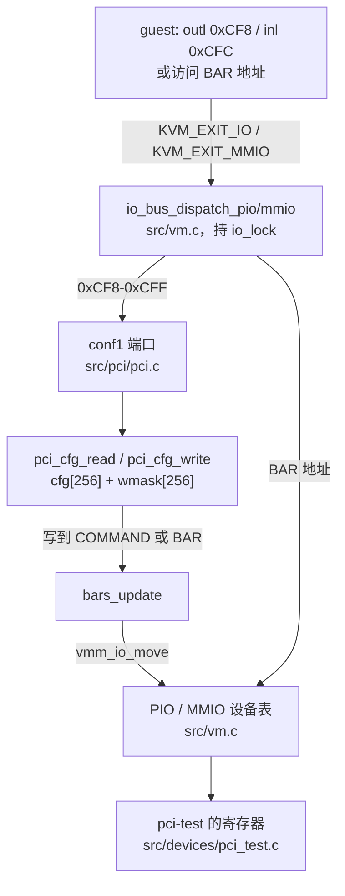

## 一、整体结构

《PCI·原理篇》讲了 PCI 的规则，这一篇讲 mini-vmm 怎样实现它。先看全貌：guest 的一次配置访问或 BAR 访问，在 VMM 里经过哪些模块。



左边一条是配置访问，最终落到每个设备的配置空间数组上；右边一条是 BAR 访问，和串口、i8042 一样走 PIO/MMIO 设备表。两条路的交点是 `bars_update`：配置空间里的 COMMAND 或 BAR 一被改写，它就去改设备表里那个 BAR 的位置。

涉及的文件：

| 文件 | 作用 |
|---|---|
| `include/pci/pci.h`、`src/pci/pci.c` | PCI 总线：conf1 端口、配置空间读写、BAR decode 与分配、host bridge |
| `include/vmm.h`、`src/vm.c` | 设备表新增 `vmm_io_reserve`/`vmm_io_move`，让表项的地址可以在运行中改变 |
| `include/boot/aml.h`、`src/boot/aml.c` | 最小 AML 编码器 |
| `src/boot/acpi.c` | DSDT 里的 `\_SB.PCI0`：`_HID`、`_CRS`、`_PRT` |
| `src/boot/mptable.c` | MP table 的 PCI 总线项和 PCI 中断项 |
| `include/devices/pci_test.h`、`src/devices/pci_test.c` | 演示用的测试设备，`--device pci-test` 挂上 |
| `tools/guest/devmem.c` | guest 里按物理地址读写一次 MMIO 的小工具 |

PCI 总线在 `src/main.c` 的 Linux 启动路径里创建，顺序有讲究：先 `pci_bus_init()` 注册 conf1 端口和 host bridge，再挂测试设备，最后生成 MP table 和 ACPI 表。固件表要根据已插的设备生成，所以必须排在设备注册之后。

## 二、配置空间：一个数组加一张可写掩码

### 2.1 数据结构

每个 PCI 设备在 VMM 里是一个 `struct pci_device`（`include/pci/pci.h`），前半部分由设备填，后半部分由 PCI 核心维护：

```c
struct pci_device {
    /* 由设备填写 */
    const char *name;
    uint16_t vendor_id;
    uint16_t device_id;
    uint32_t class_code;           /* 24 位：base class | sub class | prog-if */
    uint8_t  revision;
    uint8_t  intx_pin;             /* 0 = 不用 INTx，1..4 = INTA..INTD */
    struct pci_bar bars[PCI_NUM_BARS];

    /* 以下由 PCI 核心维护 */
    struct pci_bus *bus;
    int      slot;
    uint8_t  cfg[PCI_CFG_SPACE_SIZE];
    uint8_t  wmask[PCI_CFG_SPACE_SIZE];
};
```

配置空间就是 `cfg[256]`，按字节存放，内容和《PCI·原理篇》2.2 节转储出来的字节一模一样。和它并列的 `wmask[256]` 记录每一位是否可写：1 可写，0 只读。

### 2.2 写入只改可写位

所有配置写都经过 `pci_cfg_write()`，核心只有一行：

```c
for (i = 0; i < size; i++) {
    uint8_t m = d->wmask[reg + i];
    uint8_t b = (uint8_t)(val >> (8 * i));

    d->cfg[reg + i] = (uint8_t)((d->cfg[reg + i] & ~m) | (b & m));
}
```

可写位取新值，只读位保留旧值。原理篇 2.4 节说的“写了也不变”，在这里不需要为每个寄存器单独写代码：Vendor ID 的 `wmask` 是 0，写什么都不变；Interrupt Line 的 `wmask` 是 0xFF，写什么记什么。

**BAR 的大小探测也是这一行的自然结果，不需要专门的代码。** 一个 4KiB 的内存 BAR，`bar_setup()` 给它设的掩码是：

```c
wmask_set32(d, BAR_REG(i), ~(b->size - 1) & (uint32_t)PCI_BASE_ADDRESS_MEM_MASK);
```

代入数值：`~(0x1000 - 1) = 0xFFFFF000`，`PCI_BASE_ADDRESS_MEM_MASK = ~0xF`，相与得 `0xFFFFF000`。guest 写全 1 时：

```
cfg 原值  0xC0000000
写入值    0xFFFFFFFF
wmask     0xFFFFF000
结果      (0xC0000000 & ~0xFFFFF000) | (0xFFFFFFFF & 0xFFFFF000) = 0xFFFFF000
```

读回 `0xFFFFF000`，正是原理篇 4.2 节要的结果。类型位（低 4 位）在 `cfg` 里本来就是 0（32 位、不可预取的内存 BAR），掩码里也是 0，所以永远保持。

IO BAR 多一个限制：高 16 位也不可写。

```c
wmask_set32(d, BAR_REG(i), ~(b->size - 1) & 0xFFFFu & (uint32_t)PCI_BASE_ADDRESS_IO_MASK);
```

16 字节的 IO BAR 掩码是 `0xFFF0`。guest 写全 1，读回 `0x0000FFF0 | 1`（bit 0 是 `cfg` 里只读的 IO 类型位）= `0x0000FFF1`，和 trace 里看到的一致。如果漏掉 `& 0xFFFFu`，读回的会是 `0xFFFFFFF1`，Linux 算大小时只看低 16 位，结果不变，但 guest 往 BAR 里写的端口地址就可能超出 64K。单元测试专门检查这一点。

### 2.3 COMMAND：只有设备具备的功能位可写

`dev_setup()` 在配置 BAR 的同时收集 COMMAND 的可写位：

```c
if (b->type == PCI_BAR_IO)
    *cmd_mask |= PCI_COMMAND_IO;
else
    *cmd_mask |= PCI_COMMAND_MEMORY;
...
if (d->intx_pin)
    cmd_mask |= PCI_COMMAND_INTX_DISABLE;
...
wmask_set16(d, PCI_COMMAND, cmd_mask);
```

有 IO BAR 才有可写的 I/O Space 位，有内存 BAR 才有可写的 Memory Space 位，用 INTx 才有可写的 Interrupt Disable 位。测试设备不做 DMA，Bus Master 位只读为 0。host bridge 没有 BAR 也不用 INTx，它的 COMMAND 整个只读。

这样做的效果可以在 trace 里看到。Linux 探测设备能否屏蔽 INTx 时，先写入翻转了 Interrupt Disable 位的 COMMAND，再读回来看：

```
pci-conf1-data R2 0003      原值
pci-conf1-data W2 0403      翻转 bit 10
pci-conf1-data R2 0403      读回：这一位可写，设备支持 INTx 屏蔽
pci-conf1-data W2 0003      恢复
```

### 2.4 Interrupt Line 填 0xFF

`dev_setup()` 给用 INTx 的设备把 Interrupt Line 填成 0xFF：

```c
cfg_set8(d, PCI_INTERRUPT_PIN, d->intx_pin);
cfg_set8(d, PCI_INTERRUPT_LINE, 0xFF);
d->wmask[PCI_INTERRUPT_LINE] = 0xFF;
```

原理篇 6.1 节说过，0xFF 在 x86 上表示“不接 8259”。这里的 INTx 只接 IOAPIC 16 号以上的引脚，填 0xFF 是如实描述。更重要的是验收上的考虑：如果这里填了 17，guest 即使没读 `_PRT` 和 MP table，也可能从这个寄存器拿到正确的 IRQ，测试就证明不了那两张表起了作用。

### 2.5 不存在的设备

`find_dev()` 只认 bus 0、function 0：

```c
if (busno != 0 || PCI_FUNC_OF(devfn) != 0)
    return NULL;
return bus->devs[PCI_SLOT_OF(devfn)];
```

找不到设备时 `pci_cfg_read()` 返回全 1，`pci_cfg_write()` 直接丢弃，这就是原理篇 2.5 节的 master abort。访问宽度和对齐也在这里检查：`reg + size` 必须落在同一个 dword 里，宽度只能是 1、2、4。

### 2.6 host bridge

`pci_bus_init()` 在 slot 0 放了一个什么都不做的 host bridge：Vendor/Device `1234:0001`，Class Code `0x060000`，没有 BAR，不用中断。

它存在的唯一理由是原理篇 3.3 节的 `pci_sanity_check()`：直启的 guest 没有 SMBIOS，Linux 拿不到 BIOS 日期，必须在 bus 0 上找到一个 class 是 host bridge 的设备，才承认 conf1 可用。去掉它，Linux 照样会打印 `PCI: Fatal: No config space access function found`，尽管 conf1 端口工作完全正常。

Vendor ID `0x1234` 不在 PCI-SIG 的分配表里，QEMU 也用它标识自己的模拟设备。Linux 里唯一按 `0x1234` 匹配的驱动是 bochs 显卡（Device `0x1111`），mini-vmm 的 Device ID 都避开了它，所以 guest 不会给这些设备绑定任何驱动。

## 三、conf1 的两个端口

`pci_bus_init()` 注册两个 PIO 设备：`pci-conf1-addr` 占 `0xCF8`-`0xCFB`，`pci-conf1-data` 占 `0xCFC`-`0xCFF`。exit 统计里看到的就是这两个名字。

### 3.1 CONFIG_ADDRESS：只认 32 位访问

```c
static int conf1_addr_write(void *opaque, uint64_t off, uint32_t size,
                            const void *data)
{
    struct pci_bus *bus = opaque;
    uint32_t v;

    if (off == 0 && size == 4) {
        memcpy(&v, data, 4);
        bus->conf1_addr = v & CONF1_WRITABLE;
    }
    return VMM_OK;
}
```

只有偏移 0、宽度 4 的写才进锁存器，bit 1:0 强制为 0。其他宽度的访问按原理篇 3.2 节的规定当作普通 IO：写丢弃，读回全 1。Linux 的锁存器测试第一步 `outb(0x01, 0xCFB)` 就落在这条路径上，被丢弃。

如果这里偷懒、接受任何宽度的写，`outb(0x01, 0xCFB)` 会把锁存器的最高字节改成 0x01。但 Linux 紧接着用 `outl` 把整个锁存器重写了一遍，锁存器测试照样通过，guest 的行为看不出任何异常。所以这条规则由单元测试守着：`case_conf1_address` 按 `pci_check_type1()` 的原样序列访问，再检查对 `0xCF8`-`0xCFB` 的字节写、字写都不改变锁存器。

### 3.2 保留位非 0：按没有这个寄存器处理

```c
static bool conf1_selected(const struct pci_bus *bus)
{
    return (bus->conf1_addr & CONF1_ENABLE) &&
           !(bus->conf1_addr & CONF1_RESERVED);
}
```

`CONF1_RESERVED` 是 bit 30:24。原理篇 3.4 节说过，guest 在 AMD/海光 host 上会打开 IO ECS，用这几位传寄存器号的高 4 位，日志里那行 `PCI: Using configuration type 1 for extended access` 就是证据。mini-vmm 的设备只有 256 字节配置空间，扩展寄存器一律读全 1、写丢弃。

这条检查挡住的错误很隐蔽。假设忽略保留位，guest 读偏移 0x100（PCIe 设备第一个扩展 capability 所在的位置）：

```
CONFIG_ADDRESS = 0x81000800     bit 24 = 1（寄存器号 0x100 的高位），register = 0x00
忽略保留位后    → 读 00:01.0 偏移 0x00 = 0x00021234（Vendor/Device ID）
```

按扩展 capability 头的格式解读，这像是一个 ID 为 0x1234、版本 2 的 capability。如果是写，就会改到同偏移处的 COMMAND 或 BAR。

### 3.3 CONFIG_DATA：四个端口，一个 dword

```c
static int conf1_data_read(void *opaque, uint64_t off, uint32_t size,
                           void *data)
{
    struct pci_bus *bus = opaque;
    uint32_t a = bus->conf1_addr, v;

    if (!conf1_selected(bus) || off + size > 4) {
        memset(data, 0xFF, size);
        return VMM_OK;
    }
    v = pci_cfg_read(bus, CONF1_BUS(a), CONF1_DEVFN(a),
                     (uint16_t)(CONF1_REG(a) + off), size);
    memcpy(data, &v, size);
    return VMM_OK;
}
```

访问 `0xCFC + off` 对应选中 dword 的第 `off` 字节，寄存器号就是 `CONF1_REG(a) + off`。`off + size > 4` 的访问（比如对 `0xCFE` 做 4 字节读）跨出了这个 dword，不是合法的配置访问，按普通 IO 处理。

exit 统计里 `unhandled PIO` 在加入 PCI 之前有 `0xCFE R2 32` 这样的记录，那是 Linux 在用 `inw(0xCFC + 2)` 读配置空间的高半个 dword，加入 PCI 之后这些访问全部由 `pci-conf1-data` 处理。

## 四、BAR 的路由：让设备表的地址动起来

### 4.1 问题：设备表原本是静态的

《一次 out 指令的完整旅程·实现篇》里的设备表是一张数组：串口、i8042、CMOS 这些设备在 guest 启动前注册好，地址固定，之后不再变化。查找时按顺序比较每一项的 `[base, base + len)`。

BAR 打破了这个假设。原理篇 4.3 和 4.4 节讲过，guest 在运行中会改写 BAR、开关 decode：探测大小时 BAR 会短暂变成全 1，Linux 重新分配资源时 BAR 会被搬走。设备表必须支持“一个表项的地址在运行中改变”。

### 4.2 先占位，后搬家

`src/vm.c` 新增两个函数：

```c
int  vmm_io_reserve(struct vmm_vm *vm, enum vmm_io_space space,
                    const struct vmm_io_dev *dev, int *slot);
void vmm_io_move(struct vmm_vm *vm, enum vmm_io_space space, int slot,
                 uint64_t base, uint64_t len);
```

`vmm_io_reserve` 在设备表里占一个表项，以 `len = 0` 登记，查找时永远不会命中，也不参与注册时的冲突检查；它返回表项下标。之后 `vmm_io_move` 按下标改这个表项的基址和长度，`len = 0` 表示停止响应。

为什么是占位再改，而不是每次删掉旧表项、插入新表项？因为 exit 统计按表项下标记账：《数清每一次exit》里的 `pio_stats[]` 和 `pio_devs[]` 是同下标的平行数组。删除再插入会让下标变化，一个设备的计数就会挪到别的设备名下。占位之后下标在整个 VM 生命周期里不变。

`vmm_io_move` 不做冲突检查。guest 可以把 BAR 编到任何位置，包括和串口重叠的端口。真实硬件上地址重叠的结果是未定义的，VMM 能做的是给出确定的行为：查找按表项顺序取第一个命中的，先注册的静态设备优先，同时打一条警告：

```c
if (base < tbl[i].base + tbl[i].len && tbl[i].base < base + len)
    vmm_warn("%s %s at [0x%llx, 0x%llx) overlaps %s; %s wins", ...);
```

### 4.3 什么时候搬：bars_update

每次配置写之后，如果写到了 COMMAND 或任何一个 BAR，就重新计算这个设备每个 BAR 的位置：

```c
end = reg + size;
if ((reg < PCI_COMMAND + 2 && end > PCI_COMMAND) ||
    (reg < PCI_BASE_ADDRESS_5 + 4 && end > PCI_BASE_ADDRESS_0))
    bars_update(d);
```

判断用的是区间相交，而不是 `reg == PCI_COMMAND`，因为 guest 可能用一次 4 字节写同时写 COMMAND 和 STATUS（偏移 0x04 的 dword），也可能用 1 字节写只改 COMMAND 的低字节。

`bar_update()` 根据 COMMAND 的 decode 位和 BAR 的当前值算出应有的状态，和上次的状态比较，有变化才调用 `vmm_io_move`：

```c
if (b->type == PCI_BAR_IO) {
    space = VMM_IO_PIO;
    on    = cmd & PCI_COMMAND_IO;
    base  = v & PCI_BASE_ADDRESS_IO_MASK;
} else {
    space = VMM_IO_MMIO;
    on    = cmd & PCI_COMMAND_MEMORY;
    base  = v & PCI_BASE_ADDRESS_MEM_MASK;
}
if (on == b->mapped && (!on || base == b->base))
    return;

vmm_io_move(d->bus->vm, space, b->io_slot, base, on ? b->size : 0);
```

拿原理篇 4.3 节 Linux 探测 BAR0 的序列，看设备表的变化：

| guest 的配置写 | COMMAND | BAR0 | 设备表里的 `pci-test.bar0` |
|---|---|---|---|
| （启动前） | 0x0003 | 0xC0000000 | `[0xC0000000, +0x1000)` |
| COMMAND ← 0x0000 | 0x0000 | 0xC0000000 | `len = 0`，不响应 |
| BAR0 ← 0xFFFFFFFF | 0x0000 | 0xFFFFF000 | 不变：decode 关着 |
| BAR0 ← 0xC0000000 | 0x0000 | 0xC0000000 | 不变 |
| COMMAND ← 0x0003 | 0x0003 | 0xC0000000 | `[0xC0000000, +0x1000)` |

BAR 是全 1 的那段时间里 decode 是关的，设备表里的 BAR0 从未出现在 `0xFFFFF000`。如果 guest 不关 decode 就探测（Linux 对标记了 `mmio_always_on` 的设备就是这样，比如 host bridge），设备表会短暂地把 BAR 放到全 1 对应的地址，`vmm_io_move` 照做，这也是它不拒绝任何地址的原因之一。

注意 `bar_update` 没有把 BAR 值 0 当作“未分配”。原理篇 5.1 节说过那是 Linux 的约定，规范里 decode 只由 COMMAND 控制。VMM 模拟的是硬件，按规范来。

### 4.4 并发

配置空间和设备表的改动都发生在 exit 分发路径里，分发路径持有 `vm->io_lock`（《线程模型与事件循环》）。设备表的查找也只在持锁时进行，所以一个 vCPU 搬动 BAR 时，另一个 vCPU 不会查到半更新的表项。设备注册发生在 guest 启动之前，那时只有一个线程。

## 五、替固件分配 BAR

原理篇第五章说过，真实机器上 BAR 由固件分配，Linux 沿用。直启 Linux 时没有固件，VMM 替它做这一步。

### 5.1 两个窗口，两个游标

窗口常量定义在 `include/pci/pci.h`，DSDT 的 `_CRS` 和 BAR 分配共用同一组：

```c
#define PCI_MMIO_WINDOW_START  VMM_MEM_HOLE_START      /* 0xC0000000 */
#define PCI_MMIO_WINDOW_END    0xFEC00000ULL           /* 不含 */
#define PCI_IO_WINDOW_END      0x10000U                /* 不含 */
#define PCI_IO_ALLOC_START     0x1000U
```

`_CRS` 告诉 guest 窗口是什么，BAR 分配保证每个 BAR 都在窗口里。两边用同一组常量，就不会出现原理篇 5.4 节那种“固件分配的 BAR 不在窗口里、被 Linux 重新分配”的情况。IO 从 `0x1000` 开始分配，因为 `0x1000` 以下是 ISA 时代的固定端口，Linux 自己分配 IO 时也从这里起（`PCIBIOS_MIN_IO`）。

`bar_assign()` 为 MMIO 和 IO 各维护一个游标，按 BAR 大小对齐后往上分：

```c
base = align_up(bus->mmio_next, b->size);
if (base + b->size > PCI_MMIO_WINDOW_END) {
    vmm_err("pci: %s BAR%d: mmio window exhausted (needs 0x%x bytes)", ...);
    return VMM_ERR_NOMEM;
}
bus->mmio_next = base + b->size;
cfg_set32(d, BAR_REG(i), (uint32_t)base);
```

按自身大小对齐是规范的要求，`wmask` 也保证了低位写不进去：分配器要是给出一个没对齐的地址，guest 读回 BAR 时低位会被吃掉，看到的地址和 VMM 以为的不一样。

### 5.2 分配完打开 decode

```c
cfg_set16(d, PCI_COMMAND, cmd_mask & (PCI_COMMAND_IO | PCI_COMMAND_MEMORY));
bars_update(d);
```

固件交给操作系统的设备，BAR 已经分配、decode 已经打开。Linux 的 `pcibios_resource_survey()` 分两遍认领，先认领 decode 打开的 BAR，再认领关着的。启动时 VMM 打印出它分配的结果：

```
[INFO] pci 00:00.0 host-bridge [1234:0001] class 060000, no INTx
[INFO] pci 00:01.0 pci-test BAR0 [mem 0xc0000000-0xc0000fff]
[INFO] pci 00:01.0 pci-test BAR1 [io 0x1000-0x100f]
[INFO] pci 00:01.0 pci-test [1234:0002] class ff0000
[INFO] pci 00:01.0 pci-test INTA -> GSI 17
```

guest 的日志里 `reg 0x10: [mem 0xc0000000-0xc0000fff]` 和 `reg 0x14: [io  0x1000-0x100f]` 与之一一对应，之后没有任何 `can't claim` 或 `assigned` 的行。

## 六、DSDT 里的 PCI0：一个最小的 AML 编码器

### 6.1 为什么要写编码器

《固件与启动协议·实现篇》里的 DSDT 只有一个 `_S5` 对象，14 个字节，手写就行。PCI0 设备要加 `_HID`、`_UID`、`_CRS`（4 个资源描述符）和 `_PRT`（32 个 slot × 4 根线 = 128 项），整个 AML 有 1733 字节。手写这些字节既容易错，改一个窗口又要重算一串嵌套的长度。所以 `src/boot/aml.c` 提供了一组按 AML 语法生成字节的函数，只覆盖 DSDT 实际用到的构造：Scope、Device、Name、Package、Buffer、整数和名字。

生成 DSDT 的代码读起来和 ASL 源码几乎一一对应：

```c
sb  = aml_scope(&a, "\\_SB_");
dev = aml_device(&a, "PCI0");
aml_name_decl(&a, "_HID");
aml_int(&a, aml_eisaid("PNP0A03"));
aml_name_decl(&a, "_UID");
aml_int(&a, 0);
build_pci0_crs(&a);
build_pci0_prt(&a);
aml_close(&a, dev);
aml_close(&a, sb);
```

```
Scope (\_SB)
{
    Device (PCI0)
    {
        Name (_HID, EisaId ("PNP0A03"))
        Name (_UID, Zero)
        Name (_CRS, ResourceTemplate () { ... })
        Name (_PRT, Package (0x80) { ... })
    }
}
```

### 6.2 PkgLength：长度写在内容前面

AML 里 Scope、Device、Package、Buffer 这些结构，紧跟操作码之后是一个 PkgLength，表示整个结构的长度（ACPI 6.4 第 20.2.4 节）。它是变长编码：

```
1 字节：bit 7:6 = 0，bit 5:0 = 长度（长度 < 64）
n 字节（n = 2..4）：首字节 bit 7:6 = n - 1，bit 3:0 = 长度的低 4 位，
                    后续字节依次放长度的 bit 11:4、19:12、27:20
```

长度包含 PkgLength 自己占的字节。难点在于：写内容之前不知道内容有多长，也就不知道 PkgLength 要占几个字节。编码器的办法是 open/close 配对：

- `aml_open()` 先预留 4 个字节（最长的编码），返回这个位置；
- 调用方接着写内容；
- `aml_close()` 算出内容的实际长度，选最短的编码，把内容往前挪，填上 PkgLength。

用实际生成的字节验证。DSDT 里 Scope 开头的字节是：

```
10 46 6b 5c 5f 53 42 5f ...
```

`0x10` 是 ScopeOp。`0x46 = 0b01000110`：bit 7:6 = 01，所以 PkgLength 占 2 字节；bit 3:0 = 6。第二个字节 `0x6b` 放 bit 11:4。长度 = `0x6b << 4 | 6 = 0x6b6` = 1718 字节。Scope 的 PkgLength 从 DSDT 文件偏移 0x33 开始，`0x33 + 0x6b6 = 0x6e9`，正好是整张 DSDT 的长度（Linux 启动日志 `ACPI: DSDT ... 0006E9`），说明 Scope 一直延伸到表尾，嵌套长度算对了。

再看 `_CRS` 的 Buffer：

```
11 40 05 0a 4c 88 0d 00 02 ...
```

`0x11` 是 BufferOp，`0x40` 表示 2 字节 PkgLength、低 4 位为 0，`0x05` 是 bit 11:4，长度 = `0x50` = 80。内容是 BufferSize（`0a 4c`，BytePrefix 加 76）和 76 字节的资源描述符，`2 + 2 + 76 = 80`。

为什么选最短编码？AML 解释器两种都能解析，但 iasl 编译出的是最短的。按最短编码写，生成的 AML 才能和 iasl 从反汇编结果重新编译出来的 AML 逐字节比较（6.5 节）。

### 6.3 _CRS：四个地址空间描述符

`build_pci0_crs()` 写了四个 Address Space Descriptor 加一个结束标记：

| 描述符 | 类型 | 范围 |
|---|---|---|
| WordBusNumber | 总线号 | 0x00-0xFF |
| WordIO | IO | 0x0000-0x0CF7 |
| WordIO | IO | 0x0D00-0xFFFF |
| DWordMemory | 内存 | 0xC0000000-0xFEBFFFFF |

每个描述符的 general flags 都是 `0x0C`：bit 3 和 bit 2 表示最小、最大地址都固定，bit 0 为 0 表示 ResourceProducer。原理篇 5.2 节说过，这一位必须是 Producer，Linux 才把这段范围当作桥窗口。

拿第一个描述符的字节对照（`ACPI 6.4` 第 6.4.3.5.3 节 Word Address Space Descriptor）：

```
88          大型描述符，类型 0x08 = Word Address Space
0d 00       后面的长度 13 字节
02          资源类型：总线号
0c          general flags：MinFixed、MaxFixed、Producer
00          type specific flags
00 00       granularity
00 00       最小值 0
ff 00       最大值 0xFF
00 00       translation offset
00 01       长度 0x100
```

### 6.4 _PRT：列满 32 个 slot

```c
prt = aml_package(a, PCI_MAX_SLOTS * PCI_INTX_LINES);
for (slot = 0; slot < PCI_MAX_SLOTS; slot++) {
    for (pin = 1; pin <= PCI_INTX_LINES; pin++) {
        size_t e = aml_package(a, 4);

        aml_int(a, (uint32_t)slot << 16 | 0xFFFF);
        aml_int(a, (uint64_t)(pin - 1));  /* _PRT 里 0 = INTA */
        aml_int(a, 0);
        aml_int(a, (uint64_t)pci_intx_gsi(slot, pin));
        aml_close(a, e);
    }
}
```

`_PRT` 列出全部 32 个 slot，而不只是插了设备的 slot。它描述的是主板走线，和插了什么无关，以后热插拔进来的设备也按这张表路由。

GSI 由 `pci_intx_gsi()` 算出，DSDT 和 MP table 都调用它，这是两张表一致的根本保证：

```c
static inline int pci_intx_gsi(int slot, int pin)
{
    return PCI_INTX_GSI_BASE + ((slot + pin - 1) & (PCI_INTX_LINES - 1));
}
```

`PCI_INTX_GSI_BASE` 是 16，四根线接 IOAPIC 的 16-19 号引脚（KVM 内核态 IOAPIC 有 24 个引脚，guest 日志 `IOAPIC[0]: ... GSI 0-23`）。slot 1 的 INTA 是 `16 + (1 + 1 - 1) % 4 = 17`。

### 6.5 用 iasl 做 oracle

自己写的编码器，正确性不能靠自己检查。`tests/offline/boot_tables.sh` 把生成的 DSDT 交给 ACPICA 的 iasl 做两件事：

1. `iasl -d` 反汇编，要求没有任何错误和警告，得到上面那段 ASL；
2. 把反汇编出的 ASL 再用 iasl 编译回 AML，要求和原来的 AML **逐字节相同**（表头的 36 字节除外，因为编译器 ID 等字段不同）。

第二步很严格：只要编码器有一处和 iasl 的理解不同，比如 PkgLength 没用最短编码、整数没选对前缀，重新编译出的字节就会不一样。ACPICA 也是 Linux 内核里解析 AML 的那份代码，iasl 认可的字节，guest 内核也会认可。

`tests/unit/aml_test.c` 则单独测 PkgLength 在 1/2/3/4 字节编码切换点上的行为（总长 63 用 1 字节、64 换 2 字节，以此类推）和整数前缀的选择，这些边界在 DSDT 的实际内容里不一定都会出现。

## 七、MP table：同一套接线的另一份描述

`acpi=off` 启动时，guest 从 MP table 拿中断路由。`mptable_setup()` 多了一个参数，接收 PCI 总线：

```c
int mptable_setup(struct vmm_vm *vm, int nr_cpus, const struct pci_bus *pci);
```

### 7.1 总线 ID

```c
#define MP_BUS_ID_PCI     0
#define MP_BUS_ID_ISA     1
```

原理篇 6.4 节说过，Linux 拿 PCI 总线号直接和中断项的源总线 ID 比较，所以 bus 0 的 PCI 总线在 MP table 里的 ID 必须是 0。ISA 总线排在后面，16 个 ISA 中断项的源总线随之改成 1。

### 7.2 PCI 中断项

```c
s->type      = MP_INTSRC;
s->irqtype   = MP_IRQTYPE_INT;
s->srcbus    = MP_BUS_ID_PCI;
s->srcbusirq = (uint8_t)(i << 2 | (d->intx_pin - 1));
s->dstapic   = ioapic_id;
s->dstirq    = (uint8_t)pci_intx_gsi(i, d->intx_pin);
```

`irqflag` 留 0，表示“按总线的默认”，PCI 总线默认就是电平触发、低有效。

和 `_PRT` 不同，MP table 只列已插的设备。MP table 放在 `0x9FC00` 开始的 1KiB 里，32 个 CPU 的处理器项占掉大部分空间之后只剩 156 字节，放不下 128 项。MP table 本来也只在 `acpi=off` 时使用，那种情况下没有热插拔，只列已插设备就够了。

### 7.3 pin 写错了，guest 看不出来

一个值得注意的细节：如果 `srcbusirq` 里的 pin 写错了（比如忘了减 1），`acpi=off` 启动的 guest 仍然会拿到正确的 IRQ。原因在 `IO_APIC_get_PCI_irq_vector()` 里：

```c
if (pin == (mp_irqs[i].srcbusirq & 3)) {
        best_idx = i;
        ...
        goto out;
}

/*
 * Use the first all-but-pin matching entry as a
 * best-guess fuzzy result for broken mptables.
 */
if (best_idx < 0) {
        best_idx = i;
        ...
}
```

pin 匹配不上时，Linux 会退而使用总线和 slot 都匹配的第一项，为的是兼容写错了的 MP table。一个 slot 只有一项时，这个兜底恰好给出了正确结果。所以 pin 编码的正确性不能靠 e2e 测试检查，由 `boot_tables_test` 直接检查 MP table 的字节：每个 PCI 中断项的 slot、pin、GSI 都必须在 `_PRT` 里找到完全对应的一项。

## 八、测试设备与 devmem

### 8.1 pci-test

要验证“guest 能枚举到设备、BAR 能被探测和搬动、访问能路由到设备”，需要一个总线上的设备，但还不需要任何设备语义。`pci-test` 就是为此准备的：

| BAR | 类型 | 大小 |
|---|---|---|
| BAR0 | 32 位 MMIO | 4KiB |
| BAR1 | IO | 16 字节 |

两个 BAR 背后是同一组寄存器：

| 偏移 | 访问 | 内容 |
|---|---|---|
| 0x0 | 只读 | 魔数 `0x74736574`，按字节读是 `"test"` |
| 0x4 | 读写 | scratch，两个 BAR 共享 |
| 0x8 | 只读 | 这次访问经过的 BAR 编号 |

scratch 共享是为了一次验证两条路：经 MMIO BAR 写进去的值，经 IO BAR 读出来，说明两次访问落到了同一个设备上；偏移 0x8 则说明这次访问确实是从哪个 BAR 进来的。Class Code `0xFF0000`、ID `1234:0002`，guest 不会给它绑定驱动。它声明了 INTA，用来检查 `_PRT` 和 MP table，但从不触发中断，所以“中断计数随设备中断增加”留到 e1000 去验证。

### 8.2 devmem：为什么不能直接读 /dev/mem

没有驱动的设备，只能在 guest 用户态直接访问它的 BAR。直觉上的做法是 `dd if=/dev/mem bs=4 count=1 skip=$((0xc0000000/4))`，但在 x86 上读不出来：`/dev/mem` 的 `read()`/`write()` 只允许 RAM 范围内的地址（`valid_phys_addr_range()` 以 `high_memory` 为界），BAR 在 RAM 之上。只能 `mmap` 之后用一条 load/store 访问。

busybox 有一个 `devmem` applet 正是这么做的，但发行版的静态 busybox 常常没有编进它。所以 `tools/guest/devmem.c` 实现了同样的命令行：`devmem ADDRESS [WIDTH [VALUE]]`，由 `tools/build_initramfs.sh` 静态编译进 initramfs 的 `/sbin`。每次访问是一条指定宽度的 volatile load/store，VMM 一侧看到一次同宽度的 `KVM_EXIT_MMIO`，exit 统计里 `pci-test.bar0` 的读计数正好是 1。

IO BAR 则可以通过 sysfs 的 `resource1` 文件读写，内核会替用户态做 `in`/`out`。

## 九、验证

### 9.1 guest 里看到的现象

`tests/e2e/pci-bus.sh` 启动两次 guest。第一次带 ACPI，在 guest shell 里执行一串命令：

| 命令 | 输出 | 证明 |
|---|---|---|
| `dmesg \| grep ...` | `PCI: Using configuration type 1 for base access` | conf1 锁存器测试和 sanity check 都通过 |
| `lspci` | `00:00.0 Class 0600: 1234:0001`、`00:01.0 Class ff00: 1234:0002` | 枚举到 host bridge 和测试设备 |
| `dmesg \| grep ...` | 三个 `root bus resource [... window]`，`reg 0x10`、`reg 0x14`，没有 `assigned [`、`no space for` | `_CRS` 窗口原样接收，VMM 分配的 BAR 被认领 |
| `dmesg \| grep -c 'ACPI Error'` | 0 | DSDT 被 ACPICA 完整解析 |
| `devmem 0xc0000000`、`devmem 0xc0000008` | `0x74736574`、`0x00000000` | MMIO BAR 路由到设备，经 BAR0 进来 |
| `devmem 0xc0000004 32 0x12345678` 后 `dd` 读 `resource1` | `74736574 12345678 00000001` | IO BAR 路由到同一个设备，经 BAR1 进来 |
| 用 `dd` 往 `config` 偏移 0x10 写 `0xC0100000`，再读新旧地址 | 新地址 `0x74736574`，旧地址 `0xFFFFFFFF` | BAR 改写后路由跟着走 |
| 用 `dd` 往 `config` 偏移 0x04 写 0，再读两个 BAR | 都是全 1 | 关掉 decode 后设备停止响应 |
| `echo 1 > enable; cat irq` | 17 | `_PRT` 路由生效 |

第二次加 `--append acpi=off`，guest 日志出现 `PCI->APIC IRQ transform: INT A -> IRQ 17`，`irq` 文件也是 17：MP table 和 `_PRT` 给出同一个 GSI。

用 sysfs 的 `config` 文件改写 BAR，绕过了 Linux 的资源管理，Linux 的 `/proc/iomem` 不会知道设备搬了家。测试只用它来驱动 VMM 一侧的路由变化，不依赖 guest 内核的视图。

### 9.2 测试能抓住错误

每一层测试都用故意写错的实现确认过会失败：

| 测试 | 故意写错的实现 | 结果 |
|---|---|---|
| `pci_bus_test`（11 个用例，128 项检查） | BAR 全部位可写、写 COMMAND 不更新路由、忽略 CONFIG_ADDRESS 保留位、字节写也进锁存器、IO BAR 高 16 位可写、MMIO 窗口终点算到 4GiB | 6 种全部失败 |
| `boot_tables_test` | MP table 的 PCI 总线 ID 不是 0、GSI 偏一、pin 不减 1 | 3 种全部失败 |
| `aml_test` | PkgLength 切换点差一、长度不含自身、高位移位错 | 3 种全部失败 |
| `pci-bus` e2e | `_CRS` 内存窗口起点改成 `0xC0100000` | 只有“窗口”用例和“路由”用例失败（Linux 把 BAR0 搬到了 `0xC0100000`） |
| `pci-bus` e2e | 写 COMMAND 不更新路由 | 只有“路由”用例失败 |
| `pci-bus` e2e | MP table 的 GSI 偏一 | 只有 `acpi=off` 用例失败 |

e2e 的三个变体各自只让对应的用例失败，说明每个用例检查的就是它声称检查的东西。7.3 节说过 pin 写错时 guest 行为不变，这一类错误只能靠 `boot_tables_test` 直接检查字节。

### 9.3 exit 统计

一次带 `--device pci-test` 的启动到关机，`--exit-stats` 报告：

```
  device                     space         reads       writes
  pci-conf1-addr             PIO               2          312
  pci-conf1-data             PIO             263           46
  pci-test.bar1              PIO               0            0
  pci-test.bar0              MMIO              1            0
  unhandled                  PIO              10            9
```

`pci-conf1-addr` 和 `pci-conf1-data` 是原理篇第七章说的整个枚举过程。`pci-test.bar0` 的 1 次读是 guest shell 里执行的一次 `devmem`。加入 PCI 之前，`unhandled PIO` 这一行的读写各有一两百次，大部分是落空的 conf1 访问；现在只剩 10 次读和 9 次写，是 8250 驱动对 COM2-COM4 的探测和 i8237 DMA 的页寄存器。

## 十、限制

- 只有 bus 0，没有 PCI-PCI 桥，每个 slot 只有 function 0。
- BAR 只有 32 位 MMIO 和 IO 两种，没有 64 位 BAR 和可预取 BAR，没有 Expansion ROM。
- 没有 capability 链，所以没有 MSI/MSI-X（pci-msi、pci-msix 里程碑），也没有 PCIe 的扩展配置空间和 ECAM（pcie-ecam 里程碑）。
- 设备表的冲突处理是“先注册的优先”，guest 把 BAR 编到和静态设备重叠的位置时只打警告。
- 测试设备从不触发中断，INTx 的实际送达留到 emu-net 里程碑的 e1000 验证。

## 附录 A：本文引用的规范与源码

**规范**

- PCI Local Bus Specification 3.0：第 3.2.2.3.2 节、第 6.1 节、第 6.2.2 节、第 6.2.4 节、第 6.2.5 节
- ACPI 6.4：第 20.2.4 节（PkgLength）、第 20.2.3 节（整数常量）、第 6.4.3.5 节（Address Space Descriptor）、第 6.1.5 节（EISA ID）、第 6.2.13 节（`_PRT`）
- MultiProcessor Specification 1.4：第 4.3.2 节、第 4.3.4 节
- `include/uapi/linux/pci_regs.h`

**Linux 6.6**

- `drivers/pci/probe.c`：`__pci_read_base()`
- `arch/x86/pci/direct.c`：`pci_check_type1()`、`pci_sanity_check()`
- `arch/x86/pci/i386.c`：`pcibios_resource_survey()`
- `arch/x86/kernel/apic/io_apic.c`：`IO_APIC_get_PCI_irq_vector()`
- `drivers/acpi/acpica/amlcode.h`、`amlresrc.h`：AML 操作码与资源描述符布局

**mini-vmm**

- `include/pci/pci.h`、`src/pci/pci.c`
- `include/vmm.h`、`src/vm.c`：`vmm_io_reserve()`、`vmm_io_move()`
- `include/boot/aml.h`、`src/boot/aml.c`
- `src/boot/acpi.c`：`build_dsdt()`、`build_pci0_crs()`、`build_pci0_prt()`
- `src/boot/mptable.c`
- `include/devices/pci_test.h`、`src/devices/pci_test.c`、`tools/guest/devmem.c`
- `tests/unit/pci_bus_test.c`、`tests/unit/aml_test.c`、`tests/unit/boot_tables_test.c`、`tests/offline/boot_tables.sh`、`tests/e2e/pci-bus.sh`

## 附录 B：深入阅读

- learning-note 卷五：DSDT、MADT 等 ACPI 表的字段与 Linux 的解析流程
- learning-note 卷七第 7.4 节：没有 PCI 时 Linux 的 conf1 探测
