到目前为止，AHCI 磁盘和 e1000 网卡通过 INTx 通知 guest：设备报告有效电平，PCI 层合并共享线路上的请求，KVM 中的 IOAPIC 将其转成一个中断向量并投递给 vCPU。这一篇让 AHCI 改用 MSI，Linux 自带的 ahci 驱动从 `IO-APIC 17-fasteoi` 切换到 `PCI-MSI`。

本章讨论的核心是三件事：**设备如何获得消息配置、消息如何到达目标 CPU、虚拟化为什么可以省掉部分中断相关的开销。** AHCI 特有的发送时机放到后面的设备案例，不让它打断 MSI 的主线。

## 一、从线到消息

### 1.1 为什么不直接告诉 CPU 要处理哪个 Vector？

在传统 x86 的 IOAPIC 路径中，PCI 设备只知道自己触发 INTA 等中断请求，不知道目标 CPU 或 CPU 的 Vector。平台提供线路映射，OS 配置 IOAPIC 的重定向表。假设 GSI 17 映射到 APIC ID 2、Vector `0x40`：IOAPIC 将线路请求转换为中断消息，最后交给 LAPIC。

PCI INTx 是电平触发的，PCIe 可以用 Assert/Deassert 消息模拟这套电平语义。多个设备可能共享一个输入，VMM 必须合并各设备的请求；设备撤销请求之后才可以撤销其线路贡献。对于 IOAPIC 电平中断，EOI 还涉及 Remote IRR 和重新投递。

如果 PCI 设备本身就能提供目标 APIC ID 和 Vector，何必再经过 IOAPIC？PCI 设备原本就能作为 Bus Master 发起 Memory Write Transaction，因此可以复用这种总线事务，赋予特定地址范围中写操作以中断语义。

在传统 x86 兼容格式下（暂不讨论 Interrupt Remapping），`0xFEE00000–0xFEEFFFFF` 是 MSI 的地址窗口。向 `0xFEE02000` 写入 `0x00000040`，在物理目标模式下表示向 APIC ID 2 投递 Vector `0x40` 的普通边沿中断。

这里的“内存写”是总线事务，不是向 RAM 写入一个值：平台互连、Root Complex 等负责识别并路由它，并不要求这个地址存在一块 RAM。

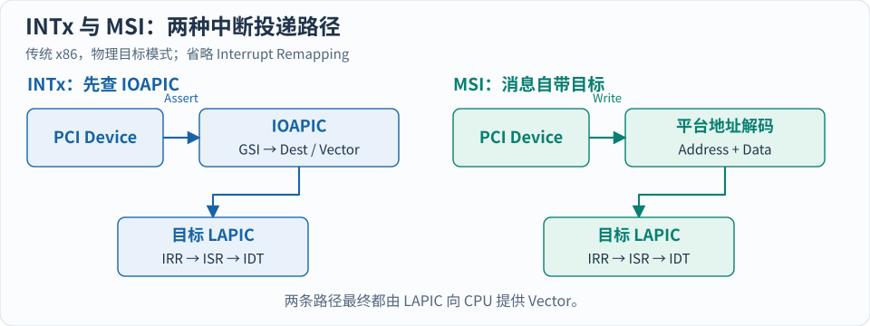

### 1.2 在这台 VMM 里的位置

```
              INTx                                 MSI
  ahci.c   pci_set_irq(level)                pci_msi_notify()
              │                                     │
  pci.c    intx_output: 或到线上             读 capability 里的地址/数据
           电平变了才通知                    Bus Master？格式合法？
              │                                     │
  irqchip  KVM_IRQ_LINE(GSI 17, 1/0)          KVM_SIGNAL_MSI(addr, data)
              │                                     │
  KVM      IOAPIC 引脚 → 重定向表 → LAPIC      按地址/数据直接找 LAPIC
```

这一篇新增的是右边这一列。PCI 层负责 capability 的寄存器和“发一条”的动作，irqchip 负责格式检查和 ioctl，AHCI 只决定“什么时候发”。三者分开，是因为“什么时候发”是设备语义，PCI 规范管不着：第九节会看到，AHCI 规范专门用一节来规定这件事。

MSI 依然是慢路径：每条消息都由 VMM 在用户态调一次 ioctl。把 eventfd 直接绑到 KVM 的路由表上（irqfd），让内核态通知源可以直接触发注入，不必为每条消息绕经用户态，是后面里程碑的事。先把慢路径做对，到时候才有对照组。

## 二、Linux IRQ 与硬件 Vector：两个不同的资源空间

### 2.1 Linux IRQ 是全局编号，Vector 是 per-CPU 分配的资源

设备芯片出厂时并不知道系统有几个 CPU、哪个 Vector 空闲。驱动代表设备向 OS 申请中断资源，Linux 的 IRQ/MSI 子系统决定底层投递目标，再写入设备的配置。驱动只需要一个稳定的软件标识，`request_irq()` 使用的是 Linux IRQ，而不是 IDT 的索引。

| 概念 | 示例 | 作用 |
|---|---|---|
| Linux IRQ（virq） | 24 | 一个内核实例内的全局逻辑中断编号 |
| APIC ID | 2 | 硬件投递的目标 LAPIC；不一定等于 Linux CPU 编号 |
| Vector | `0x40` | 8-bit x86 中断向量，是 IDT 索引；普通设备中断按 CPU 分配 |
| `irq_desc` | IRQ 24 的描述符 | 保存中断状态、irq_data 和已注册的处理动作等 |
| `vector_irq` | 每 CPU 一张表 | 从当前 CPU 的 Vector 直接找到 `irq_desc` |

同一个 Vector 编号可以在不同 CPU 上独立分配。例如 AHCI 的 MSI 投递给 CPU 0，网卡的 MSI 投递给 CPU 1，两条消息都携带 `0x40`。`(CPU 0, 0x40)` 对应 AHCI 的 IRQ 24，`(CPU 1, 0x40)` 对应网卡的 IRQ 25。普通设备中断占用的是目标 CPU 上的向量槽位，而不是全系统独占的 Vector 编号。

每次中断都在目标 CPU 上处理：CPU 用 `0x40` 索引自己的 IDTR 所指向的 IDT，入口 stub 再把向量号传给 `common_interrupt()`。两个 CPU 可以共用同一张 IDT 和同一套入口代码，但 `arch/x86/kernel/irq.c` 的 `call_irq_handler()` 只读当前 CPU 的 `vector_irq[vector]`。因此，同样的表下标会在两张 per-CPU 表中找到不同的 `irq_desc`，最终调用不同的设备 handler。这个模型描述普通设备中断；异常和 IPI 有各自的入口或处理路径。

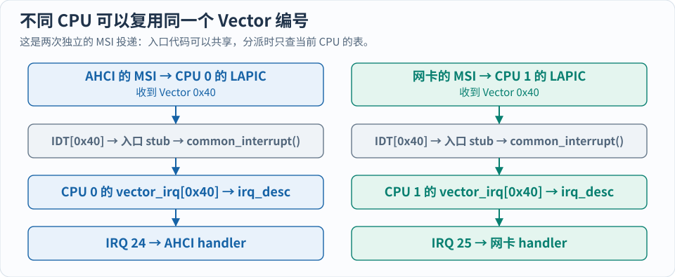

### 2.2 中断迁移：IRQ 不变，底层映射可以变

例如 AHCI 的 IRQ 24 最初分配在 CPU 2 的 `0x30`，后来迁移到 CPU 3，而后者的 `0x30` 已经被占用，可以改用 `0x31`。

| | 迁移前 | 迁移后 |
|---|---|---|
| Linux IRQ | 24 | 24 |
| APIC ID（假设等于 CPU 编号） | 2 | 3 |
| Vector | `0x30` | `0x31` |
| MSI Address | `0xFEE02000` | `0xFEE03000` |
| MSI Data | `0x0030` | `0x0031` |

Linux 需要更新 Vector 映射和设备里的 MSI 配置，并处理迁移过程中的在途消息、旧 Vector 回收和同步；上表只表示两个稳定状态，不是实际迁移算法。驱动注册的 handler 不需要重新绑定 IRQ。

全局 IRQ 抽象并不能突破硬件限制。单 CPU 如果只剩下 10 个可分配的 Vector，就不能通过分配 64 个 IRQ 实现 64 个独立、同时可用的普通设备中断。可以减少中断数、复用队列通知，或者在多 CPU 上利用更多可用 Vector。

## 三、MSI capability：设备与 OS 如何协商

### 3.1 capability 链表

对于本文的普通 PCI Type 0 设备，配置空间的前 64 字节是标准头，之后的空间放 capability。PCI 3.0 第 6.7 节规定的找法是：status 寄存器 bit 4 为 1 表示有链表，偏移 0x34 的一个字节指向第一项，每一项的第一个字节是 ID，第二个字节是下一项的偏移，0 表示结束。MSI 的 ID 是 05h。

mini-vmm 的设备只有这一项 capability，所以布局是固定的：0x34 指向 0x40，0x40 处就是 MSI，下一项指针为 0。Linux 探测设备时就是这么走的，`--trace-pio` 记下的配置访问（只保留 00:01.0）：

```
R off 0x06 size 2 val 0010      status：bit 4 有 capability 链表
R off 0x34 size 1 val 40        第一项在 0x40
R off 0x40 size 2 val 0005      ID 05h（MSI），下一项 00
```

### 3.2 Message Control、Address 和 Data

MSI capability 有好几种形状（32 位或 64 位地址、带不带 per-vector mask），由控制字里的只读位告诉软件是哪一种。mini-vmm 选的是 64 位地址、不带 mask 的形状（PCI 3.0 第 6.8.1 节）：

| 偏移 | 字段 | mini-vmm 的取值 | 谁能写 |
|---|---|---|---|
| 0x40 | ID / Next | 05h / 00h | 只读 |
| 0x42 | Message Control | bit 7（64 位）= 1，MMC（bit 3:1）= 0 | 只有 bit 0（Enable）和 bit 6:4（MME）可写 |
| 0x44 | Message Address | guest 写入 | bit 1:0 只读为 0 |
| 0x48 | Message Upper Address | guest 写入 | 32 位都可写 |
| 0x4C | Message Data | guest 写入 | 16 位 |

几个取值的理由：

- **MMC = 0**：设备最多支持 2^0 = 1 个向量。多向量 MSI 要求向量号连续且按 2 的幂对齐，设备往数据的低位里填序号来区分。AHCI 只有一个端口接了盘，用不着。
- **64 位**：规范第 6.8.1 节的脚注 48 要求，设备如果作为总线主控支持 64 位寻址，就必须实现高 32 位地址。AHCI 的 DMA 是 64 位的（CAP.S64A），所以要带上它。
- **没有 per-vector mask**：mask 位让软件临时屏蔽一个向量而不关掉 MSI，被屏蔽期间产生的中断要记成 pending，取消屏蔽时补发。本阶段为简化实现选择不提供这项可选能力；单向量 MSI 设备也可以支持 per-vector mask。

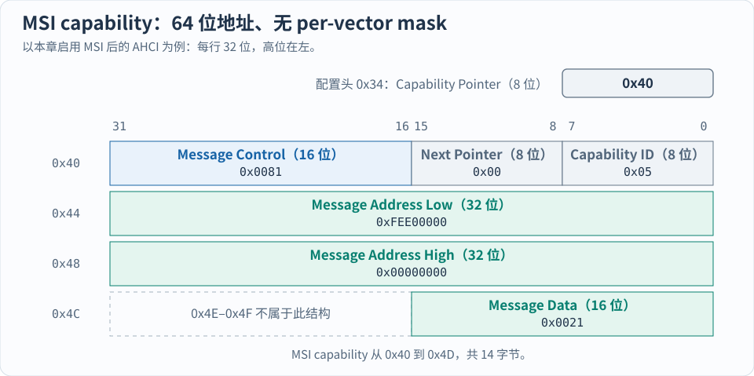

Message Control 是一个 16 位寄存器。以 AHCI 启用 MSI 后的配置值 `0x0081` 为例，只有 bit 7（64 位地址能力）和 bit 0（MSI Enable）为 1。

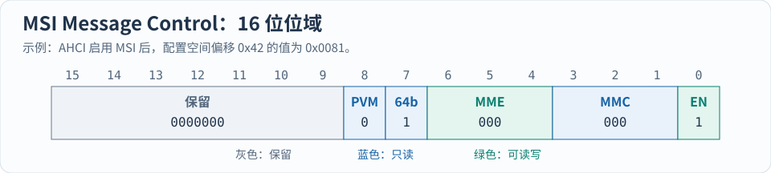

| bit | 字段 | 读写 | 含义 |
|---|---|---|---|
| 0 | MSI Enable（EN） | RW | 是否使用 MSI |
| 3:1 | MMC | RO | Multiple Message Capable：最多支持的消息数量的指数 |
| 6:4 | MME | RW | Multiple Message Enable：OS 实际启用的消息数量的指数 |
| 7 | 64-bit Capable（64b） | RO | 是否支持 64-bit Message Address |
| 8 | Per-vector Masking Capable（PVM） | RO | 是否具有独立屏蔽能力 |
| 15:9 | 保留 | 读为 0，写入无效 | 保留给规范使用 |

`MMC = 0` 表示最多一条消息；`MME = 0` 表示实际启用一条消息。为什么是指数编码、设备如何使用 MME，见第四节。

### 3.3 用可写掩码实现

《PCI·实现篇》的配置空间是“一个字节数组加一张可写掩码”：guest 的写只改掩码允许的位。capability 也走这条路，PCI 层在设备注册时把它摆进数组、设好掩码，之后 guest 写什么、什么时候写，设备一概不用管：

```c
static void msi_setup(struct pci_device *d)
{
    cfg_set16(d, PCI_STATUS, (uint16_t)(cfg_get(d, PCI_STATUS, 2) | PCI_STATUS_CAP_LIST));
    cfg_set8(d, PCI_CAPABILITY_LIST, PCI_MSI_CAP_OFFSET);
    cfg_set8(d, PCI_MSI_CAP_OFFSET + PCI_CAP_LIST_ID, PCI_CAP_ID_MSI);
    cfg_set8(d, PCI_MSI_CAP_OFFSET + PCI_CAP_LIST_NEXT, 0);
    cfg_set16(d, MSI_CTRL, PCI_MSI_FLAGS_64BIT);
    wmask_set16(d, MSI_CTRL, PCI_MSI_FLAGS_ENABLE | PCI_MSI_FLAGS_QSIZE);
    wmask_set32(d, MSI_ADDR, ~0x3u);
    wmask_set32(d, MSI_ADDR_HI, ~0u);
    wmask_set16(d, MSI_DATA, 0xFFFF);
}
```

MME 设成可写而不是只读 0，是因为规范规定它是 RW：软件把分到的向量数写进去。规范允许的配置满足 MME ≤ MMC。当前实现仍允许写入 MME 字段，但只实际使用一个向量；这是本阶段简化实现的边界，不应推广为多向量 MSI 的处理规则。

设备只要在 `struct pci_device` 里声明 `msi = true`，注册时就会多出这段 capability。设备声明了 MSI，command 寄存器的 Bus Master 位也随之可写：MSI 是设备发起的内存写，没有 Bus Master 就发不出去（第 6.2.2 节），后面 5.4 节会用到这一点。

### 3.4 Linux 怎样打开它

驱动 probe 时调 `ahci_init_irq`。控制器有 6 个端口，它先试着按端口数申请多个向量（`pci_alloc_irq_vectors(pdev, n_ports, INT_MAX, PCI_IRQ_MSIX | PCI_IRQ_MSI)`），MMC = 0 只能给 1 个，这条路失败；再退回 `pci_alloc_irq_vectors(pdev, 1, 1, PCI_IRQ_MSI)` 申请单向量。真正打开 MSI 的是 `msi_capability_init`（`drivers/pci/msi/msi.c`），配置访问的 trace 是这样的：

```
W off 0x42 size 2 val 0080      先确认 Enable 为 0
W off 0x42 size 2 val 0080      写 MME = 0（pci_write_msg_msi 先改控制字）
W off 0x44 size 4 val fee00000  地址
W off 0x48 size 4 val 00000000  高 32 位地址
W off 0x4c size 2 val 0021      数据
R off 0x04 size 2 val 0002
W off 0x04 size 2 val 0402      command 置 INTx Disable（bit 10）
W off 0x42 size 2 val 0081      置 MSI Enable
...
W off 0x04 size 2 val 0406      pci_set_master：置 Bus Master
...
W off 0x44 size 4 val fee00000  request_irq 激活中断时又写了一遍同样的消息
W off 0x48 size 4 val 00000000
W off 0x4c size 2 val 0021
```

能看出三件事：

1. **先写消息，再置 Enable。** Enable 一旦为 1，设备随时可能发消息，所以地址和数据必须先就位。这也意味着 VMM 在 Enable 打开的那一刻记下的地址和数据，就是 guest 当时准备使用的消息（后续可能因激活或迁移被改写），所以 mini-vmm 在这一刻打一行日志：

   ```
   [INFO] pci 00:01.0 ahci: MSI enabled, address 0xfee00000 data 0x0021
   ```

2. **INTx Disable 在 MSI Enable 之前。** 这是 `pci_intx_for_msi(dev, 0)`。规范已经规定 MSI 打开后设备不得使用 INTx（第 6.8.3.3 节），Linux 还是多关了一道。
3. **Bus Master 是在 MSI 打开之后才置的。** 中间这段时间如果设备发消息，就违反了第 6.2.2 节。AHCI 这时 GHC.IE 还是 0，不会发，但设备模型不能指望这一点，5.4 节的 Bus Master 检查就是为这种窗口准备的。

最后那次重写来自中断激活：`request_irq` 一路走到 `msi_domain_activate`，后者重新组装消息并写进设备（`kernel/irq/msi.c`）。消息和之前一样，Enable 没有变化，所以 VMM 不会再打日志。

## 四、消息格式、多向量 MSI 与 MSI-X

### 4.1 x86 的消息格式

PCI 规范只说 MSI 是“往地址写数据”，地址和数据怎么解释由平台决定。x86 的定义在 Intel SDM 第 3 卷第 13.11 节：

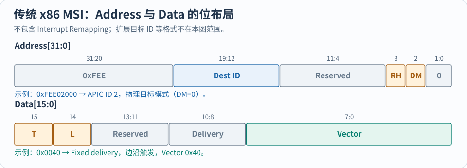

把 Linux 写进去的值拆开：

| 值 | 拆开 | 含义 |
|---|---|---|
| 地址 `0xfee00000` | 0FEEh，目标 ID 0x00，RH = 0，DM = 0 | 物理目标模式，APIC ID 0 |
| 数据 `0x0021` | 触发 0（边沿），投递模式 000（Fixed），向量 0x21 | 向量 0x21，边沿触发 |

在本文实验使用的物理目标模式下，目标 ID 就是目标 CPU 的 APIC ID。不要将这个结论推广到所有 x86 APIC 模式、x2APIC 扩展格式或 Interrupt Remapping。mini-vmm 给 vCPU n 的 APIC ID 是 n，所以 0x00 就是 CPU 0。用 `--smp 4` 启动时，Linux 把中断分给了另一个 CPU：

```
[INFO] pci 00:01.0 ahci: MSI enabled, address 0xfee02000 data 0x0020
 24:          0          0      16388          0  PCI-MSI-0000:00:01.0    0-edge      ahci[0000:00:01.0]
```

目标 ID 0x02 是 APIC ID 2，`/proc/interrupts` 里中断全落在第三列，也就是 CPU 2。地址里的 8 位就这样决定了中断去哪个 CPU，中间不经过任何重定向表。

### 4.2 MME 为什么决定 Message Data 的最低几位？

设备如果拥有多个队列，最好能让不同队列产生不同的中断。但传统 MSI Capability 只有一组 Address / Data。规范的做法是让设备在 Message Data 的低位编码内部消息编号，允许改写的低位数量由 MME 决定。

| MMC / MME 编码 | 对应消息数量 | MME 对应可改写的 Data 位 |
|---:|---:|---|
| 0 | 1 | 无 |
| 1 | 2 | bit 0 |
| 2 | 4 | bit 1:0 |
| 3 | 8 | bit 2:0 |
| 4 | 16 | bit 3:0 |
| 5 | 32 | bit 4:0 |

例如设备宣告 `MMC = 5`（32 条），但 OS 只分配 4 条，写入 `MME = 2`，Address 为 `0xFEE02000`，基础 Data 为 `0x0040`。设备可以选择消息 index 0–3。

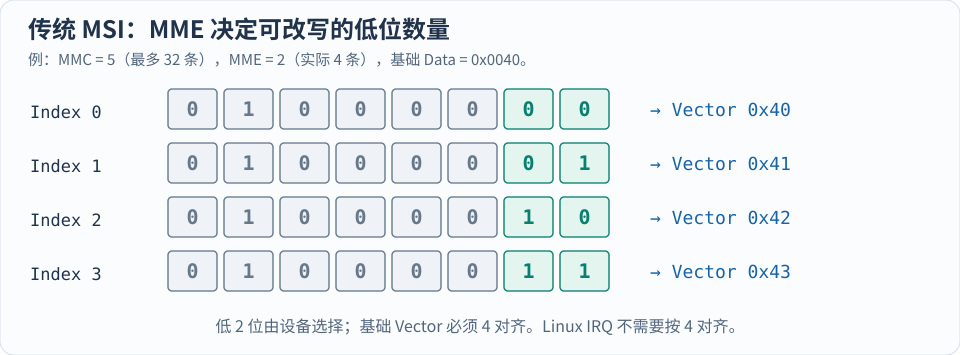

用 C 伪代码表达设备的行为（假定 MME 合法，index 在启用范围内）：

```c
uint16_t generate_msi_data(uint16_t base_data, unsigned int mme,
                           unsigned int index)
{
    uint16_t mask = (1u << mme) - 1;

    return (base_data & ~mask) | (index & mask);
}
```

如果 OS 写基础 Data `0x0043`，而 MME 仍为 2，设备覆盖低两位后生成的仍然是 `0x40–0x43`。所以 OS 不能从 `0x43` 开始分配四个连续 Vector：起点的最低 MME 位必须为 0。

**对于不带 Interrupt Remapping 的传统 x86 MSI，Vector 必须连续、按消息数量对齐，且在这里采用的物理目标模式下共用同一个目的 APIC ID。** 这是硬件消息编码约束，不是 Linux IRQ 的数学约束。开启中断重映射等不同机制后，实际硬件分配约束需要按相应模式分析。

### 4.3 Linux IRQ 也必须连续吗？

硬件并不感知 Linux IRQ。理论上 `0x40–0x43` 可以分别映射到 IRQ 24、37、58、103；但 Linux 的传统 PCI MSI 管理方式为一组消息分配连续的 virq，使用一个 `msi_desc` 记录起始 IRQ 和 `nvec_used`，根据 index 取得 `base_irq + index`。每个 IRQ 仍有独立的 `irq_desc`。

| 约束 | 传统 x86 MSI Vector（直接投递） | Linux IRQ（传统 PCI MSI 实现） |
|---|---|---|
| 连续 | 硬件编码要求 | 软件管理要求 |
| 起始编号按消息数量对齐 | 是 | 否 |
| 设备感知 | 是（消息低位） | 否 |

这个设计有代价：如果软件 IRQ 空间中找不到长度足够的连续区间，即使底层 Vector 可分配，申请也可能失败。

但现代启用 `CONFIG_SPARSE_IRQ` 的 Linux 使用 Maple Tree 按需管理描述符，编号上限 `MAX_SPARSE_IRQS` 为 `INT_MAX`，并不是预分配约 21 亿个描述符。`irq_find_free_area()` 寻找连续空闲编号区间，失败返回 `-ENOSPC`。

传统 MSI 最多 32 条消息，因此在通常的 x86 系统上，IRQ 编号碎片远不如硬件 Vector 稀缺。

这是一种工程取舍：可以用数组管理离散编号，消除人为的连续性要求；也可以保留更简单的 `base + index`，使用足够大的稀疏编号空间。这里没有断言这就是当初维护者的设计动机，也不能仅凭理论碎片风险证明值得修改现有代码。实现参考见附录 A。

### 4.4 MSI-X：用一张表替代低位编码（扩展）

如果有四个空闲 Vector `0x40`、`0x41`、`0x43`、`0x47`，传统 MSI 无法用一组四向量的直接投递消息充分利用它们。多个队列也希望独立选择 CPU。最自然的设计是让每条消息拥有自己的一组 Address / Data。

MSI-X Capability 只记录表的位置、大小和全局控制位。真正的 Table 放在设备 BAR 暴露的 MMIO 空间，不是在 PCIe 4096 字节配置空间内，也不是 OS 随意分配的普通 RAM。BIR（BAR Indicator Register）选择 BAR，Offset 表示相对该 BAR 起始地址的偏移。每条表项 16 字节，包含 64-bit Message Address、32-bit Message Data、32-bit Vector Control。

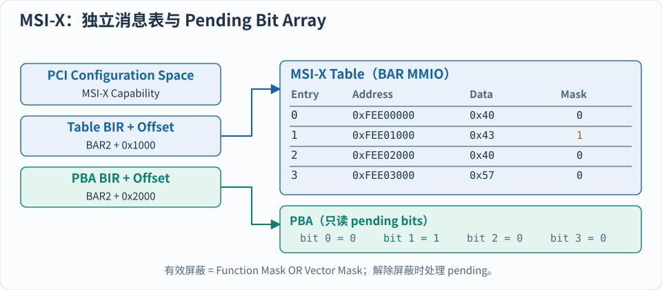

例如 BAR2 的基地址是 `0x80000000`，Table BIR = 2，Offset = `0x1000`，则表的 MMIO 地址为 `0x80001000`。OS 可单独配置每个 entry，设备事件到 entry 的选择由设备协议定义。

| | MSI | MSI-X |
|---|---|---|
| 最大消息数量 | 32 | 2048 |
| 配置位置 | PCI 配置空间 | BAR 中的 MSI-X Table |
| Address / Data | 共用 Address、Data 低位编码 | 每项独立 |
| 消息数量 | 2 的幂 | 不要求是 2 的幂 |
| 单独屏蔽 | 可选 | 必须支持 |

MSI-X 的 Table Size 字段编码的是表项数量减 1，而不是 MMC/MME 的指数。Linux PCI MSI-X 通常为每条消息使用单独的 `msi_desc`，不要求 virq 连续。底层还是 MSI 的写事务，并没有发明一种新的 CPU 中断机制。

### 4.5 Mask 与 Pending：事件记录不能依赖通知（扩展）

OS 修改一个 MSI-X Entry 的 Address 和 Data 时，**两次写入并不是一个原子操作**。如果设备在中途发消息，可能出现新 Address + 旧 Data，错误地投递到另一中断。因此软件可以先屏蔽该 Entry，再更新字段，最后解除屏蔽；这只描述配置更新的基本协议，不是 Linux IRQ affinity 迁移的完整算法，也不消除已经在途的消息。

MSI-X 有 Function Mask（整个 function）和 Vector Mask（单条表项）。当任意一个置位，且设备本应发送这条 MSI-X 消息时，设备记录该 entry 的 pending bit；解除有效屏蔽时，如果 pending bit 仍为 1，则补发相应消息并清除 pending bit。

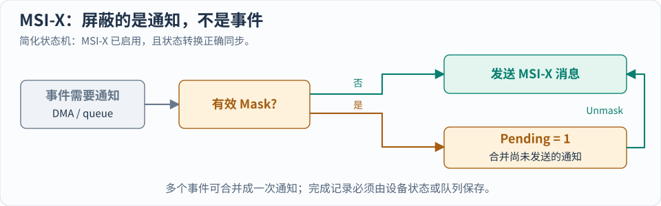

PBA（Pending Bit Array）也是设备 BAR 内的结构，由独立的 BIR / Offset 指向，每个 entry 对应一个 bit。为什么不是 counter？因为 **中断是关于事件的通知，而不是事件本身。** 100 次 DMA 完成应由 completion ring、descriptor 或其他设备状态记录；只要驱动按照协议处理所有待处理工作并避免漏唤醒，一条通知就可以代表多次完成。PBA 并不承诺保存事件计数，也不是 KVM 的 LAPIC IRR。

本章的 mini-vmm 不实现 MSI-X、多向量 MSI 或 per-vector mask。上述内容是为了后续 VirtIO-PCI 做准备。

## 五、KVM 中的 MSI 投递

### 5.1 为什么不直接写 guest 物理地址？

在 mini-vmm 用户态中，`*(volatile uint32_t *)0xFEE02000 = 0x0040` 操作的是 host 进程的虚拟地址，并不是 GPA。即使将 GPA 转为 HVA，再写入 guest RAM 的 backing memory，也只是在修改内存字节，不会触发虚拟 LAPIC。APIC/MSI 窗口也不应当作为普通 RAM 处理。

KVM 提供的是一个显式的语义接口：`KVM_SIGNAL_MSI`。例如：

```c
struct kvm_msi msi = {
    .address_lo = 0xFEE02000,
    .address_hi = 0,
    .data       = 0x0040,
};

ioctl(vm_fd, KVM_SIGNAL_MSI, &msi);
```

这是示意，实际代码需要检查返回值。注意 ioctl 的对象是 `vm_fd`，不是 `vcpu_fd`，因为目标 vCPU 已经编码在消息中，由 KVM 负责解析和匹配。

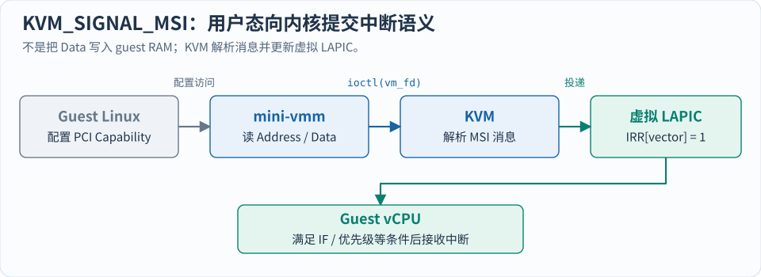

### 5.2 KVM 怎样解释它

`KVM_SIGNAL_MSI` 收到地址和数据后，交给 `kvm_set_msi_irq`（`arch/x86/kvm/irq_comm.c`）：

```c
	irq->dest_id = x86_msi_msg_get_destid(&msg, kvm->arch.x2apic_format);
	irq->vector = msg.arch_data.vector;
	irq->dest_mode = kvm_lapic_irq_dest_mode(msg.arch_addr_lo.dest_mode_logical);
	irq->trig_mode = msg.arch_data.is_level;
	irq->delivery_mode = msg.arch_data.delivery_mode << 8;
```

它只取出目标 ID、向量、目标模式、触发模式和投递模式，然后像 LAPIC 收到一条中断消息那样投递。注意它**不看地址的高 12 位是不是 0FEEh**：在本文假设的真实平台上，不在这个窗口里的写不会按传统 MSI 解释，而会按照平台地址映射处理，可能落到内存、其他设备或被拒绝；KVM 收到的已经被假定是一条中断消息。

### 5.3 VMM 要拦什么

所以格式检查得由 VMM 做。`irqchip_msi_invalid` 在本 mini-vmm 支持的直接投递格式中做以下检查（不是所有 MSI 平台格式的通用验证器）：

```c
    if ((addr >> 32) || ((uint32_t)addr & MSI_ADDR_WINDOW_MASK) != MSI_ADDR_WINDOW)
        return "address is outside the interrupt window 0xfee00000-0xfeefffff";
    if (dm == 3 || dm == 6)
        return "reserved delivery mode";
    if ((dm == MSI_DELIVERY_FIXED || dm == MSI_DELIVERY_LOWEST) &&
        (vec < 0x10 || vec > 0xFE))
        return "vector outside 0x10-0xfe";
    return NULL;
```

- **地址不在窗口里**：包括高 32 位非 0。这样的写在真实硬件上不是中断，交给 KVM 会凭空变出一个中断。
- **投递模式 011 和 110**：SDM 列为保留编码。
- **向量 0x00–0x0F 与 0xFF**：SDM 第 13.11.2 节说向量的范围是 010H 到 0FEH，注意 SDM 在这里给出的投递编码范围不等于 Linux 可分配给设备的 Vector 范围；Linux 还保留 `0x00–0x1F` 等系统向量。不能把外部中断简单等同于 CPU 同步异常。NMI、INIT 这类投递模式不用向量字段，所以只对 Fixed 和 Lowest Priority 检查。

刻意**不检查**的是地址 bit 11:4 和数据里的保留位。SDM 对保留位的说法是“不假定为任何值”，而且 KVM 的扩展目标 ID 正好借用了地址 bit 11:5 来传高位的 APIC ID，拒绝它们会误伤合法的 guest。

### 5.4 KVM_SIGNAL_MSI 的返回值与投递失败

PCI 层的 `pci_msi_notify` 先查 Bus Master，再查格式，最后交给 irqchip：

```c
    if (!(cfg_get(d, PCI_COMMAND, 2) & PCI_COMMAND_MASTER))
        why = "bus master disabled";
    else if (!(why = irqchip_msi_invalid(addr, data)) &&
             irqchip_signal_msi(d->bus->vm, addr, data, &why) == VMM_OK) {
        d->msi_sent++;
        d->msi_drop_run = 0;
        return;
    }
```

`KVM_SIGNAL_MSI` 的返回值在 `Documentation/virt/kvm/api.rst` 里写的是“>0 on delivery, 0 if guest blocked the MSI, and -1 on error”。追到 `kvm_irq_delivery_to_apic`，三种结果分别是：

| 返回 | 含义 | mini-vmm 的处理 |
|---|---|---|
| > 0 | 收下这条中断的 LAPIC 个数 | 成功 |
| 0 | 快速路径算出的目标里没有 LAPIC 收下（目标 ID 不对应任何 vCPU，或者 LAPIC 被软件关掉了） | 记为 guest 的问题：`no vCPU accepted it` |
| -1，errno = EPERM | 慢速路径一个目标都没匹配上 | 记为 guest 的问题：`no LAPIC matches the destination` |
| -1，其他 errno | ioctl 本身失败 | 记 `vmm_err`，带地址、数据和 errno |

mini-vmm 将没有接收者等情况作为 guest 配置或状态问题记录而不退出，将其余 ioctl 错误作为需要诊断的问题处理。这是当前实现的错误分类，不是所有 KVM 版本的 errno 都具有相同的具体语义。返回正数表示投递被接受，并不等于 guest handler 已经运行。irqchip 创建时还会检查 `KVM_CAP_SIGNAL_MSI`，不支持就直接报错，免得等到第一条消息才发现。

## 六、MSI 与 INTx 的互斥和切换

### 6.1 规则

PCI 3.0 第 6.8.3.3 节：MSI Enable 为 1 时，设备不得使用 INTx 引脚。反过来，guest 关掉 MSI 时，在支持 INTx 且没有禁止 INTx 的情况下，设备回到 INTx。这里有一个容易漏掉的细节：关掉 MSI 那一刻，设备如果还有没处理完的中断请求，若 INTx 未被禁止，该请求应立即反映到 INTx 线上，否则可能丢失通知。

两者的控制位独立存在：

| MSI Enable | INTx Disable | 可用模式 |
|---:|---:|---|
| 0 | 0 | INTx（若设备支持） |
| 0 | 1 | 两者均不可用 |
| 1 | 0 | MSI |
| 1 | 1 | MSI |

上表不含 Bus Master、设备中断使能等其他条件。MSI Enable 已经可以禁止 INTx，Linux 仍会显式设置 INTx Disable。

### 6.2 实现：设备照报电平，PCI 层决定上不上线

mini-vmm 的做法是不让设备关心这件事。AHCI 照常用 `pci_set_irq` 报告它的 INTx 电平，不管 MSI 开没开；PCI 层计算“实际驱动到线上的电平”时多加一个条件：

```c
static bool intx_output(const struct pci_device *d)
{
    return d->intx_pin && d->intx_level &&
           !(cfg_get(d, PCI_COMMAND, 2) & PCI_COMMAND_INTX_DISABLE) &&
           !pci_msi_enabled(d);
}
```

MSI Enable 被写到时，配置写的处理函数重新算一遍线电平：

```c
    if (d->msi && reg < MSI_CTRL + 2 && end > MSI_CTRL) {
        msi_note_enable(d);
        if (d->intx_pin)
            intx_line_update(bus, d);
    }
```

打开时，线上可能挂着的请求被撤下；关掉时，`intx_level` 一直保存设备的逻辑请求；若 INTx 未被禁止，挂着的请求马上回到线上。设备自己不保存“MSI 开着时攒下的 INTx 请求”这种状态，也就没有机会把它弄错。

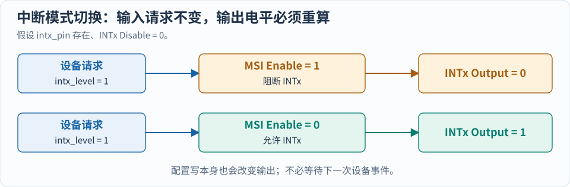

`intx_level` 和 `intx_output()` 分别表示设备请求和实际输出；它们不能混为一谈。在 PCI INTx 的电平语义下，配置写可以改变输出，即使设备没有新事件。对于被屏蔽的瞬时边沿消息，则通常需要 pending/锁存机制保留通知。

### 6.3 运行中切换

Linux 提供了一个现成的开关：`/sys/bus/pci/devices/<BDF>/msi_bus`。写 0 之后，这个设备上**以后** probe 的驱动都不能申请 MSI（`drivers/pci/pci-sysfs.c` 的 `msi_bus_store` 只设 `pdev->no_msi`，不碰已经绑定的驱动）。所以要真正切换，得解绑再绑定驱动。以下实验应在可丢弃的测试 guest 内进行，并确保目标磁盘未承载正在使用的根文件系统或数据。解绑时驱动调 `pci_free_irq_vectors`，清掉 MSI Enable，这就是 guest 在运行中把设备从 MSI 切回 INTx 的真实路径：

```
echo 0 > /sys/bus/pci/devices/0000:00:01.0/msi_bus
echo 0000:00:01.0 > /sys/bus/pci/drivers/ahci/unbind
echo 0000:00:01.0 > /sys/bus/pci/drivers/ahci/bind
```

VMM 日志和 guest 的 `/proc/interrupts` 是这样变化的：

```
[INFO] pci 00:01.0 ahci: MSI enabled, address 0xfee00000 data 0x0021
 24:  ...  PCI-MSI-0000:00:01.0   0-edge      ahci[0000:00:01.0]       ← 第一次 probe
[INFO] pci 00:01.0 ahci: MSI disabled, interrupts go to INTA
 17:  ...  IO-APIC  17-fasteoi   ahci[0000:00:01.0]                      ← msi_bus=0，重新绑定
[INFO] pci 00:01.0 ahci: MSI enabled, address 0xfee00000 data 0x0021
 24:  ...  PCI-MSI-0000:00:01.0   0-edge      ahci[0000:00:01.0]       ← msi_bus=1，重新绑定
```

三个阶段各做 256 次 4 KiB 直读，中断计数的增量都不少于 256，读到的内容和镜像一致。INTx 阶段分到的是 GSI 17，和 DSDT `_PRT` 给 slot 1 INTA 的接线一致，`pci=nomsi` 启动时也是这根线。

## 七、为什么 MSI 能减少 VMEXIT？

### 7.1 先区分 ioctl、VMEXIT 与用户态 exit

在 vmm 进程外面套一层 `strace -f -e trace=ioctl`，guest 做 1024 次 4 KiB 直读，数中断相关的 ioctl：

| 方式 | ahci 中断数 | `KVM_SIGNAL_MSI` | `KVM_IRQ_LINE` |
|---|---|---|---|
| MSI | 1028 | 1030 | 848 |
| INTx（`pci=nomsi`） | 1028 | 0 | 2904 |

MSI 下的 848 次 `KVM_IRQ_LINE` 是串口这些传统设备的，两边都有。INTx 比 MSI 多出 2904 − 848 = 2056 次，正好是 1028 的两倍：在这组负载下，每次中断对应一次逻辑 assert 和一次 deassert。MSI 每次中断一次 ioctl，返回值都是 1（一个 LAPIC 收下了）。`KVM_SIGNAL_MSI` 比中断数多出 2 次，这 2 次在哪里发生我没有核对。一种可能是：两条消息在 guest 处理第一条之前先后到达，LAPIC 的 IRR 里只有一位，合并成了一次中断。

上面的 ioctl 计数不是 VMEXIT 计数。ioctl 是 host 用户态进入 host 内核的系统调用；VMEXIT 是 vCPU 从 guest mode 退出到 KVM，KVM 可能自行处理后重新进入 guest，也可能让 `KVM_RUN` 返回用户态。不能把三者直接划等号。

### 7.2 实验观察：差异发生在 KVM 内部

更大的差别在 KVM 内部。`--exit-stats` 会把 KVM 自己的计数器一起打出来。guest 做 3 轮各 4096 次 4 KiB 直读，ahci 中断数两边都是 12288：

| 计数 | MSI | INTx | 差 |
|---|---|---|---|
| 交给用户态的 MMIO exit | 86626 | 86630 | ≈ 0 |
| KVM 的 `exits` 总数 | 151674 | 176830 | 25156 |
| `insn_emulation` | 90977 | 115689 | 24712 |

交给 VMM 的 exit 一模一样，因为设备的寄存器访问不受中断方式影响。总 exits 的差值约为每次中断 2 次，指令模拟次数差值也接近；这些是计数器层面的观察，不能由总数直接证明每一条 exit 的具体原因。

这两次 exit 是从源码推出来的，没有逐条核对：挂 `kvm_exit` tracepoint 需要 root，这台机器上没有。推理过程如下。这个 guest 内核开着 KVM 的 PV EOI，dmesg 里有一行：

```
kvm-guest: APIC: eoi() replaced with kvm_guest_apic_eoi_write()
```

### 7.3 EOI 的两种因果链

普通 MSI 和 IOAPIC 电平中断都需要 LAPIC EOI。对于后一种，还需要 IOAPIC 获得 EOI 通知，清除 Remote IRR，若中断线仍然有效就可以重新投递。MSI 没有这层 IOAPIC 状态。

在本文实验的 xAPIC、无 AVIC 环境中，guest 写虚拟 LAPIC EOI 寄存器（偏移 `0xB0`，通常 GPA `0xFEE000B0`）会产生 VMEXIT；KVM 模拟 EOI，清除 ISR 中相应的最高优先级中断，必要时通知 IOAPIC 并重新评估等待中的中断。这个 exit 由 KVM 内部处理，不需要返回 mini-vmm。

这里要理解两个不同的状态：LAPIC 的 IRR 是等待投递的请求，ISR 是已经接收但尚未 EOI 的中断。第二条相同 Vector 的普通边沿 MSI 可以在第一条仍位于 ISR 时进入 IRR。IRR 是 bitmap，多条相同消息可能合并。CPU 能否开始处理它还取决于 PPR/TPR、IF 和其他接收条件。

IOAPIC 则不同：对于同一电平中断请求，Remote IRR 没有被清掉，IOAPIC 不能按正常流程重新投递。若 EOI 等待下一次无关 VMEXIT，新的中断又在等待 EOI，就会无故延迟进度。

### 7.4 PV EOI：在 VMENTRY 之前授权，VMEXIT 之后同步

KVM 与支持 PV EOI 的 guest 通过共享内存标志进行协作。KVM 可以在 VMENTRY 前判断某次 EOI 是否可以延迟同步。若授权，guest 在执行 EOI 时清除共享标志、跳过通常的 LAPIC EOI 寄存器写；KVM 在下次退出或相关同步路径中检查标志，完成真正的 LAPIC 状态更新。若没有授权，guest 执行普通 EOI。

`arch/x86/kvm/lapic.c` 的 `apic_sync_pv_eoi_to_guest()` 中，是否允许快速路径的关键条件可概括为（省略注释）：

```c
if (!pv_eoi_enabled(vcpu) ||
    apic->irr_pending ||
    apic->highest_isr_cache == -1 ||
    kvm_ioapic_handles_vector(apic, apic->highest_isr_cache))
    return;

pv_eoi_set_pending(apic->vcpu);
```

为何检查 `irr_pending`？假设高优先级 A (`0x80`) 在 ISR，低优先级 B (`0x40`) 在 IRR。如果 guest 清除共享位后继续执行计算，而 KVM 没有同步 EOI，那么旧 ISR 可能仍然压制 B。不能让已知等待的中断依赖下一次无关 exit 才得到处理。源码采用保守条件，在 IRR pending 或 ISR cache 不可用、需要 IOAPIC EOI 等情形不授予快速路径。若新的 MSI 在 guest 运行期间到达，软件 APIC 路径可以请求事件评估并 kick vCPU，让 KVM 获得同步和重新评估的机会；具体路径受实现和加速模式影响。

特别注意时序：`apic_sync_pv_eoi_to_guest()` 本来就在 Host Mode 中运行，但这次 EOI **尚未由 guest 执行**，因此不能趁当前 exit 提前清 ISR。KVM 只能决定下一次 guest EOI 是否需要立即退出。

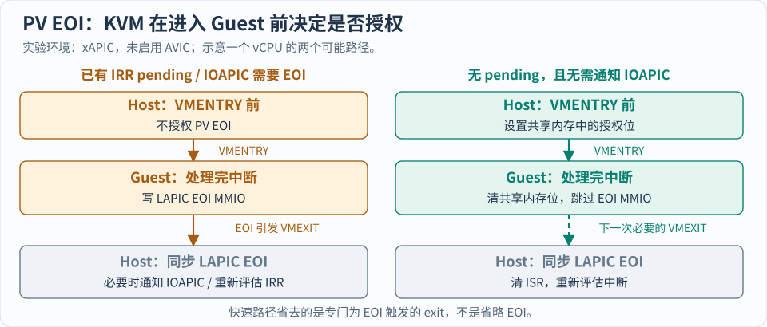

两种路径的工作量差异不在于 MSI 不需要 EOI，而在于是否必须为 EOI 单独进行一次 guest/host 切换。

回到本节实验，原文提出两项具体的 exit 差异来源：

- MSI 在允许 PV EOI 时省去 EOI MMIO 写对应的 exit；IOAPIC 电平中断需要同步 Remote IRR，走普通 EOI。
- Linux 的 `ioapic_ack_level` 在特定路径中还会读 LAPIC TMR，检查触发模式以处理老 IOAPIC 的勘误；在该 xAPIC、无 AVIC 的环境中，该读取也可能产生一次 exit。

两者与计数器的差值吻合，但仍是源码支持的解释，不是逐次 trace 已证实的因果链。如果要验证，应在有权限的环境下采集 `kvm:kvm_exit`、相关 APIC/MMIO tracepoint（先核对内核提供的事件）或在 KVM 关键函数加计数，保持同一 guest 负载，对比 EOI 和 TMR 对应的访问及退出原因。未启用 PV EOI，或启用 APICv/AVIC、采用 x2APIC 时，不能直接复用这组结论。

### 7.5 快了多少

和 exit 数比起来，耗时的差别没有那么清楚。同一个二进制、同样的负载，原稿记录了如下六轮样本：

| 方式 | 6 轮耗时（秒） |
|---|---|
| MSI | 0.414、0.506、0.476、0.429、0.428、0.440 |
| INTx | 0.551、0.535、0.496、0.541、0.521、0.590 |

这两组看起来 MSI 快大约 20%。但更早的一组三轮里，两者不相上下（MSI 0.53–0.56 秒，INTx 0.51–0.54 秒）。NCQ 下每条命令本身要 7 次左右的用户态 MMIO exit（《全模拟磁盘 P4：后端与 DMA 读写》第六节），中断路径上少掉的 2 次内核内 exit 和 1 次 ioctl 只是其中一小部分。比较稳妥的结论是：在这组实验中 MSI 的 exit 计数确实更少，但耗时优势尚未得到稳定复现，不能据此宣称所有环境下 MSI 一定更快。

## 八、故障路径与诊断：完成了 I/O，不代表通知送达

### 8.1 三种原因，一行日志

消息可能在三个地方被拦下：Bus Master 关着；格式不合法；KVM 没有 vCPU 收下。任何一种都记一行日志，带 BDF、地址、数据和原因：

```
[WARN] pci 00:01.0 ahci: MSI address 0xfee00000 data 0x0005 not delivered: vector outside 0x10-0xfe (1 with this address/data, 1 in total)
```

日志的频率需要想一下。guest 把配置写坏之后，设备每产生一次中断都会丢一条消息，每条都记就会刷屏；只记第一条，又看不出后来丢了多少条，guest 接着写出另一种坏配置时也看不到。mini-vmm 的规则是：

- 换成一组新的地址/数据时，立刻记；
- 同一组连续失败，在第 1、2、4、8……次时记，括号里给出这一组丢了几条、总共丢了几条；
- 中间成功一次，计数重新开始。

### 8.2 一条坏消息在 guest 里是什么样子

以下为原文故障注入实验，仅在可丢弃的 guest 和测试磁盘上进行；不建议对工作系统的控制器配置空间做这种修改。

用 sysfs 的 config 文件把数据的低字节（偏移 0x4C）改成 0x05，然后读一个块：

```
printf '\005' | dd of=/sys/bus/pci/devices/0000:00:01.0/config bs=1 seek=76 conv=notrunc
dd if=/dev/sda of=/dev/null bs=4k count=1 skip=100 iflag=direct
```

VMM 这一侧和 guest 的 dmesg 交织在一起：

```
[WARN] pci 00:01.0 ahci: MSI address 0xfee00000 data 0x0005 not delivered: vector outside 0x10-0xfe (1 with this address/data, 1 in total)
[   32.674145] ata1.00: exception Emask 0x0 SAct 0x200 SErr 0x0 action 0x6 frozen
[   32.674274] ata1.00: failed command: READ FPDMA QUEUED
[   32.674319]          res 40/00:00:00:00:00/00:00:00:00:00/00 Emask 0x4 (timeout)
[   32.674356] ata1: hard resetting link
[WARN] pci 00:01.0 ahci: MSI address 0xfee00000 data 0x0005 not delivered: vector outside 0x10-0xfe (2 with this address/data, 2 in total)
[   38.305536] ata1.00: qc timeout after 5000 msecs (cmd 0xec)
[   49.056006] ata1.00: qc timeout after 10000 msecs (cmd 0xec)
[   49.056207] ata1: limiting SATA link speed to 3.0 Gbps
[WARN] pci 00:01.0 ahci: MSI address 0xfee00000 data 0x0005 not delivered: vector outside 0x10-0xfe (4 with this address/data, 4 in total)
[   79.775869] ata1.00: qc timeout after 30000 msecs (cmd 0xec)
[   79.776010] ata1.00: disable device
[   80.090369] I/O error, dev sda, sector 800 op 0x0:(READ) flags 0x800 phys_seg 1 prio class 2
dd: /dev/sda: I/O error
```

命令其实早就完成了：设备读完了数据，PxSACT 清了，IS 置上了，只是消息被丢了。Linux 看不到中断，30 秒后判定超时，进入 EH：硬复位链路，重新 IDENTIFY，每次 IDENTIFY 同样收不到中断，超时从 5 秒、10 秒一直到 30 秒，中间还把链路降到了 3 Gbps，最后把这块盘停用。`dd` 等了 77 秒，拿到一个 I/O 错误。这期间 VMM 一共丢了 4 条消息，日志出现在第 1、2、4 条，第 3 条按规则没有记。

如果没有这行日志，现场只剩 guest 侧的“timeout”和“disable device”。这几行和“设备卡死”“中断控制器没接好”“命令根本没执行”在 guest 侧完全一样，要在 VMM 这一侧加诊断输出才能区分。

还有一个后果：消息丢了之后 IS 一直挂着，按图 22，IS 不再变化就不会再发消息。所以一次启动里只能观察一种坏配置。另外，关机时 Linux 还会发 FLUSH CACHE 和 STANDBY IMMEDIATE，它们同样收不到中断，关机会卡住。e2e 测试在写坏配置之前先把写缓存改成 write through、关掉关机时的停盘，再在三次启动里分别测三种坏配置：

| 改哪个字节 | 结果 | 日志里的原因 |
|---|---|---|
| 0x4C 写 0x05 | 向量 0x05 | `vector outside 0x10-0xfe` |
| 0x47 写 0x00 | 地址 `0x00e00000` | `address is outside the interrupt window 0xfee00000-0xfeefffff` |
| 0x45 写 0xE0 | 地址 `0xfee0e000`，目标 ID 0x0E | `no vCPU accepted it`（格式合法，KVM 返回 0） |

第三种说明了为什么格式检查之后还要看 KVM 的返回值：用例只有一个 vCPU（APIC ID 0），目标 0x0E 在物理目标模式下是 APIC ID 14，按扁平逻辑模式解释是 CPU 1 到 3 的位图，哪种解释都没有 vCPU 匹配。这条消息格式完全合法，只有投递的时候才知道没人收。目标 ID 不能写成 0：Linux 的消息本来就发给 APIC ID 0，写 0 等于没改。

## 九、设备案例（可独立阅读）：AHCI 什么时候发送 MSI？

### 9.1 PCI 层和设备层的职责不同

PCI/MSI 定义如何配置和发送消息，而设备协议决定什么时候应该发送。这一节讨论的是 AHCI 的通知状态机，不是所有 MSI 设备的通用规则。VirtIO、NVMe 等有自己的完成队列和通知机制。只想掌握 MSI 机制本身，可以先跳到第十节。

AHCI 的 PxIS 记录端口中断原因，PxIE 是端口级使能；Global IS 是端口级请求的粘滞汇总，需要软件写 1 清除；GHC.IE 是全局中断总开关。将这类多位状态布尔化，作为 INTx 的逻辑电平是合理的，但不能把这个电平的上升沿机械地当成 MSI 的唯一发送条件。

先看双端口例子：驱动已读出 IS = `01` 准备处理 Port 0，此时 Port 1 完成并置位，IS 变成 `11`。驱动按原快照处理并清除 Port 0 后，IS 变成 `10`，整个过程中 `active` 没有回到 0。如果只观察上升沿，Port 1 的通知就可能丢失。INTx 可以在 EOI 后根据仍然有效的电平再次投递；MSI 必须遵循设备的消息生成规则。

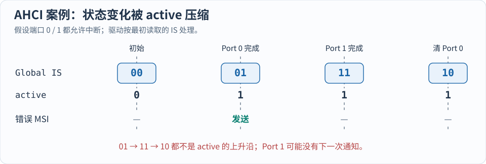

### 9.2 单端口反例：清除后又被置位

INTx 下，AHCI 的线电平是“GHC.IE 为 1 且 IS 非零”（《全模拟磁盘 P2：命令的生命周期与中断》第三节）。MSI 是边沿语义，一个自然的想法是：电平从 0 变 1 的时候发一条消息。用 INTx 时，驱动处理完把 IS 清零，线就落下去，下次再升起来就再发一条，看起来完全对得上。

这个想法有一个漏洞。回忆 Linux 的中断处理顺序（`ahci_single_level_irq_intr`）：

```
读 IS
  对每个置位的端口：读 PxIS，写 PxIS 清零，读 PxCI/PxSACT 完成命令
写 IS 清零
```

更精确地假设在驱动检查并处理完已完成命令之后、写 IS 清零之前，又有一条命令异步完成：

```
时间 →
PxIS     1 ──清── 0 ──完成── 1 ─────────────────── 1
IS bit0  1 ──────────────────── 1 ──写 1 清── 0 → 1（虚拟线还是 1，立刻又置上）
电平     1 ──────────────────────────────────────── 1   ← 从没落下，也就没有上升沿
```

IS 是粘滞的，端口的“虚拟线”（PxIS & PxIE）还是 1，驱动清掉 IS 的那一刻它又被置上了。电平从头到尾都是 1，按“上升沿发”的规则一条消息也不会发。可驱动已经退出了中断处理函数，它以为 IS 清干净了，这次完成就没人管了。INTx 下这不是问题：电平一直高着，guest EOI 后，如果中断线仍然有效，IOAPIC 就可以再次投递。MSI 没有“一直高着”这回事，消息发过就没了。

### 9.3 规范的规则

AHCI 1.3.1 第 10.7.2.1 节规定了 MSI 模式下的发送时机：“any change to the IS register that doesn't result in the register being all cleared shall cause an MSI to be sent”，IS 发生的**每一次变化**，只要结果不是全 0，就发一条消息。图 22 列出了几种情形：IS 从全 0 变成有位置上，发；已经有位置上、又有新位置上，发；软件清掉一部分位、还剩别的位，发；软件清掉全部位，不发。

同一节还有一句：软件只清 IS、没先清 PxIS 时，虚拟线还是 1，IS 那一位会被重新置上。软件清掉、又被重新置上，图 22 没有单列这一行。mini-vmm 把它算作一次变化：IS 确实被软件改过，结果也不是全 0，作者认为符合“任何变化”这条总规则。这是我对规范的读法，规范原文没有逐字这样写。之所以这样读，是因为它正好补上了 9.2 节的漏洞：驱动写 IS 的那一刻，位被清掉又被置上，设备补发一条，驱动收到后再进一次处理函数，把那次完成收掉。如果不这样读，Linux 的清除顺序在命令异步完成时就会丢中断。

### 9.4 实现

`irq_sync` 是 AHCI 每次状态变化后都会调用的函数，INTx 和 MSI 两条路都从这里出去：

```c
static void irq_sync(struct ahci *s, bool sw_change)
{
    uint32_t before = s->is;
    bool active;
    int i;

    for (i = 0; i < AHCI_NR_PORTS; i++)
        if (port_is(&s->port[i]) & s->port[i].ie)
            s->is |= 1u << i;
    active = (s->ghc & AHCI_GHC_IE) && s->is;
    pci_set_irq(&s->pci, active);
    if (active && pci_msi_enabled(&s->pci) && (sw_change || (s->is & ~before)))
        pci_msi_notify(&s->pci);
}
```

“有新位置上”由 `s->is & ~before` 判断。另外两种变化是软件写寄存器造成的，由调用方通过 `sw_change` 告诉它：

```c
    case AHCI_GHC:
        ...
        ie_on = (val & AHCI_GHC_IE) && !(s->ghc & AHCI_GHC_IE);
        s->ghc = val & AHCI_GHC_IE;
        irq_sync(s, ie_on);
        break;
    case AHCI_IS:
        cleared = s->is & val;
        s->is &= ~val;
        irq_sync(s, cleared != 0);
        break;
```

写 IS 时真的清掉了某些位，就算一次软件变化：清掉后如果还剩别的位（第二条），或者被虚拟线重新置上（第三条），`active` 仍为 1，就发一条；全清了，`active` 为 0，不发。写 IS 却没清掉任何位（写 0，或者写的位本来就是 0），IS 没变，不发。

GHC.IE 从 0 变 1 也算一次：图 22 没有单列这一项，但 GHC.IE 是 MSI 和 INTx 共用的总开关，IS 在 GHC.IE 为 0 时照样记录端口事件，打开的那一刻 INTx 线会变为有效，MSI 也应该在这一刻把挂着的事件报出来。重复写 1 不是变化，不发。

`pci_set_irq` 照常调用：MSI 开着时 PCI 层不会把它送上线（6.2 节），但 guest 关掉 MSI 的那一刻，这个电平就是要回到线上的请求。

### 9.5 反直觉的地方：今天的 guest 测不出这个漏洞

为了看看 9.2 节的漏洞在真实 guest 上是什么样子，我按“INTx 电平的上升沿发 MSI”写了一个错误实现：记住上一次的 `active`，只在它从 0 变 1 时发。然后用这个二进制跑两种负载：

| 配置 | 负载 | 结果 |
|---|---|---|
| 单 vCPU | 4 路并发，每路 4096 次 4 KiB 直读 | 16384 次中断，没有超时 |
| 4 vCPU | 同上 | 16384 次中断，没有超时 |

一次中断都没丢。原因要到 Linux 的锁里找。`ahci_single_level_irq_intr` 的整个处理过程，包括最后写 IS，都持着 `host->lock`；而 libata 里每个端口的锁就是这把锁（`libata-core.c` 里 `ap->lock = &host->lock`），发命令的 `ata_qc_issue` 也在它下面。mini-vmm 的命令是同步执行的：完成就发生在发命令的那次 PxCI 或 PxSACT 写里，也就是在发命令的 vCPU 持着 `host->lock` 的时候。中断处理函数持着同一把锁，所以在“清 PxIS”和“写 IS”之间，不可能有别的 vCPU 发出命令，也就不可能有命令完成。

```
vCPU 0（中断处理）                       vCPU 1（发命令）
spin_lock(host->lock)
  写 PxIS 清零                           spin_lock(host->lock) ← 等着
  完成 qc
写 IS 清零
spin_unlock(host->lock)
                                         拿到锁，写 PxCI
                                         命令在这次 MMIO 写里同步完成，IS 0→1，发消息
```

那为什么还要按规范做？因为这个前提迟早会变。块设备的 io_uring 里程碑会把磁盘 I/O 挪到 I/O 线程上，命令完成由 I/O 线程产生，它不持有 guest 的任何锁，完成可以落在中断处理函数的任何两条指令之间。到那时 9.2 节的窗口就真实存在了。真实的 AHCI 硬件也一样，它的命令本来就是异步完成的。

这个漏洞今天在端到端测试里看不见，所以由单元测试来挡住。`ahci_test` 的 `case_msi` 按图 22 一行一行地摆出 IS 的变化，每一步单独数这一步发了几条消息。其中“清掉了但虚拟线仍为 1”这一步专门对应 9.2 节的窗口：

```c
    /* 软件清 IS bit 1，但端口 1 的原因还在：位立刻又置上。驱动清 PxIS
     * 之后、写 IS 之前有命令完成时就是这个情形，只看 INTx 电平上升沿的
     * 实现在这里不发，那次完成的中断就丢了 */
    wr(AHCI_IS, 2);
    CHECK_U64(rd(AHCI_IS), 2, "wire still high: bit set again");
    CHECK_U64(g_msi_sent - mark, 1, "cleared and set again: one message");
```

“上升沿”那个错误实现在这个用例上有三处失败：另一个端口置位、软件部分清除、清后重新置上，三处都漏发。

## 十、验证

**单元测试**

- `pci_bus_test`（257 项检查，19 个用例）新增四个 MSI 用例：capability 的位置、链表、只读位与可写位；MSI Enable 与 INTx 的互斥，包括 Enable 被字节写清掉；发消息时高低地址拼成 64 位、数据只取 16 位、Bus Master 关着不发；非法地址、保留投递模式、异常向量都报原因且不投递，合法边界（向量 0x10 和 0xFE，NMI，地址保留位、RH/DM、电平触发）原样交给 KVM，丢弃日志按 8.1 节的频率出现。irqchip 的 ioctl 换成了桩，格式检查是 `static inline`，单元测试走到的是真实的检查代码。
- `ahci_test`（300 项检查，25 个用例）新增 `case_msi`，按 9.3 节的规则一行一行检查，每一步单独比较消息数的增量，一处出错不会把后面的行一起带红。

判据来自规范而不是被测代码：capability 布局来自 PCI 3.0 第 6.7、6.8.1 节，格式检查来自 SDM 第 13.11 节，发送时机来自 AHCI 第 10.7.2.1 节和图 22。

为了证明这些测试真的能挡住错误，我写了十八种错误实现，每一种都至少让一个测试失败：

| 测试 | 能挡住的错误实现 |
|---|---|
| `ahci_test` | 只看有没有新置位；按 INTx 电平的上升沿发（9.5 节）；每次同步都发；GHC.IE 为 0 也发；重写 GHC.IE = 1 也发；GHC.IE 0→1 不补发；写 IS 不清位也发；不申请 MSI capability |
| `pci_bus_test` | MSI 开着仍驱动 INTx；Bus Master 关着照发；改 Enable 不重算 INTx；不查地址高 32 位；不查 0xFEE 窗口；放行保留投递模式；放行 0x00–0x0F 向量；每次丢弃都记日志；只记第一次丢弃；Enable 不可写 |

**端到端测试**

`make test pci-msi` 一共 7 条：一次启动里依次经过 MSI、INTx、MSI 三个阶段（6.3 节），检查关机正常、中断类型、中断计数增量和读到的内容；另外三次启动各测一种坏配置（8.2 节）。用 MSI 之前的上一版二进制跑，6 条失败，只剩“两次重新绑定后正常关机”通过，因为它走 INTx 本来就能工作。`emu-blk` 的第一次启动加了 `pci=nomsi`，原有的 INTx 用例继续守住 INTx 这条路。

9.5 节说过，“上升沿”这类错误在今天的端到端测试里看不出来，只能靠单元测试挡住。

## 十一、本阶段的实现边界

- **只有单向量。** MMC 固定为 0，AHCI 走 Linux 的单 MSI 模式（所有端口共用一个向量）。多向量 MSI 和 MSI-X 留给后面的里程碑。
- **每条消息都经过用户态。** VMM 调一次 `KVM_SIGNAL_MSI`。irqfd 让 KVM 直接在内核里根据 eventfd 注入，那是后面的事。
- **没有 per-vector mask。** capability 不带 mask 位和 pending 位。
- **e1000 只用 INTx。** 82540EM 的手册里有单向量 MSI capability（8254x 开发手册第 4.1.3 节），但 Linux 的 e1000 驱动从不申请 MSI，`e1000_request_irq` 直接用 `pdev->irq`。给它加上 capability 也没有 guest 驱动会用，验证不了。
- **消息丢了之后不会重发。** 设备模型不会因为一条消息被丢就重发，这符合图 22 的规则：IS 不变就不发。所以一次配置错误会让 guest 一直等到超时。

## 十二、本章回顾与后续路线

现在应该能在不看代码的情况下解释下面这些问题：

1. INTx 为什么需要 IOAPIC，MSI 为什么不需要？一次 PCIe 写事务和普通 RAM 写入有什么区别？
2. 谁决定 APIC ID 和 Vector？Linux IRQ 与 Vector 为什么不是同一个编号？
3. MMC 和 MME 的区别是什么？为什么多向量 MSI 需要连续对齐的 Vector，Linux IRQ 连续又属于什么约束？MSI-X 如何消除这些限制？
4. MSI-X 为什么要有 Pending Bit Array？为什么 pending bit 不是事件计数？
5. 为什么 VMM 不能简单写入 guest RAM 来产生 MSI？`KVM_SIGNAL_MSI` 的语义接口与平台地址解码之间的边界在哪里？
6. 为什么修改 PCI 配置空间也可能要求重新评估 INTx 输出？
7. 为什么 MSI 仍需 EOI，但在特定环境下可以省去 EOI 专用的 VMEXIT？为什么已有 IRR pending 时不能放心地推迟 EOI？

下一步再进入 IRQ Routing、irqfd、ioeventfd 和 VirtIO-PCI。IRQ Routing/irqfd 解决如何预先绑定中断路由，让内核态事件源可以直接触发中断注入；ioeventfd 则是 guest 到设备后端方向的通知机制。两者的实现和 KVM 源码路径留到后续章节，不在本阶段假设已经完成。

## 附录 A：参考

**规范**

- `ref/PCI_Local_Bus_3.0.pdf`：第 6.2.2 节（command 寄存器，Bus Master 与 INTx Disable）、第 6.7 节（capability 链表）、第 6.8.1 节（MSI capability 的布局，脚注 48 关于高 32 位地址）、第 6.8.3.3 节（MSI 打开后不得使用 INTx）、第 6.8.3.4 节（消息是一次 DWORD 写，数据在低 2 字节）
- Intel 64 and IA-32 Architectures Software Developer's Manual，Order Number 325384-093US，第 3 卷第 13.11.1 节（消息地址）、第 13.11.2 节（消息数据，向量范围 010H–0FEH，投递模式编码）
- `ref/serial-ata-ahci-spec-rev1-3-1.pdf`：第 10.7.2.1 节和图 22（MSI 模式下何时发消息）

**Linux 7.4-rc2（guest）**

- `drivers/pci/msi/msi.c`：`msi_capability_init`、`pci_write_msg_msi`、`pci_msi_vec_count`、`pci_intx_for_msi` 的调用位置
- `kernel/irq/msi.c`：`msi_domain_activate`
- `drivers/pci/pci-sysfs.c`：`msi_bus_store`
- `drivers/ata/ahci.c`：`ahci_init_irq`；`drivers/ata/libahci.c`：`ahci_single_level_irq_intr`；`drivers/ata/libata-core.c`：`ap->lock = &host->lock`
- `arch/x86/kernel/apic/io_apic.c`：`ioapic_ack_level`；`arch/x86/kernel/kvm.c`：PV EOI

**Linux 6.6（host KVM）**

- `arch/x86/kvm/irq_comm.c`：`kvm_set_msi_irq`；`arch/x86/kvm/lapic.c`：`kvm_irq_delivery_to_apic`、`apic_sync_pv_eoi_to_guest`
- `Documentation/virt/kvm/api.rst`：第 4.71 节 `KVM_SIGNAL_MSI`

**mini-vmm**

- `include/pci/pci.h`：文件头的 MSI 说明，`pci_msi_enabled`、`pci_msi_notify`
- `src/pci/pci.c`：`msi_setup`、`msi_note_enable`、`pci_msi_notify`、`intx_output`，`pci_cfg_write` 末尾对 MSI 控制字的处理
- `include/devices/irqchip.h`：`irqchip_msi_invalid`；`src/devices/irqchip.c`：`irqchip_signal_msi`
- `include/devices/ahci.h`：文件头的中断说明；`src/devices/ahci.c`：`irq_sync`、`ahci_reg_write` 里 GHC 和 IS 的分支
- `tests/unit/pci_bus_test.c`：`case_msi_cap`、`case_msi_intx`、`case_msi_send`、`case_msi_invalid`；`tests/unit/ahci_test.c`：`case_msi`
- `tests/e2e/pci-msi.sh`

**本次重构补充的 Linux 源码索引**（用于解释机制；不等同于原实验版本逐行核对）

- [`arch/x86/kernel/irq.c`](https://github.com/torvalds/linux/blob/master/arch/x86/kernel/irq.c)：普通外部中断从当前 CPU 的 `vector_irq` 获得描述符。
- [`kernel/irq/msi.c`](https://codebrowser.dev/linux/linux/kernel/irq/msi.c.html)：`msi_domain_get_virq()`、`__msi_domain_alloc_irqs()`，PCI MSI 的索引和成组分配。
- [`kernel/irq/irqdesc.c`](https://kernel.googlesource.com/pub/scm/linux/kernel/git/torvalds/linux/+/refs/heads/master/kernel/irq/irqdesc.c)：`irq_find_free_area()` 与稀疏 IRQ 分配；[Maple Tree 改造提交记录（2023-05-24）](https://lists.openwall.net/linux-kernel/2023/05/24/644)。
- [`arch/x86/kvm/lapic.c`](https://code.googlesource.com/linux/torvalds/linux/+/2656821f1f202d58224551b71eff41aafd1edf8b/arch/x86/kvm/lapic.c)：PV EOI 的进入与退出同步、PPR 更新和 pending 条件。
- MSI-X 结构和屏蔽语义：PCI 3.0 第 6.8.2 节（原文参考规范）。

## 附录 B：延伸阅读

- PCI 3.0 第 6.8.2 节（MSI-X）：表放在 BAR 里，每个向量有自己的地址、数据和 mask 位。对比本篇的 capability，可以看到“每个队列一个向量”需要多出哪些状态，这也是 VirtIO-PCI 设备要用的形式。
- `virt/kvm/eventfd.c` 的 `kvm_irqfd_assign` 和 `irqfd_wakeup`：eventfd 被写时，KVM 在内核里查路由表，直接调 `kvm_set_msi`。对照 7.1 节，可以看到 irqfd 省掉的正是那一次 `KVM_SIGNAL_MSI`。
- `arch/x86/kvm/lapic.c` 的 PV EOI 相关函数（`pv_eoi_set_pending`、`apic_sync_pv_eoi_from_guest`）：7.4 节中解释的那次 EOI exit 是怎样省下来的；开了 APICv 或 AVIC 的机器上，EOI 和 TMR 读本来就不 exit，7.2 节的差距可能变小。
