# 30. 从零入门虚拟化：用 GDB 调试 Guest 内核

> 从断点到一致的暂停点：在 mini-vmm 中实现 gdbstub

前面的章节已经让 mini-vmm 能启动 Linux、处理 PIO/MMIO，并建立完整的中断路径。但 guest 一旦出错，我们只有串口 dmesg、`KVM_EXIT_*` 现场以及 `--trace-pio` / `--trace-mmio` 的访问记录。它们是观察手段，却不能主动冻结现场、检查寄存器，再控制 CPU 走一步。

这一章为 VMM 增加 gdbstub。以 `--gdb 1234` 启动后，普通 GDB 通过 `target remote :1234` 就能从第一条 guest 指令开始调试；按 vmlinux 的符号下断点、单步、读写寄存器和 guest 虚拟地址，每个 vCPU 在 GDB 中对应一个线程。后续 arch-distro 里程碑启动发行版内核时，这也是排查早期启动故障的基础设施。

本章的重点不在于实现另一套调试器，而在于回答一个更一般的虚拟化问题：**VMM 怎样借助 KVM 控制 vCPU 的执行，同时保持 guest 架构状态的一致性，并尽量不破坏其原本的执行语义？**

阅读顺序由硬件机制出发，逐步推进到异常所有权、多核暂停、I/O 指令完成边界，最后再回到 GDB 协议与测试。原始实验环境为 Linux 6.6 host KVM、Linux 7.4-rc2 guest（版本按原文记录）；新增 QEMU 对照固定在 v10.2.0。文中“实验记录”来自原文，“源码对照”来自指定版本的外部代码，“设计推演”是讨论所得的边界条件，尚未运行新的实验。

## 一、调试器为什么可以站在 Guest 外面

### 1.1 GDB、gdbstub 与 KVM 各自负责什么

在普通进程调试中，GDB 借助 `ptrace()` 等内核机制控制被调试进程。在虚拟化中，被调试对象变成了整台机器，负责控制它的则是 host KVM 与 VMM。GDB 本身不需要懂 KVM，更不需要在 guest 内部运行。

另一条路是 KGDB：它依赖 guest 内核自身的串口和异常处理机制。对于内核尚未初始化、串口尚不可用或这些路径本身发生故障的情形，外部 gdbstub 更有优势。外部调试不需要 guest 主动配合，但不意味着 guest 的行为完全不受影响，后面会看到 TF 和 INT3 的反例。

GDB 理解程序：符号、类型、源码、栈回溯；gdbstub 提供机器状态：读写内存、寄存器、断点、运行与停止。gdbstub 是实现 Remote Serial Protocol（RSP）的服务端兼适配层，而不是另一份 GDB。
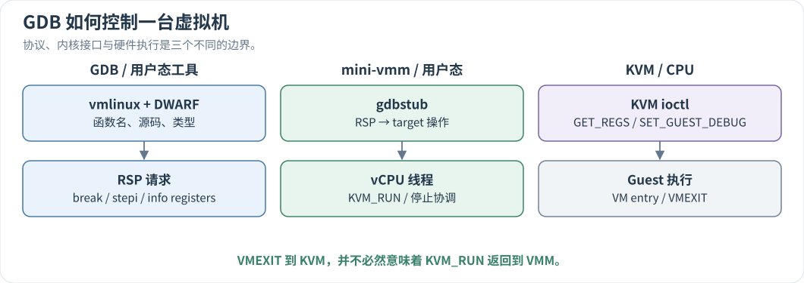

例如 `info registers` 触发 RSP 的 `g` 包，stub 调用 `KVM_GET_REGS` 等 ioctl，将寄存器按协议编码返回。`break kernel_init` 则由 GDB 自己解析符号，VMM 只收到目标地址。早在前几章，我们已经拥有大部分必要原语：`KVM_RUN`、`KVM_GET_REGS`/`SET_REGS`、`gpa_to_hva()`、中断 vCPU 的信号机制。这次只是把它们组织成可交互的控制接口。

### 1.2 为什么还要本地的 vmlinux

guest 中的内核机器码是用于运行的，调试段并不需要随代码一起加载。只要保留启动所需信息，运行映像可以去除调试信息。GDB 加载与该内核构建匹配、包含符号和 DWARF 的 `vmlinux`，才知道一段地址对应的函数、源码行和数据结构成员。例如 `p ((struct task_struct *)ADDR)->pid`，GDB 根据类型信息计算字段偏移，再请求 stub 读取内存。

```sh
gdb vmlinux
```

```gdb
target remote :1234
hbreak start_kernel
continue
```

需要注意 KASLR：如果内核运行时地址与 ELF 链接地址不一致，`break` 和 `hbreak` 都可能瞄准错误的线性地址。最简单的实验配置是在内核命令行加入 `nokaslr`；若已知内核实际重定位偏移，也可以使用 GDB 的 `symbol-file -o OFFSET` 重新加载符号。模块等独立重定位的对象另行处理。关闭 KASLR 是方便调试的做法，不是调试的必要条件。

### 1.3 两种退出，不要混为一谈

`KVM_RUN` 是用户态进入 host KVM 的 ioctl；VM entry 才是真正进入 guest。硬件产生 VMEXIT 后，KVM 可能直接在内核中处理并重新进入 guest，也可能以 `KVM_EXIT_DEBUG`、`KVM_EXIT_IO` 等原因返回用户态。这个区别贯穿后面的断点、暂停和 I/O completion。

## 二、断点是硬件事件，还是对代码的修改？

如果 VMM 只是每次 `KVM_RUN` 返回时读 RIP，并检查是否等于 `start_kernel`，guest 可能已经执行了这个地址甚至执行了数百万条指令。断点必须让硬件在指定条件下主动通知调试器。

### 2.1 硬件断点：DR0–DR7

x86 有四个断点地址寄存器 DR0–DR3。DR6 记录调试异常原因，DR7 决定每个槽是否启用、匹配哪种访问、监视多大的数据范围。具体来说，DR7 中：每个槽 n 的局部使能位 Ln 在 bit 2n，R/Wn 在 bit 16+4n，LENn 在 bit 18+4n；bit 10 是保留位，读出恒为 1。指令断点的 R/W 和 LEN 都是 00。这些取值和 Linux 的 `arch/x86/include/uapi/asm/debugreg.h`（`DR_LOCAL_ENABLE`、`DR_ENABLE_SIZE`、`DR_CONTROL_SHIFT`）以及 KVM 的 `DR7_FIXED_1 = 0x400` 一致。一个槽用在 `start_kernel` 上时，DR7 是 `0x401`。

命中时 KVM 报 exception 1（#DB），并带回 DR6。本例中 KVM 返回的 `dr6 0xffff0ff1` 最低位 B0 为 1，表示槽 0 命中。Linux UAPI 的 `DR6_RESERVED`（`0xffff0ff0`）记录复位时为 1 的位，并不表示这些位都固定为 1：支持 BLD 或 RTM 的 CPU 可分别清除 bit 11 或 bit 16 来报告相应的调试事件。
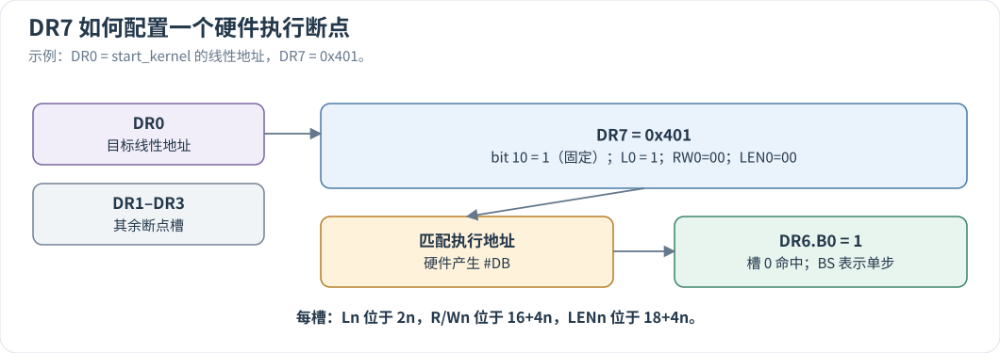

DR7 的 R/W 编码是：

| R/W | 条件 |
|---|---|
| `00` | 指令执行 |
| `01` | 数据写入 |
| `10` | I/O 读写（需要相关硬件支持与配置） |
| `11` | 数据读取或写入 |

数据监视通常支持 1、2、4、8 字节长度（依模式、对齐和硬件约束而定）。x86 没有原生的仅 Read 数据断点，这一设计可追溯到 80386；当时 `10` 尚未定义，后来用于 I/O。没有找到 Intel 对最初取舍的确证，不应把可能的编码空间或工程成本解释当作历史事实。ARM64 的 watchpoint 则提供独立的 Load/Store 控制，说明这不是硬件原理上的必然限制。

GDB 的 `rwatch` 在缺少原生 read-only watchpoint 的某些目标上可借助读写监视与值变化判断近似实现：写入相同值可能被误判为读取。具体行为取决于 GDB/目标能力；若远端不支持硬件 watchpoint，`rwatch`/`awatch` 可能无法设置，而不是保证能够软件降级。普通 `watch` 才可以退回逐指令比较值的昂贵实现。

**设计推演：能否用 EPT 实现 Read Watchpoint？** EPT 权限作用于 GPA 对应的页，最小常用粒度 4 KiB，大页需要拆分。并且 `R=0, W=1` 是非法 EPT 权限组合，因此不能简单关闭 R 而保留 W。需要额外区分访问类型、模拟或控制重执行，且同页其他访问会产生无关 VMEXIT。它不是 DR 字节级监视的直接替代品；NPT 权限语义也不能与 EPT 混为一谈。

### 2.2 软件断点：把原指令变成 INT3

硬件执行断点命中产生 #DB（vector 1，fault 类）；软件断点则把目标指令首字节替换成单字节 `INT3`（`0xCC`），执行后产生 #BP（vector 3，trap 类）。单字节编码允许在正确的指令边界覆盖第一个字节，不需要覆盖邻接指令；但多核并发和代码修改仍需要同步。

| | 软件断点 | 硬件执行断点 |
|---|---|---|
| 匹配条件 | 执行到写入的 INT3 | 线性地址匹配 DR0–DR3 |
| 异常 | #BP | #DB |
| 修改 guest 内存 | 是 | 否 |
| 硬件槽位 | 不消耗 DR 槽 | 共 4 个槽（每个调试上下文） |
| 设置时要求页表映射 | 是（本章实现） | 否 |

注意：异常本身不必导致 VMEXIT。KVM 配置拦截后，硬件把异常交给 host KVM，KVM 决定是否向用户态报告 `KVM_EXIT_DEBUG`；没有拦截则按正常 guest 异常语义处理。

### 2.3 KVM 提供统一的调试控制接口
KVM 的调试功能都经由一个 ioctl：`KVM_SET_GUEST_DEBUG`，参数里的 `control` 是一组标志（`linux/kvm.h`）：

| 标志 | 作用 |
|---|---|
| `KVM_GUESTDBG_ENABLE` | 总开关，其他标志都要它 |
| `KVM_GUESTDBG_USE_SW_BP` | guest 执行 int3 时退出到用户态（`KVM_EXIT_DEBUG`，exception 3），而不是投递给 guest |
| `KVM_GUESTDBG_USE_HW_BP` | 用 `arch.debugreg[0..3]` 和 `debugreg[7]` 作为 guest 的 DR0–DR3、DR7，命中时退出 |
| `KVM_GUESTDBG_SINGLESTEP` | 每执行一条指令退出一次（exception 1，DR6.BS 置位） |
| `KVM_GUESTDBG_BLOCKIRQ` | 单步期间不注入中断 |
| `KVM_GUESTDBG_INJECT_BP` / `INJECT_DB` | 往 vCPU 里排一个 #BP / #DB，下次进 guest 时投递 |

每次放行前，gdbstub 按断点表和这个 vCPU 是否单步，为每个 vCPU 重新算一次控制字：有软件断点就带 `USE_SW_BP`，有硬件断点就带 `USE_HW_BP` 和 DR 值，单步就带 `SINGLESTEP`（KVM 支持时再加 `BLOCKIRQ`）。所有组合都带 `ENABLE`：没有总开关，其余位都不生效。
这里的 `SINGLESTEP` 应理解为请求单步，而不是无条件保证下一条普通指令执行完成；同步异常、阻塞和其他退出都可能改变观察结果。

### 2.4 为什么早期启动只能用 hbreak

DR0–DR3 保存的是**线性地址**。在 x86-64 Linux 的通常平坦地址空间中，即 GVA，而不是 GPA 或 HPA。硬件执行断点只是记住未来要匹配的地址，配置时无需访问该地址。软件断点却必须立即定位对应代码字节。
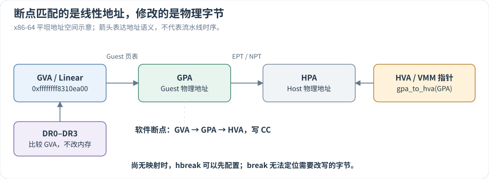
用户在入口处敲 `hbreak start_kernel` 时，gdb 先读一下这个地址：

```
[remote] Sending packet: $mffffffff8310ea00,1#ec
[remote] Packet received: E0e
Hardware assisted breakpoint 1 at 0xffffffff8310ea00: file init/main.c, line 871.
```

读失败了。此刻 guest 用的是 VMM 建的页表，只有低 1 GiB 的恒等映射（`page tables @ PML4=0x2000 ... identity map 1024 MiB`），内核还没建好 `0xffffffff8...` 的映射，`KVM_TRANSLATE` 翻译不了这个地址。软件断点要写内存，同样翻译不了，`break start_kernel` 会让 gdb 报 `Cannot insert breakpoint`。硬件断点比较的是线性地址，不需要翻译，所以能用。等内核切到自己的页表之后（比如停在 `start_kernel` 时），`break kernel_init` 就能正常插入了，原文实验的包序列里它读到了 `f3`（`endbr64` 的第一个字节）。
### 2.5 地址别名与断点的共享范围

两个 GVA（0x1000 和 0x2000）如果映射到同一个 GPA 0x3000，`break *0x1000` 实际改的是共享物理字节。从 0x2000 执行同样会执行 INT3。`hbreak *0x1000` 只设置线性地址比较条件，从 0x2000 执行则不匹配。
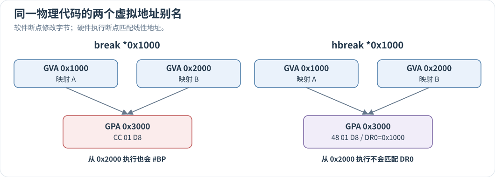

因此软件断点跟着代码走，硬件断点跟着 CPU 调试上下文走。后者不是设置者进程天然独占：DR 本身没有 CR3 或进程 ID 匹配，guest 操作系统需在任务切换时管理调试上下文；VMM 也可以对所有 vCPU 安装相同的 DR 配置。对地址别名的 #BP，本章按 PC 查表可能无法识别另一个 GVA 上的 INT3。这是设计推演，并非已经复现的缺陷。

### 2.6 怎样跨过软件断点而不丢掉它

命中断点后，如果 RIP 还在断点地址且内存仍是 CC，直接 continue 就可能再次命中。典型做法是撤销该断点、执行一次原始指令、重新插入断点。原地单步时要控制其他 vCPU，避免它们趁断点临时撤销而执行目标代码。
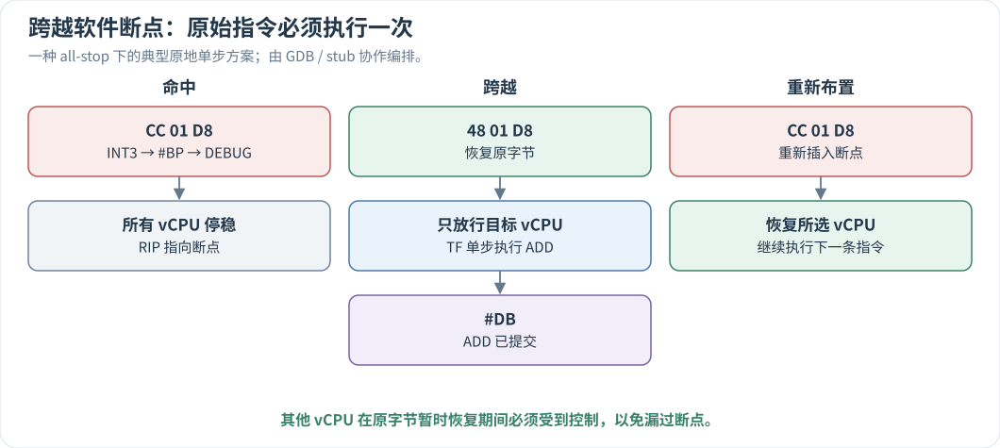

讨论中曾提出另一种办法：不撤销 CC，而是根据保存的首字节与后续指令字节重构并模拟原指令，再推进 RIP。比如 `48 01 d8`（`add rax, rbx`）应更新 RAX、RFLAGS，并前进 3 字节。KVM 的 `arch/x86/kvm/emulate.c` 的确支持 ADD 等普通指令，因为 MMIO 指令可能包含普通算术操作。但 KVM 没有通用 ioctl 供 VMM 任意提交指令字节要求执行；自己模拟还要处理访存、异常、原子性、特权检查与控制流等语义。直接让 CPU 执行原指令更简单。

GDB 另有 displaced stepping（移位单步）机制：把原指令复制到其他地址执行，再修正状态，避免原断点临时移除；RIP-relative 寻址、控制转移等又引入额外复杂性。这里仅作为设计对照，不表示 mini-vmm 已实现它。mini-vmm 将断点跨越的编排主要交给 GDB，stub 提供插入、撤销和单步原语。

## 三、单步与异常归属：不要把调试器状态混进 Guest

### 3.1 RFLAGS.TF 与硬件单步

x86 RFLAGS 的 bit 8 为 Trap Flag（TF）。通常指令开始时 TF 已置位，执行结束后便产生 #DB；该条指令即使清除 TF，也不意味着它一定不会触发单步。MOV SS、异常等特殊情形有额外规则。

`stepi` 让 GDB 发 `vCont;s:1`，VMM 给 vCPU 0 设置 `KVM_GUESTDBG_SINGLESTEP`。本章日志中 `pc 0xffffffff8310ea04 dr6 0xffff4ff0` 表示 RIP 前进 4 字节，恰是 `start_kernel` 第一条 `endbr64` 的长度；DR6 的 0x4000 为 BS（`DR_STEP`）。

一个真正微妙的问题是：如果 KVM 为单步设置了 TF，而 guest 下一条指令恰好是 `pushfq`，那么即使之后马上退出，写入栈中的值也可能已经包含额外的 TF。

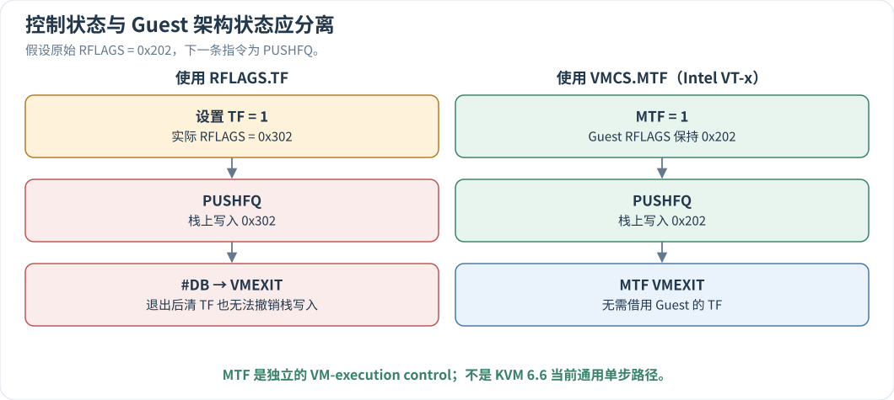

假设原始 RFLAGS 为 0x202，调试器为了单步使硬件 RFLAGS 变成 0x302。若 `pushfq` 直接执行，栈会留下 0x302，事后清 TF 并不能撤销已经写入的内存。这里不需要 guest 主动检测调试器，正常程序就可能受影响。

**源码对照（[Linux v6.6 x86.c](https://github.com/torvalds/linux/blob/v6.6/arch/x86/kvm/x86.c)）：** `__kvm_set_rflags()` 在单步相关条件下设置 TF；`kvm_get_rflags()` 对调试器使用的 TF 做屏蔽。这样可以控制经 KVM 软件接口读取的 RFLAGS，却不能保证所有直接执行的硬件指令都看不到它。`kvm_vcpu_do_singlestep()` 也负责软件模拟路径中的单步处理。

从硬件设计出发，更理想的方案是增加独立于 guest RFLAGS 的单步控制。Intel VT-x 的 Monitor Trap Flag（MTF）正是这种机制：VMCS 中的控制位使处理器在相应执行边界产生 MTF VMEXIT，无须改 guest TF。MTF 并不是自动清除的一次性位，也不保证在所有异常/中断情形下恰好退休一条指令。2021 年 KVM 邮件讨论中，开发者已经提出 VMX 使用 MTF，并指出 AMD SVM 缺少对应机制（见附录链接）。本章使用的 6.6 host 仍沿 TF 路径理解，不推断更新版本的全部实现。

### 3.2 为什么单步还需要 BLOCKIRQ

假设当前 RIP 指向 `add rax, rbx`，之后是 `mov rcx, rax`。LAPIC 的 IRR 中已有满足 IF、优先级等条件的 pending 定时器中断。直觉上单步 ADD 之后应到 MOV，但 KVM 可以在 VM entry **之前**处理待注入事件，所以中断处理函数可能先于 ADD 执行。
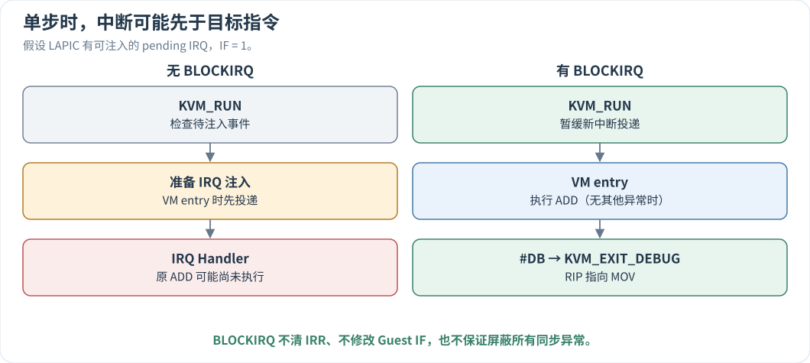

Linux 6.6 的 `vcpu_enter_guest()` 会检查事件并安排注入，`kvm_check_and_inject_events()` 在新的中断投递路径检查 `KVM_GUESTDBG_BLOCKIRQ`；它还通过 APICv inhibit 避免绕过软件控制。BLOCKIRQ 不清除 IRR，不修改 guest IF，也不能保证消除所有同步异常或已经排队的事件影响。

该标志在 Linux 5.16 引入，旧 host 会收到 VMM 警告。HLT 中的 vCPU 仍可能需要等待挂起中断唤醒：原文实验条件下，对停在 idle `hlt` 的 vCPU 单步要等下一次中断。中断/异常投递本身还可能保存带 TF 的 RFLAGS，因此 BLOCKIRQ 与上一节的状态泄漏问题相关，却不能彻底解决它。

### 3.3 Guest 自己也会执行 INT3：异常不能被调试器吞掉

拦截一种异常并不意味着调试器拥有这种异常。Linux 的 kprobes、动态代码修改等路径也会使用 INT3。mini-vmm 要先判定事件归属，再决定是暂停整台 VM，还是继续 guest。

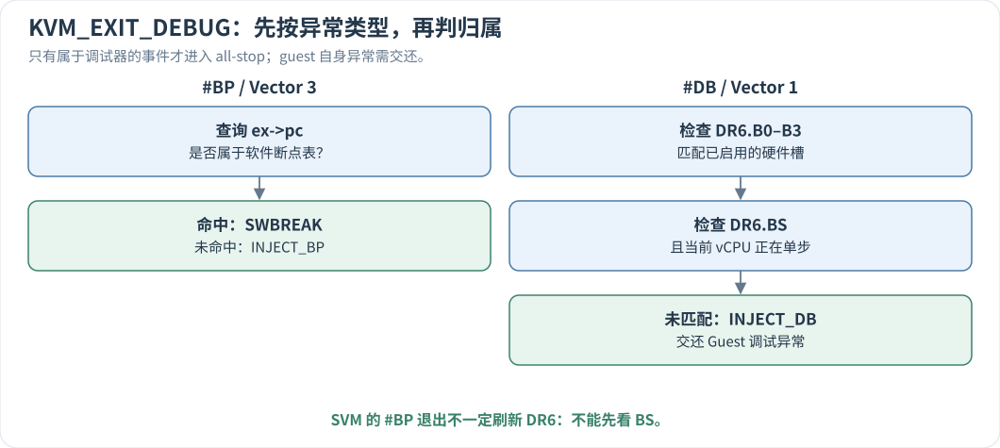
打开 `USE_SW_BP` 之后，guest 执行的**每一条** int3 都会退出到 VMM，包括 guest 自己的。Linux 就有：启动时 `int3_selftest()`（`arch/x86/kernel/alternative.c`）故意执行一条 int3，它注册的 die notifier 检查 `regs->ip - 1` 是不是 `int3_selftest_ip`，是的话模拟一次函数调用把 `val` 置 1，之后 `BUG_ON(val != 1)`。运行中 `text_poke_bp()` 改代码时也会临时插 int3。

所以每次 `KVM_EXIT_DEBUG` 都要先归类：

```c
/* src/gdb/x86.c gdb_x86_classify() */
if (ex->exception == GDB_X86_BP_VECTOR)
    return gdb_x86_sw_find(b, ex->pc) >= 0 ? GDB_X86_EV_SWBREAK
                                           : GDB_X86_EV_REINJECT_BP;
for (i = 0; i < GDB_X86_NR_HW_BP; i++)
    if (b->hw_used[i] && (ex->dr6 & (1u << i)))
        return GDB_X86_EV_HWBREAK;
if (stepping && (ex->dr6 & GDB_X86_DR6_BS))
    return GDB_X86_EV_STEP;
return GDB_X86_EV_REINJECT_DB;
```

本实现把 pc 不在断点表里的 #BP 归类为 guest 自己的。这时 VMM 重设一次 guest debug，带上 `KVM_GUESTDBG_INJECT_BP`，KVM 把 #BP 排进这个 vCPU，然后照常回到 `KVM_RUN`，不停 VM、不告诉 gdb。KVM 投递 #BP 时把它当作软件异常（`kvm_exception_is_soft()`），rip 会被推到 int3 之后（SVM 的 `svm_update_soft_interrupt_rip()`，VMX 用退出时记下的指令长度），guest 的处理函数看到的 `regs->ip` 和没有调试器时一样，`int3_selftest` 的检查才能通过。

这次实际跑的日志里能看到它：

```
gdbstub: vCPU 0 debug exit: exception 3 pc 0xffffffff8311df51 dr6 0xffff4ff0 -> guest int3
gdbstub: vCPU 0 debug exit: exception 3 pc 0xffffffff81fda840 dr6 0xffff4ff0 -> software breakpoint
...
gdbstub: passed 1 guest #BP and 0 guest #DB back to the guest
```

`0xffffffff8311df51` 在 `nm vmlinux` 里正是 `int3_selftest_ip`。第二行才是 gdb 下的 `kernel_init` 断点。

这一步能不能省？把“不在表里的 #BP”也当作 gdb 的断点报上去，重跑端到端测试：gdb 停在一个它不认识的地址上，`break kernel_init` 的检查失败；guest 的 #BP 处理函数从没被调用，`val` 保持 0，随后串口上出现 `kernel BUG`，RIP 是 `int3_selftest_ip+0x33`（`BUG_ON` 的 `ud2`），接着 `Kernel panic - not syncing: Attempted to kill the idle task!`。

#DB 同理：DR6 里的 Bn 对应的槽不是 gdb 设的，或者单步期间来的 #DB 没有 BS 位，都是 guest 自己的，用 `INJECT_DB` 交还。

还有一个细节藏在上面两行日志的 `dr6` 里：它们是 #BP 退出，DR6 却带着 BS 位 0x4000。SVM 的 `bp_interception()` 只填 `debug.arch.pc` 和 `exception`，不写 `dr6`，`kvm_run` 里这个字段留着上一次 #DB 退出（那次 `stepi`）的值。所以归类必须先看 `exception`，只有 #DB 才去看 DR6，否则一个 #BP 会被误认成单步。
这里“pc 不在断点表中就是 guest 自己的”是本章的分类规则，并非硬件提供的严格所有权证明。它假定软件断点的地址和字节没有被 guest 自己的操作混淆。下一节会讨论这一假设的边界。对于 #DB 同样应认识到匹配 DR 槽和 BS 是本实现的归类规则，并不是对所有重叠调试事件的完备证明。

**QEMU 源码对照（[v10.2.0 / x86 KVM](https://github.com/qemu/qemu/blob/v10.2.0/target/i386/kvm/kvm.c)）：** `target/i386/kvm/kvm.c:kvm_handle_debug()` 也通过 `kvm_find_sw_breakpoint(cs, arch_info->pc)` 识别软件断点；不能归属于调试器的异常使用 `kvm_queue_exception()` 排回 guest。成熟 VMM 也需要区分异常的所有权，不能仅因 VMEXIT 就吞掉事件。

## 四、软件断点的生命周期：地址不等于对象身份

### 4.1 为什么同时保存 GVA、GPA 和原始字节

插入断点时，GDB 提供 GVA。mini-vmm 用 `KVM_TRANSLATE` 按选中 vCPU 的当前地址空间获得 GPA，再用 `gpa_to_hva()` 取得 host 指针。保存 GVA 用于命中归类，保存 GPA 用于撤销，保存原字节用来恢复代码。

假设进程 A 的 GVA 0x1000 映射到 GPA 0x3000，此时插入 CC；后来 CR3 切换到进程 B，同一 GVA 映射到 GPA 0x5000。如果撤销时重新翻译 GVA，就可能将 A 的原指令写到 B 的页面，原断点仍留在 0x3000。故原文规定撤销使用保存的 GPA，而不是重新翻译。

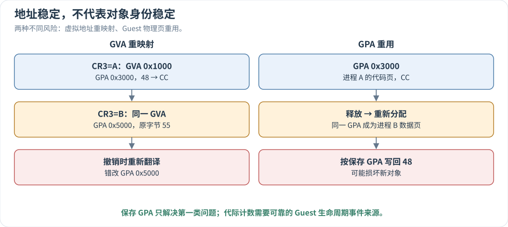

### 4.2 保存 GPA 能否保证撤销安全？

不能。GPA 是 guest 的物理地址，不是 guest 分配对象的身份。如果 guest 释放了 GPA 0x3000 对应的页，随后把同一页分配给别的进程或数据对象，原断点表中的 GPA 仍然相同，但页面的语义已变化。这时恢复旧字节可能破坏新对象。即使尚未重新分配，也不能认为 host 写入必然无害，因为分配器可能使用该内存。

另一种风险是 guest 自己修改断点位置：GDB 写入 CC，guest 后来写入新的代码甚至自己的 CC。此时仅检查 PC 与当前字节，无法证明这个 CC 属于谁；撤销时恢复旧字节也可能覆盖 guest 的修改。

讨论中提出代际计数器（generation counter）：保存断点时记录页的 generation，每次释放或重分配增加计数。这在拥有可靠生命周期事件的系统里是可行的身份验证方法，但 guest 的 `alloc_pages()`、`__free_pages()` 不会天然通知 VMM。host pin 住 backing memory 也不能防止 guest 内部重新分配 GPA。除非建立可信的 guest 协作或虚拟机内省（VMI）追踪机制，否则单独增加计数字段解决不了问题。这是典型的 semantic gap：外部能观察字节和页表，却不天然知道 guest 对象的所有权。

**设计推演，尚未复现：** 上述反例针对用户空间映射、动态内核代码或可回收内存；本章主要调试稳定的内核 text，不能据此断言现实中的 QEMU 或 mini-vmm 已存在可触发 bug。要验证，应构造可控的页表切换、同 GPA 重用或动态代码修改实验，记录 CR3、GVA、GPA、当前字节和 saved_byte，再比较撤销前后的物理内容。

### 4.3 QEMU 如何撤销断点

[QEMU v10.2.0 的 `struct kvm_sw_breakpoint`](https://github.com/qemu/qemu/blob/v10.2.0/include/system/kvm.h) 保存 `pc`、`saved_insn` 和 `use_count`；后者是断点自身的使用计数，并非 guest 物理页引用计数。`kvm_arch_remove_sw_breakpoint()` 以 `cpu_memory_rw_debug()` 读取当前 PC 对应的内存字节：读失败返回错误，当前不是 CC 则不写回，仍是 CC 才恢复原始字节。它在这条路径上没有保存原始 GPA，也没有 guest 页代际信息。

| 防护 | mini-vmm（原文） | QEMU v10.2.0（x86/KVM） |
|---|---|---|
| 记录原 GVA/PC 与字节 | 是 | 是 |
| 记录插入时 GPA | 是 | 否 |
| 撤销前验证仍为 CC | 原文未说明 | 是 |
| 追踪 guest 物理页生命周期 | 原文未实现 | 该路径未见 |
| 识别 guest 在同地址写入的 CC | 无完备机制 | 无完备机制 |

二者防御的是不同风险。QEMU 的检查避免覆盖一个已经被改成非 CC 的字节，却仍可能遇到地址重映射及 ABA 问题。这里是指定版本、指定后端的源码对照，不是对所有 accelerator 的结论。

### 4.4 调试透明性：读内存为何不应该露出 CC

调试是一种机制；理想情况下，用户看到的应当是原始程序的指令，而不是调试器注入的实现细节。如果真实内存是 `cc 01 d8`，原指令是 `48 01 d8`，mini-vmm 在 GDB 读内存时返回保存的 48；GDB 写入断点位置时则更新 saved_byte，实际内存仍保留 CC。它提供的是一层逻辑内存视图，而不是所有访问者都不可见的真实内存修改。

GDB 默认 `set breakpoint always-inserted off`：每次恢复前发送 `Z0` 插入，停止后发送 `z0` 撤销。因此多数时候用户读内存时断点已经撤销；上述隐藏与影子写主要服务 `always-inserted on`。QEMU v10.2.0 的 `gdbstub/gdbstub.c:handle_read_mem()` 读取 target debug memory 后直接编码返回，在该路径没有 mini-vmm 的 shadow-byte 处理；若断点仍在，原始读取可能返回 CC。`handle_write_mem()` 同样直接将解码后的数据交给 target debug memory 接口，没有此处描述的影子写步骤。GDB 自身是否进一步隐藏取决于断点管理路径，不能一概保证。

透明性可以分为三层：观察透明（用户看到原指令）、状态透明（退出调试不留下 CC 等状态）、行为透明（程序原本的行为尽可能不受影响）。最后一层最难，因为 TF 泄漏、暂缓中断、全局暂停都会改变运行时序，甚至让原有 race condition 消失。

## 五、暂停整台虚拟机：请求、确认与一致性

断点解决的是单个 vCPU 如何产生停止事件，但调试器必须面对整台 VM。假设 vCPU 0 命中断点时，其他 vCPU 正运行，甚至还在更新共享内存。只让 vCPU 0 停下无法得到稳定的全局 CPU 现场。

### 5.1 run 与 parked 是两种状态，不是重复变量

gdbstub 用一把锁和一个条件变量管理每个 vCPU 的两个布尔量：

```
run[i]     gdb 允许 vCPU i 运行
parked[i]  vCPU i 的线程此刻正停在 gdbstub 的条件变量上
```

外加 `stopping`（一次停止已经发起、还没报告给 gdb）和 `event`（这次要报告的事件）。不变式是：**gdbstub 只有在所有 vCPU 都 parked（或已经在退出）时，才去读写 vCPU 状态、guest 内存和断点表**。
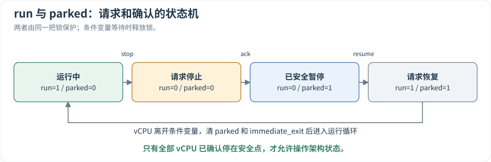

| run | parked | 含义 |
|---|---|---|
| 1 | 0 | 允许运行，尚未暂停 |
| 0 | 0 | 已请求暂停，但未到安全点 |
| 0 | 1 | 已确认暂停 |
| 1 | 1 | 已允许恢复，线程尚未离开暂停点 |

`run[i]` 由控制方表达持续的运行意图，`parked[i]` 由 vCPU 在线程到达安全点后确认事实。条件变量等待释放 mutex，被唤醒后重新取得 mutex、再次检查条件。下面是概念伪代码（省略 shutdown 等处理）：

```c
/* vCPU：仅在安全退出点调用 */
pthread_mutex_lock(&g->lock);
if (!g->run[i]) {
    g->parked[i] = true;
    pthread_cond_broadcast(&g->cond);
    while (!g->run[i])
        pthread_cond_wait(&g->cond, &g->lock);
    g->parked[i] = false;
}
pthread_mutex_unlock(&g->lock);
```

控制方必须等待所有 vCPU 确认，而不是看到 `run=false` 就开始访问寄存器。这个不变量保证 vCPU 不再修改相关状态；对于带异步设备或 DMA 的更完整 VMM，还需要单独考虑其他内存写入者，不应把 vCPU 全停等同于所有设备均冻结。

### 5.2 为什么同时需要 immediate_exit 与信号

发起一次停止（gdb 发 Ctrl-C，或者某个 vCPU 撞上断点）时，对每个还在跑的 vCPU 做三件事：

```c
g->run[i] = false;
__atomic_store_n(&v->run->immediate_exit, 1, __ATOMIC_SEQ_CST);
pthread_kill(v->thread, SIGUSR1);
```

`immediate_exit` 是 `struct kvm_run` 里的一个字段，置 1 之后，下一次 `KVM_RUN` 一进去就返回 `EINTR`，不进 guest。但它只在进入时检查，对一个已经在 guest 里跑的 vCPU 不起作用；这时要靠信号把它踢出来，KVM 发现有挂起的信号，同样返回 `EINTR`。两者合起来覆盖了所有时刻：还没进 `KVM_RUN` 的被 `immediate_exit` 挡住，已经在里面的被信号踢出来。这和 VMM 关机时 `vm_request_stop()` 用的是同一个办法。

信号能不能省？第一次停止通常是 `hbreak start_kernel`：vCPU 0 撞上断点，vCPU 1 这时是一个还没收到 SIPI 的 AP。等 SIPI 的 AP 阻塞在 `KVM_RUN` 内部，guest 一条指令都没执行，也就永远不会有一次 exit 让它回到用户态看 `immediate_exit`。把 `pthread_kill` 去掉之后重跑端到端测试，gdb 连上、列出两个线程之后就停住了，第一次停止永远等不齐，120 秒后超时。
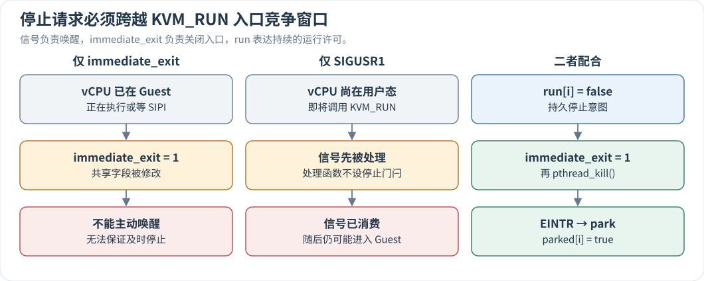

如果只发 SIGUSR1，并且信号处理函数不设置停止门闩，信号可能在 vCPU 进入 KVM_RUN 之前就被消费，随后 vCPU 仍会进入 guest。`immediate_exit` 持久地关闭入口，信号把已经进入 KVM_RUN 的线程踢出来，`run[i]` 则决定退出后是不是应该睡在条件变量上而非循环重新进入。信号和共享字段都不能替代运行许可与确认机制。

这里的 AP 等待 SIPI 是一个重要的反例：不是只有计算密集型 guest 才会迟迟不退出；等待启动的 vCPU 甚至还没有执行一条 guest 指令。原文去除信号的反向实验确实在该环境中超时，而非理论猜想。

### 5.3 VMEXIT 不一定是指令完成边界

vCPU 线程只在 `KVM_RUN` 返回 EINTR 后，以及调试事件处理点进入 parked 状态，不能在处理完普通 `KVM_EXIT_IO` 或 `KVM_EXIT_MMIO` 后直接宣告停稳。原因是 I/O 指令的模拟分成内核与用户态两个阶段。

例：`0x1000: in al, dx`（单字节编码 EC），下一条是 `0x1001: mov bl, al`。设备返回 0x42。第一次退出到 VMM 后，设备读操作可能已发生，甚至包含 read-to-clear 副作用，但在本例 fast PIO 路径中 AL、RIP 仍尚未更新。此时让 GDB 读写寄存器会暴露中间状态；并不是 KVM 会忘记这次 I/O 或必然重复执行，而是 VMM 不能把尚未完成的指令作为一致的调试边界。

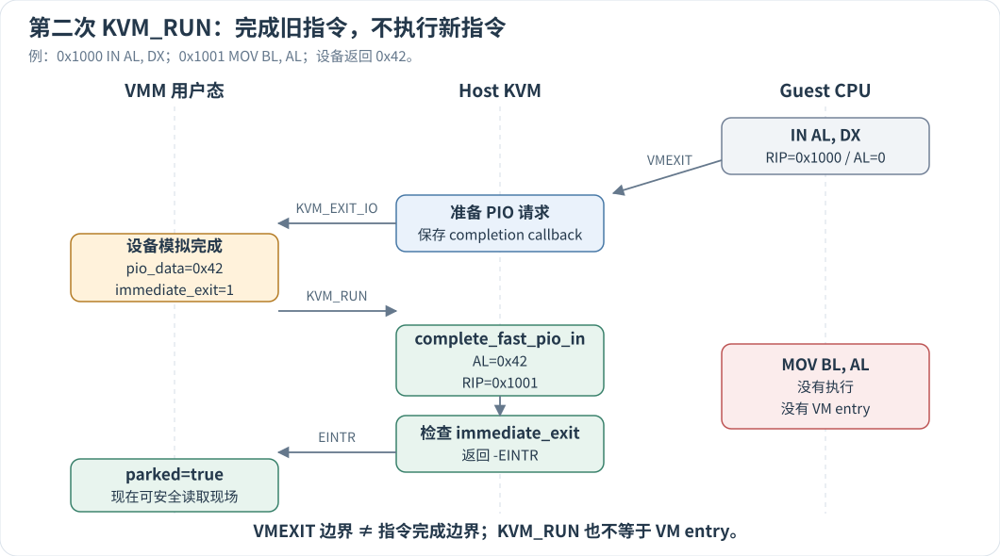

KVM API 对这类用户态 I/O exit 明确说明：操作完成、guest 状态一致需要重新进入 KVM_RUN；通过 `immediate_exit=1` 或待处理信号，可以在不再执行 guest 指令的情况下完成挂起工作。这里不是 `stepi`，下一条 MOV 不会执行，甚至不会发生 VM entry。复杂 MMIO 等操作可能再次返回用户态要求处理后续片段，VMM 应继续按 exit 协议完成，直到安全边界，而不是假设任意 completion 一次必然成功。

原文暂停点：

```c
/* src/vm.c vcpu_run_loop(): KVM_RUN 返回 EINTR 之后 */
if (vcpu->vm->gdb)
    gdbstub_vcpu_interrupted(vcpu);
continue;
```

### 5.4 深入 Linux 6.6：complete_userspace_io 是续延回调

它确实存在，定义在 `arch/x86/include/asm/kvm_host.h` 的 `struct kvm_vcpu_arch` 中：

```c
int (*complete_userspace_io)(struct kvm_vcpu *vcpu);
```

`arch/x86/kvm/x86.c:kvm_arch_vcpu_ioctl_run()` 的关键顺序（以下为依据源码重写的精简伪代码）：

```c
if (vcpu->arch.complete_userspace_io) {
    int (*complete)(struct kvm_vcpu *) = vcpu->arch.complete_userspace_io;
    vcpu->arch.complete_userspace_io = NULL;
    r = complete(vcpu);
    if (r <= 0)
        goto out;
}
if (kvm_run->immediate_exit) {
    r = -EINTR;
    goto out;
}
/* ... kvm_x86_vcpu_pre_run ... */
r = vcpu_run(vcpu);
```

先消费 completion callback，再检查 immediate_exit。回调可以重新注册后续阶段；返回值若要求退出则先返回。源码位置见附录 Linux v6.6 链接（10516–10536，按浏览版本行号可能变化）。

以 AMD SVM 上非字符串 `IN AL, DX` 走 fast PIO 路径为例：

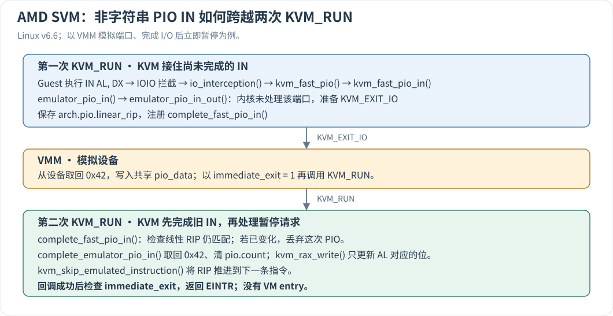

相关状态包括 `arch.pio.port/size/count/linear_rip`、`arch.pio_data` 与 `arch.complete_userspace_io`。`complete_fast_pio_in()` 要求 count 为 1；若线性 RIP 已改变，丢弃待完成 PIO；否则按访问宽度合并或零扩展结果。对于 AL，假设 RAX 原为 0x12345678，返回 0x42 后成为 0x12345642。对于 EAX 宽度访问则零扩展，而非保留高 32 位。最后调用 `kvm_skip_emulated_instruction()`，本例 RIP 增加 1（`IN AL, DX` 是一字节指令）。

从软件设计看，这是 continuation：内核在 I/O 指令执行到一半时保存必要上下文和后续回调，把设备语义交给用户态，返回后再完成 CPU 架构状态。它不要求每次都经过完整的通用 x86 指令模拟器。该设计对调试、快照和热迁移都有意义：**必须先收敛到一致的执行边界，再保存或修改状态。**

### 5.5 一次实际的多 vCPU 停止

下面是 VMM 自己的调试日志（`-v -v`），对应 `hbreak start_kernel`、`continue`、`stepi` 三步：

```
gdbstub: insert hardware breakpoint at 0xffffffff8310ea00: ok
gdbstub: vCPU 0 debug exit: exception 1 pc 0xffffffff8310ea00 dr6 0xffff0ff1 -> hardware breakpoint
gdbstub: all vCPUs stopped, reporting stop on vCPU 0
gdbstub: vCPU 0 debug exit: exception 1 pc 0xffffffff8310ea04 dr6 0xffff4ff0 -> single step
gdbstub: all vCPUs stopped, reporting stop on vCPU 0
```

展开第二、三行之间发生的事：

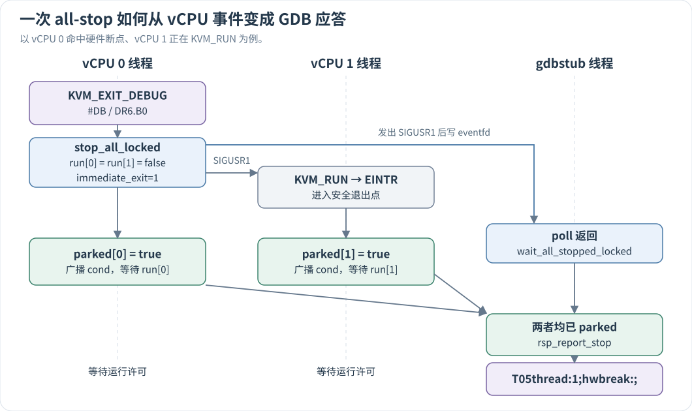

gdb 收到停止应答之后发 `g`、`m` 读现场，这些都在 gdbstub 线程上执行。它能直接对 vCPU 的 fd 发 `KVM_GET_REGS`：api.rst 说 vCPU ioctl 可以从别的线程发，代价只是性能；而且 parked 的 vCPU 线程不在 `KVM_RUN` 里，KVM 内部的 `vcpu->mutex` 是空闲的，ioctl 不会卡住。

gdb 发 `vCont` 时，gdbstub 先给每个 vCPU 设好 guest debug（第二、三节），再把 `vCont` 里点到的 vCPU 的 `run[i]` 置回 true 并广播。被放行的 vCPU 自己把 `immediate_exit` 清零，回到 `KVM_RUN`。只有被放行的一方才清这个字段：VM 要关机时 `immediate_exit` 必须保持为 1，否则一个刚被唤醒的 vCPU 可能再进一次 guest。
**QEMU 对照：** `system/cpus.c:pause_all_vcpus()` 同样发出暂停请求，等待 `cpu->stopped`，并停止虚拟时钟；其 `stop/stopped` 对应 mini-vmm 的运行意图/确认。`accel/kvm/kvm-all.c` 中 `exit_request` 触发 `kvm_cpu_kick_self()`，但仍会调用 `KVM_RUN`，源码注释明确解释这是为完成上次 I/O 指令模拟。支持 immediate_exit 时 self-kick 写共享字段，否则使用信号路径。`kvm_init_cpu_signals()` 安装 `SIG_IPI` 处理函数 `kvm_ipi_signal()`，支持 immediate_exit 的路径由目标 vCPU 的信号处理函数调用 `kvm_cpu_kick()` 写该字段；这与 mini-vmm 由请求线程先写字段再发信号的组织方式不同。可见这里不是 mini-vmm 特有的技巧，而是 KVM API 本身的要求。

### 5.6 All-stop 与选择性恢复是不同维度


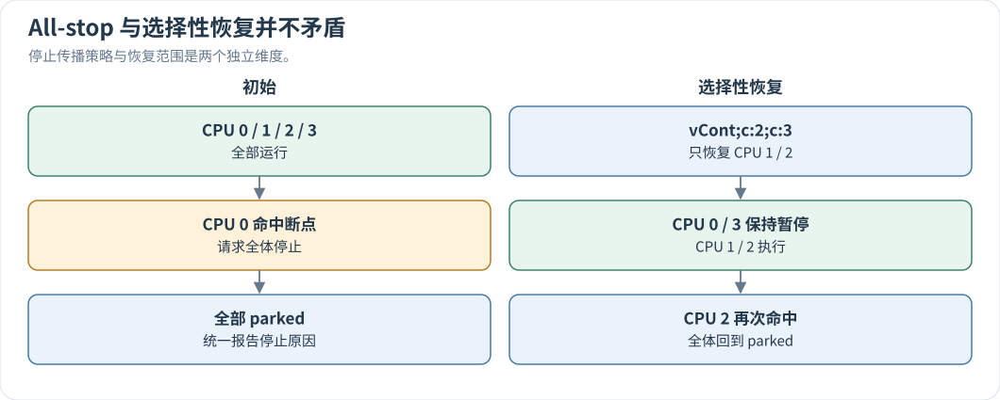

mini-vmm 只实现 all-stop：一个 vCPU 停止，所有 vCPU 停稳后才报告停止事件。原文担心 non-stop 下暂停线程持有 guest 自旋锁，其余线程只能自旋；但这不是 non-stop 没有价值的证明。研究并发 bug 时，恰好希望持锁 CPU 停止、另一个 CPU 运行并观察行为。

合理的折中是原实现已经支持的 all-stop + selective resume：停止时获得稳定现场，恢复时选择部分 vCPU。完整 non-stop 还需要异步事件报告和各线程独立状态管理，本里程碑不增加这项复杂度。`vCont` 的具体协议见第七节。

### 5.7 多个停止事件竞争，是否可以丢弃？

原实现以全局 `stopping` 和 `event` 记录每轮停止；先到者发起停止并记录事件，后来者只 park，不再报告。下面三种情况并不完全等价：

| 事件 | 当前指令状态 | 丢弃后能否重现 |
|---|---|---|
| 硬件执行断点 #DB | 目标指令尚未执行 | 若断点仍启用且未受抑制，可能再次命中 |
| 软件断点 #BP | 本章拦截路径中 RIP 仍指向 INT3 | 若 INT3 仍存在并被拦截，可能再次命中 |
| 单步 #DB | 原指令已产生执行效果 | 不能重现同一次单步；再次单步将执行后续指令 |

普通 #BP 投递给 guest 时，其保存的 RIP 指向 INT3 之后；KVM 拦截路径不应直接用 trap 的定义推断 RIP。本章原文记录的是退出 RIP 指向 INT3 的具体场景。

因此“丢弃不会漏”的准确含义是本实现每轮只承诺报告一个停止原因，并允许未报告的断点在满足条件时重新触发；同时完成的单步由后续命令重新编排。它并不是无损的事件队列。若未来实现数据 watchpoint 或要求逐一报告事件，就必须重新审视这个设计。

## 六、连接、暂停、恢复与异常退出的完整生命周期

`--gdb` 的 guest 从第一条指令起就停着。做法是在创建 vCPU 线程之前，把所有 vCPU 的 `run[i]` 置 false、`immediate_exit` 置 1：每个 vCPU 第一次进 `KVM_RUN` 就拿到 `EINTR`，停在 gdbstub 里。gdb 连上时整台 VM 已经停稳，`?` 的应答就是 `T05thread:1;`。

gdb 断开有两种：正常的 `D`（detach），以及连接意外断开（gdb 被杀、网络出错）。两种都走同一条路：撤掉所有软件断点、写回原字节，清掉硬件断点，关掉 guest debug，放行所有 vCPU。调试器走了，guest 不能停在那里，也不能留着 int3。
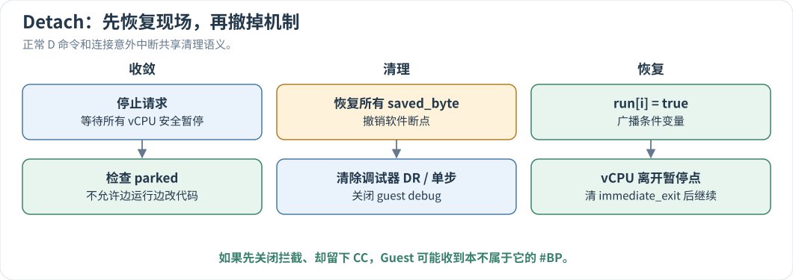

如果连接在运行时中断，清理应先收敛到所有 vCPU 的安全暂停点，再恢复软件断点、撤掉调试器 DR 配置和单步、关闭 guest debug（`KVM_SET_GUEST_DEBUG` 的 control=0），最后置 `run[i]=true` 并广播。被放行的 vCPU 自己清除 `immediate_exit`。关机路径需保留退出请求，不应让被唤醒的 vCPU 又进 guest。

若仅关闭调试拦截而留下 CC，guest 会收到不属于自己的 #BP，可能触发 Oops 或 Panic；如果边运行边写回断点，则还有并发修改代码的风险。原文记录正常 detach 与意外断开走同一清理路径。这体现了 error path 和正常路径的生命周期对称原则。上图是根据原文不变量归纳的清理顺序，而非对未提供的完整 `t_detach()` 源码逐行验证。

## 七、协议与实现：把机器操作包装成 GDB 接口

至此虚拟化主线已经完成。RSP 的意义是把前面的底层原语暴露给不需要理解 KVM 的标准 GDB；细节可以按实现需求查阅，但仍然要准确处理。

### 7.1 三层代码与线程边界

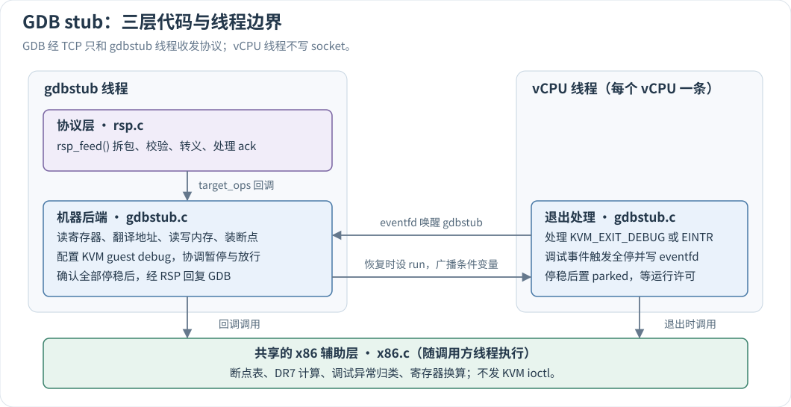

协议层 `src/gdb/rsp.c` 不认识 KVM，也不碰 socket：字节由调用方喂进来，应答经一个 write 回调送出去。这样同一份协议代码在单元测试里可以接一个纯内存的假 target，逐字节检查应答。`src/gdb/x86.c` 处理断点表、DR7、调试异常归类和寄存器换算，只操作调用方传入的数据，不发 ioctl。gdbstub 线程执行 target 回调时会调用它，vCPU 线程处理调试退出时也会调用它。真正和 KVM、线程打交道的只有 `src/gdb/gdbstub.c`。

gdbstub 有自己的线程，用 `poll` 同时等待 socket（尚未连接时是监听 socket）和 eventfd。vCPU 线程撞上断点时不直接写 socket，而是记下事件、写 eventfd，由 gdbstub 线程在所有 vCPU 都停稳之后统一发应答。所有对 gdb 的输出都出自同一个线程，协议层就不需要加锁。
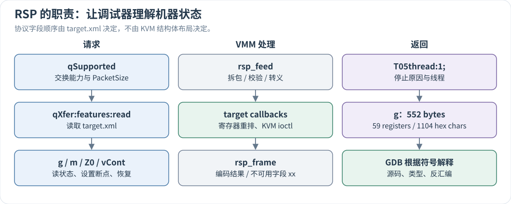

### 7.2 包、校验与 ack

gdb 和 stub 之间传的是 ASCII 包，格式是 `$<数据>#<两位十六进制校验和>`，校验和是数据部分所有字节之和取低 8 位（GDB 手册附录 E.1）。收到一个完整的包，接收方回一个字节 `+`；校验和不对回 `-`，对方重发上一个包。下面是 gdb 读全部寄存器的一来一回，取自 `set debug remote 1` 的输出：

```
[remote] Sending packet: $g#67
[remote] Received Ack
[remote] Packet received: 0000000000000000...（1104 个十六进制字符）
```

`g` 的 ASCII 是 0x67，所以校验和是 `67`。数据里出现 `#`、`$`、`}` 时要转义成 `}` 加原字节异或 0x20，否则接收方会把它当成包的结束或开头；stub 发出的数据还要转义 `*`，因为 gdb 把 `*` 当成游程编码的标记。校验和按转义之后实际发出的字节算。

这里有一个测试上的小问题：VMM 现在的应答全是十六进制数字、`OK`、`E0e` 和 target.xml，没有一个含这四个字符，转义代码经由协议根本走不到。所以组包被拆成了一个独立的纯函数 `rsp_frame()`，单元测试直接拿 `a#$}*b` 去喂它。
### 7.3 一次连接实际交换了什么

gdb 连上来之后、用户还没敲任何命令之前，会先发一串查询。按实际顺序摘出主要的几条：

```
$qSupported:multiprocess+;swbreak+;hwbreak+;...   → PacketSize=1000;qXfer:features:read+;swbreak+;hwbreak+
$vCont?                                           → vCont;c;C;s;S
$vMustReplyEmpty                                  → （空包）
$Hg0                                              → OK
$qXfer:features:read:target.xml:0,ffb             → m<?xml version="1.0"?>...
$qXfer:features:read:target.xml:ffb,ffb           → l...</target>
$?                                                → T05thread:1;
$qfThreadInfo                                     → m1,2
$qsThreadInfo                                     → l
$qAttached                                        → 1
$g                                                → 0000...
$m1000000,1                                       → 49
```

每一条的意思：

- `qSupported` 交换双方支持的特性。gdb 声明自己懂 `swbreak`/`hwbreak` 停止原因，stub 回报包长上限 0x1000 字节、能提供 target.xml。
- 不认识的包回空包，gdb 据此知道“不支持”并换一种做法。`vMustReplyEmpty` 就是 gdb 专门用来确认 stub 遵守这条规则的。
- target.xml 描述寄存器，分两段读完：`m` 表示后面还有，`l` 表示这是最后一段。
- `?` 问“目标机为什么停着”，`T05thread:1;` 回答“线程 1 收到 SIGTRAP”。
- `qfThreadInfo`/`qsThreadInfo` 列出线程，这里是两个 vCPU。
- `qAttached` 回 1 表示“附加到一个已经存在的进程”，gdb 退出时就发 `D`（让 VM 接着跑），而不是 `k`（结束 VM）。
- 最后读寄存器和 rip 处的 1 个字节，gdb 打出 `0x0000000001000000 in ?? ()`：VMM 直启 vmlinux 的入口就是 GPA 0x1000000，这时还没有符号能对上。
### 7.4 寄存器布局不是 KVM 结构体布局

`g` 包是所有寄存器按顺序拼起来的十六进制串，顺序由 target.xml 决定，而不是由 `struct kvm_regs` 决定。VMM 内置的 target.xml 由 gdb 源码里的 `64bit-core.xml`、`64bit-sse.xml`、`64bit-segments.xml` 拼成，一共 59 个寄存器、552 字节：16 个通用寄存器、rip、eflags、6 个段选择子、8 个 x87 寄存器和它的 8 个控制字段、16 个 xmm、mxcsr、fs_base、gs_base。

最容易写错的是第 6、7 号：gdb 的顺序是 rax rbx rcx rdx rsi rdi **rbp rsp**，而 `struct kvm_regs` 里是 rsp 在 rbp 前面。照着结构体字段顺序拷贝，gdb 里的栈回溯会全乱。

x87 的 ftag、fiseg、fioff、foseg、fooff 五个字段在本实现中不做完整换算：`KVM_GET_FPU` 给的是 FXSAVE 格式，标记字 `ftwx` 是 8 位的简写，而 gdb 的 ftag 是完整的 16 位标记字，要按每个物理寄存器的内容重新推算；64 位模式下 FPU 的指令和数据指针是 64 位偏移，拆不成“段选择子 + 32 位偏移”。VMM 对这五个字段回 `xx`，意思是“这个寄存器的值拿不到”（附录 E 的 `g` 包），gdb 显示为 `<unavailable>`，而不是一个看起来像真的假值。

写寄存器（`P` 包）只接受通用寄存器、rip 和 eflags。段寄存器在 gdb 里只是一个 16 位选择子，CPU 真正用的是 `kvm_sregs` 里的影子描述符（base、limit、属性）；只改选择子不改描述符，两者就不一致了，可能形成不符合预期的段描述符状态；不能把 CS 当作普通通用寄存器直接写入。
这体现了接口诚实性：填零会伪造状态，省略字段会破坏协议布局，只有明确标为不可用才能既保持布局又不误导用户。x87 tag 的重新构造并非原则上不可能，而是本实现没有完成相应语义转换。

### 7.5 线程映射与 vCont

gdb 的线程号从 1 开始，0 表示“任意线程”，-1 表示“所有线程”，所以 vCPU 的下标加 1 就是线程号。`Hg2` 让之后的 `g`、`m` 作用在 vCPU 1 上；`qThreadExtraInfo,2` 回 `vCPU 1` 的十六进制，`info threads` 里看到的就是：

```
* 1    Thread 1 (vCPU 0) kernel_init (unused=0x0) at init/main.c:1612
  2    Thread 2 (vCPU 1) 0x000000000000fff0 in ?? ()
```

vCPU 1 停在 0xfff0，这不是 bug：`kernel_init` 刚开始时还没执行到 `smp_init()`，AP 还没收到 SIPI，停在复位状态，rip 就是 0xfff0（gdb 显示的是 rip，不加 CS base，这个地址上没有内核符号，所以是 `??`）。第五节已经看到，这个“还没启动的 AP”正是暂停机制里最容易漏掉的一种状态。
GDB 的恢复命令 `vCont;动作[:线程]...` 规则是每个线程取最左边匹配的动作；无匹配则保持停止。RSP thread ID 从 1 开始，mini-vmm vCPU ID 从 0 开始。

| 请求 | 恢复方式 |
|---|---|
| `vCont;c` | 全部继续 |
| `vCont;c:2` | 仅 vCPU 1 继续 |
| `vCont;c:2;c:3` | vCPU 1、2 继续 |
| `vCont;s:1` | 仅 vCPU 0 单步 |
| `vCont;s:1;c` | vCPU 0 单步，其余继续 |

all-stop 是停止传播策略，不排斥选择性恢复。这正是 per-vCPU `run[i]` 存在的原因。

## 八、验证：不是能连上 GDB 就算做对了

调试器如果在边界条件下破坏 guest，反而会妨碍排查。原文采用两层验证：独立规范判据的协议/架构单元测试，以及真实 GDB + 两个 vCPU 的端到端测试；再通过错误变体确认测试可以实际捕获回归。

**单元测试**

`gdb_test`（188 项检查，12 个用例）接一个纯内存的假 target，逐字节喂入 gdb 会发的包，检查应答：

- 组包：校验和按线上字节算，错的回 `-` 且不执行，超长包回 `-`，gdb 回 `-` 时重发上一个包，转义后的字节按异或 0x20 还原并决定执行哪条命令；`rsp_frame()` 对 `# $ } *` 都转义；vCPU 在跑时收到的包只 ack 不执行，0x03 只在跑时打断。
- 命令：`g` 包 552 字节、rbp 在 rsp 前、拿不到的字段是 `x`；`P` 只接受 0–17 号；`m` 可以短读，一个字节都读不到才回 `E0e`；`M` 的数据长度必须和声明的一致；target.xml 59 个寄存器、带着最后一段数据的应答以 `l` 开头；`vCont` 取最左边的动作；停止应答的线程号、swbreak/hwbreak 只在 gdb 声明支持时带上。
- x86：断点表的插入、删除、隐藏和影子写；4 个 DR 槽与 DR7；每种组合下的 guest debug 控制字；`KVM_EXIT_DEBUG` 的归类；`kvm_regs` 与 gdb 布局的换算。

判据来自规范，而不是被测代码：包格式和命令语义来自 GDB 手册附录 E，寄存器顺序来自 gdb 源码里的 target 描述，DR6/DR7 的位来自 `asm/debugreg.h`，控制字来自 `linux/kvm.h`。

为了证明这些断言真的能分辨对错，`tests/mutants/gdbstub.py` 里有 32 种错误实现（例如 stub 不转义 `*`、rbp/rsp 对调、vCont 取最右边的动作、读内存不隐藏 int3、DR7 使能位错位、吞掉 guest 自己的 int3、单步时不看 BS），`make test negctl` 逐个换上去重新编译，每一种都让 `gdb_test` 变红。

**端到端测试**

`make test gdbstub` 一共 3 条：

- `--gdb 70000` 被拒绝。
- 2 vCPU 的完整场景：没有改过的 gdb 连上，看到 2 个线程；`hbreak start_kernel` 停在 vCPU 0；`stepi` 后 pc 前进的正好是那条指令的长度；改写 rax 再还原，读写 `linux_banner` 再还原，读没有映射的地址报错；`break kernel_init` 停下，读另一个线程的寄存器；guest 跑到 shell 提示符后 Ctrl-C；detach 后 guest 继续跑，经串口执行 `poweroff -f` 正常关机。VMM 报出交还了 1 个 guest #BP，全程没有 `kernel BUG`。
- guest 自己结束：`rdinit=/nonexistent` 让 guest panic 后重启，gdb 收到退出报告。

“所有 vCPU 一起停”不能只听 gdb 说，要从 VMM 外面看。测试脚本在 Ctrl-C 前后各读一次 host 上 `/proc/<VMM pid>/task/*/syscall`：运行中两个 vCPU 线程都在 `ioctl`（`KVM_RUN`）里，停下后都在 `futex` 上（条件变量）。这个读取放在协调脚本里做，而不是放进 gdb 脚本：Yama 的 `ptrace_scope=1` 只允许祖先进程读，gdb 和 VMM 是兄弟进程。

第五节与第三节的两个 RED 都是用这个测试看到的：去掉 SIGUSR1，第一次停止就永远等不齐；不交还 guest 的 int3，guest 在 `int3_selftest` 里 BUG。
### 8.1 后续可验证的设计推演（尚未执行）

| 实验 | 需要观察的证据 |
|---|---|
| 两个 GVA 映射同一 GPA | GVA/GPA、断点表、#BP 的 ex->pc 与分类 |
| CR3 切换后撤销断点 | 插入与撤销的 CR3、GPA、原始字节及两页最终内容 |
| GPA 被重新分配 | 受控的 guest 页重用事件、前后物理字节及新对象内容 |
| Guest 自行写入断点位置 | 当前 CC 的写入来源、saved_byte 与撤销结果 |
| 多 vCPU 并发调试事件 | 各 vCPU 的 exception、DR6、RIP、stopping/event 状态 |
| TF 泄漏 | 在可控 guest 中单步 PUSHFQ，对比栈值与 RFLAGS；区分 VMX/SVM |

这些实验是从讨论推导出的后续方向，不计入原文 188 项检查、32 个错误变体或三个端到端测试，不宣称已经发现上游 bug。

## 九、实现边界与本章收获

### 9.1 当前限制

- **没有硬件 watchpoint。** VMM 对 `Z2`–`Z4` 回空包。普通 `watch` 可退回软件 watchpoint（`rwatch`/`awatch` 则可能不支持）：逐条单步再比较，慢得多，而且只能看到当前线程的修改（GDB 手册 Set Watchpoints），多 vCPU 的内核里基本不可用。数据断点要另外编码 DR7 的 R/W、LEN 位，处理命中归属，这个里程碑只要求指令断点。
- **软件断点在内核切换页表之前插不进去。** 见 2.4 节，用 `hbreak`。
- **只有 all-stop。** 见 5.6 节。
- **只读写通用寄存器、rip、eflags。** 段寄存器、控制寄存器、MSR 不能经 gdb 改写；x87 的几个控制字段读出来是 `<unavailable>`。
- **单步一个 HLT 中的 vCPU 要等下一个中断。** 见 3.2 节；host 内核低于 5.16 时没有 `BLOCKIRQ`，单步可能走进中断处理函数。
- **一次只服务一个 gdb。** 监听队列长度是 1，后来的连接等前一个断开。

此外，软件断点表尚不能证明任意 guest 动态代码和页生命周期下的所有权；all-stop 每轮只报告一个停止事件；vCPU 停止也不等于复杂设备模型中所有异步写入者都已静止。这些是本文设计推演提出的范围边界，不是原文的已验证功能。

### 9.2 比 GDB 更值得记住的虚拟化原则

| 原则 | 本章实例 |
|---|---|
| 控制状态与架构状态应尽量分离 | TF / MTF |
| 请求停止不等于已停止 | run / parked |
| VMEXIT 不等于指令完成 | complete_userspace_io |
| 拦截事件不等于拥有事件 | Guest INT3 交还 |
| 地址不等于对象身份 | CR3 重映射、GPA 重用 |
| 停止传播与恢复范围是独立策略 | All-stop / selective resume |
| 正常路径和异常路径须维持相同的资源清理语义 | Detach / TCP 断开 |
| 调试机制应尽量保持被控制对象的语义 | 原始字节视图、异常投递 |

本章最重要的并不是记住 RSP 字符串，而是学会区分硬件、内核接口和 VMM 状态机之间的边界。尤其是 **`KVM_RUN` 可以完成挂起的 I/O，却不发生 VM entry**，这是调试和迁移等系统设计共享的基础认知。

## 附录 A：参考（保留原文并补充链接）

**规范与文档**

- GDB 手册附录 E（Remote Serial Protocol）：E.1 包格式、ack 与转义，E.3 停止应答，`g`/`p`/`P`/`m`/`M`/`Z`/`H`/`vCont`/`qXfer` 各包；附录 G 的 i386 target 描述；Set Breaks 一节的 `breakpoint always-inserted`；Set Watchpoints 一节的软件 watchpoint
- gdb 源码 `gdb/features/i386/64bit-core.xml`、`64bit-sse.xml`、`64bit-segments.xml`
- `Documentation/virt/kvm/api.rst`：`KVM_RUN` 的 `immediate_exit`，`KVM_EXIT_IO`/`KVM_EXIT_MMIO` 要到下一次 `KVM_RUN` 才完成，`KVM_SET_GUEST_DEBUG`，`KVM_TRANSLATE`，vCPU ioctl 跨线程调用的说明

**头文件**

- `linux/kvm.h`：`struct kvm_guest_debug`、`struct kvm_debug_exit_arch`、`KVM_GUESTDBG_*`、`KVM_CAP_SET_GUEST_DEBUG2`、`struct kvm_translation`
- `arch/x86/include/uapi/asm/debugreg.h`：`DR6_RESERVED`、`DR_TRAP0..3`、`DR_STEP`、`DR_LOCAL_ENABLE`、`DR_CONTROL_SHIFT`
- `arch/x86/include/asm/kvm_host.h`：`DR7_FIXED_1`

**Linux 7.4-rc2（guest）**

- `arch/x86/kernel/alternative.c`：`int3_selftest`、`int3_exception_notify`
- `arch/x86/kernel/hw_breakpoint.c`：执行断点的长度编码

**Linux 6.6（host KVM）**

- `arch/x86/kvm/x86.c`：`kvm_arch_vcpu_ioctl_set_guest_debug`（`KVM_GUESTDBG_INJECT_BP`/`KVM_GUESTDBG_INJECT_DB`）；`arch/x86/kvm/x86.h`：`kvm_exception_is_soft`
- `arch/x86/kvm/svm/svm.c`：`bp_interception`、`db_interception`、`svm_update_soft_interrupt_rip`；`arch/x86/kvm/vmx/vmx.c`：`vmx_inject_exception` 里的 `event_exit_inst_len`

**mini-vmm**

- `include/gdb/rsp.h`、`src/gdb/rsp.c`：协议层，`rsp_frame`、`rsp_feed`、`rsp_report_stop`
- `include/gdb/x86.h`、`src/gdb/x86.c`：断点表、`gdb_x86_dr7`、`gdb_x86_guest_debug`、`gdb_x86_classify`
- `include/gdb/gdbstub.h`：暂停的不变式；`src/gdb/gdbstub.c`：`stop_all_locked`、`park_locked`、`gdbstub_vcpu_debug_exit`、`resume_locked`、`t_detach`
- `src/vm.c`：`vcpu_run_loop` 里 `EINTR` 之后的暂停点、`KVM_EXIT_DEBUG` 分支；`src/smp.c`：`vm_request_stop` 末尾唤醒 gdbstub
- `tests/unit/gdb_test.c`、`tests/mutants/gdbstub.py`、`tests/e2e/gdbstub.sh`、`tests/gdb_session.py`、`tests/gdb_checks.py`

**本次讨论补充的源码与文档入口**

- [Linux v6.6 KVM API](https://docs.kernel.org/6.6/virt/kvm/api.html)：`KVM_RUN`、`KVM_EXIT_IO`、`KVM_EXIT_MMIO`、`KVM_SET_GUEST_DEBUG`。
- [Linux v6.6 arch/x86/kvm/x86.c](https://github.com/torvalds/linux/blob/v6.6/arch/x86/kvm/x86.c)：`kvm_arch_vcpu_ioctl_run`、`complete_fast_pio_in`、`kvm_fast_pio_in`、`complete_emulator_pio_in`、`kvm_check_and_inject_events`、RFLAGS helpers。
- [Linux v6.6 arch/x86/include/asm/kvm_host.h](https://github.com/torvalds/linux/blob/v6.6/arch/x86/include/asm/kvm_host.h)：`complete_userspace_io`。
- [Linux v6.6 SVM](https://github.com/torvalds/linux/blob/v6.6/arch/x86/kvm/svm/svm.c)、[指令模拟器](https://github.com/torvalds/linux/blob/v6.6/arch/x86/kvm/emulate.c)。
- [QEMU v10.2.0 x86 KVM](https://github.com/qemu/qemu/blob/v10.2.0/target/i386/kvm/kvm.c)：`kvm_handle_debug`、`kvm_arch_insert_sw_breakpoint`、`kvm_arch_remove_sw_breakpoint`。
- [QEMU v10.2.0 KVM 通用层](https://github.com/qemu/qemu/blob/v10.2.0/accel/kvm/kvm-all.c)、[CPU 暂停管理](https://github.com/qemu/qemu/blob/v10.2.0/system/cpus.c)、[KVM 头文件](https://github.com/qemu/qemu/blob/v10.2.0/include/system/kvm.h)、[GDB stub](https://github.com/qemu/qemu/blob/v10.2.0/gdbstub/gdbstub.c)。
- [2021 年 KVM 单步、TF 泄漏与 MTF 讨论](https://lkml.iu.edu/2103.2/00912.html)。
- [Intel SDM](https://www.intel.com/content/www/us/en/developer/articles/technical/intel-sdm.html)：Vol. 3 的 Debugging、VMX MTF、EPT 权限；[AMD APM](https://www.amd.com/en/search/documentation/hub.html)：SVM 调试与异常拦截；[Arm Architecture Reference Manual](https://developer.arm.com/documentation/ddi0487/latest/)：DBGWCRn_EL1。
- [GDB Remote Protocol](https://sourceware.org/gdb/current/onlinedocs/gdb.html/Remote-Protocol.html)、[GDB 手册](https://sourceware.org/gdb/current/onlinedocs/gdb.html/)：断点、watchpoint、displaced stepping、符号重定位与 target description。

## 附录 B：延伸阅读


- `scripts/gdb/linux/`（构建时生成 `vmlinux-gdb.py`）：`lx-dmesg`、`lx-ps`、`lx-symbols` 都只是 gdb 的 Python 脚本，经本篇的 `m` 包读 guest 内存实现。`tools/build_guest_kernel.sh` 构建的内核带 DWARF 和这些脚本，README 里有加载方法。
- `arch/x86/kvm/x86.c` 的 `__kvm_set_rflags`、`kvm_get_rflags` 和 `kvm_vcpu_do_singlestep`：KVM 怎样用 RFLAGS.TF 实现 `SINGLESTEP`，又怎样在 guest 和用户态读 RFLAGS 时把这个 TF 藏起来。
- QEMU 源码里的 gdbstub 部分：同一个协议在支持多种架构、多种 accelerator 时是怎样组织的，以及它为 non-stop 模式和 watchpoint 多维护了哪些状态。
