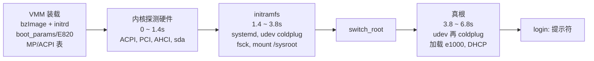

到上一篇为止，mini-vmm 跑的 guest 都是为测试量身定做的：内核用项目自己的精简配置编译，驱动全部编进内核，initramfs 里只有一个 BusyBox 和几行脚本，测试做完就 `poweroff -f`。这样的 guest 只走 VMM 想让它走的路。这一篇换成一个没有裁剪过的发行版：Arch Linux 官方 `linux` 包里的内核和 initramfs，systemd 做 init，udev 按需加载驱动模块，networkd 拿 DHCP，pacman 从网络装包，最后用 `systemctl reboot` 和 `systemctl poweroff` 收尾。VMM 一行设备代码都没有为它改，要回答的是另一类问题：从 VMM 把第一条指令交给 guest，到串口上出现 login 提示符，中间经过了哪几站，每一站用到了前面哪一篇做出来的东西；一个发行版对“虚拟硬件做得对不对”的要求，比我们自己的测试多在哪里；以及怎样把“发行版能跑”变成可以自动判定的结论。

## 一、为什么要跑一个没裁剪的发行版

### 1.1 自己写的测试只覆盖自己想到的路

前面每个里程碑的验收都在精简 guest 上做，好处是因果清楚：内核里只有这一个驱动，它探测到了，就说明设备做对了。代价是 guest 的行为由我们自己决定。发行版会做很多我们没让它做的事：

| 发行版做的事 | 精简 guest 里 | 碰到 VMM 的哪一部分 |
|---|---|---|
| 内核配置是通用的，大量驱动是模块 | 只编需要的驱动 | 内核会按 ACPI、PCI、CPUID 去探测和加载它认为需要的东西，任何一处描述不一致都会变成一条警告或一次超时 |
| initramfs 由 mkinitcpio 生成，里面跑的是 systemd | 一个 shell 脚本 | 根盘要由 udev 发现、由 systemd-fsck 检查之后才挂载，和 AHCI 的探测时序、磁盘标识（型号、序列号）都有关 |
| 真根上再做一遍 udev coldplug，按 modalias 加载模块 | 驱动都已编进内核 | PCI 的 vendor/device/class 要和驱动的匹配表对得上，模块加载发生在启动中段，此时中断和定时器都已在高负载下运行 |
| systemd 并行启动几十个 unit | 串行几行命令 | 4 个 vCPU 同时干活，中断、IPI、定时器都比测试里密集得多 |
| 关机时停 unit、pivot 到 shutdown ramfs、卸载、同步磁盘缓存 | `poweroff -f` 直接断电 | 块设备要正确处理 flush，i8042 和 ACPI S5 两条退出路径都要走到 |

所以这个里程碑的判据不是某个设备的某个寄存器，而是发行版自己给出的结论：systemd 有没有进入 `running`，有没有失败的 unit，内核有没有打印超时，pacman 的签名校验有没有通过，关机后文件系统是不是干净。这些结论由 systemd、pacman、e2fsck 这些和 VMM 无关的程序给出，不依赖我们对“正确”的理解。

`MILESTONES.md` 把 arch-distro 定成一道闸门：后面的里程碑统一在 Arch guest 里验收，fio、iperf3、perf、gcc、`linux-headers` 都能直接装，不用再往精简 initramfs 里一个个塞工具。

### 1.2 做一个可复现的镜像

镜像由 `tools/build_arch_image.sh` 生成，几个设计点：

- **全程不要 root。** `pacstrap -N` 在 user namespace 里安装；之后写配置、`mkfs.ext4 -d` 打包也在同样映射的 namespace 里做（脚本里的 `in_ns`，即 `unshare --map-auto --map-root-user`）。两次进入的映射必须相同，否则 `mkfs.ext4 -d` 按 stat 看到的属主写 inode，guest 里的文件会属于 host 上 `/etc/subuid` 分出来的那些 uid。
- **软件源默认是 Arch Linux Archive 某一天的快照。** 同一份脚本重跑，装进去的包和版本都相同，`packages.txt`（`pacman -Q` 的输出）逐字一致，官方内核 `vmlinuz-linux` 逐字节一致。磁盘镜像本身不是逐字节相同的，ext4 的时间戳和目录哈希种子每次都不一样，所以等价性以包列表和脚本写出的配置为准。pacman 配置只开 `core` 和 `extra`，不继承 host 的 `pacman.conf`，避免 host 上的第三方仓库混进来。
- **根文件系统的 UUID 固定。** fstab 和内核命令行都用 `root=UUID=...` 找根，重建镜像后测试的命令行不用改。测试从镜像本身用 `blkid` 读 UUID，不在两处各写一份。
- **整盘一个 ext4，没有分区表。** guest 里根就是 `/dev/sda`。VMM 是直接装载内核的（下一节），用不着引导分区。
- **最少的配置。** hostname、locale、时区；root 空密码，串口上输入 `root` 就能登录（镜像只在本机测试用）；systemd-networkd 对 `en*` 开 DHCPv4。包只有 `base linux fio iperf3`，后两个是第六节 exit 基线的负载。

还有一个坑和 initramfs 有关，放到 2.3 节讲。

### 1.3 不经过引导器

真机上从上电到内核要经过固件和引导器（GRUB、systemd-boot），它们从磁盘上读出内核和 initramfs。mini-vmm 现在没有固件，用的是第 9 篇的直接装载：VMM 自己按 Linux boot protocol 把 bzImage 和 initramfs 放进 guest 内存，填好 `boot_params`，从 64 位入口开始执行。所以镜像脚本把 `/boot` 下的 `vmlinuz-linux` 和 `initramfs-linux.img` 拷到镜像旁边，命令行是：

```text
mini-vmm --mode linux --smp 4 --mem 2G \
    --device ahci,drive=d0 --drive id=d0,file=disk.img \
    --netdev tap,id=n0,ifname=tap0 --device e1000,netdev=n0 \
    --initrd initramfs-linux.img \
    --append "root=UUID=6d696e69-766d-4d2d-8172-636800000001 rw ignore_loglevel" \
    vmlinuz-linux
```

磁盘走第 24～28 篇的 AHCI，网卡走第 18～23 篇的 e1000。`ignore_loglevel` 的用处在第四节。

## 二、从第一条指令到 login 提示符

下面按时间顺序走一遍。内核部分的时间戳是串口上 printk 的时间，用户态部分是 systemd 自己报告的时间。最后 systemd 给出的总账是：

```text
Startup finished in 1.419s (kernel) + 2.390s (initrd) + 3.036s (userspace) = 6.846s
```



### 2.1 VMM 装载

VMM 的日志里能看到它替固件和引导器做了哪些事：

```text
[INFO] bzImage: 7.2.11-arch1-1 (linux@archlinux) #1 SMP PREEMPT_DYNAMIC ...
[INFO] bzImage: protocol 2.15, setup 20480 bytes, payload 0x106d200 bytes -> GPA 0x1000000, init_size 0x446e000, entry 0x1000200
[INFO] MP table @ GPA 0x9fc00: 4 CPU(s), IOAPIC id 4 @ 0xfec00000, 27 entries
[INFO] ACPI @ GPA 0xe0000: RSDP XSDT@0xe0030 FADT@0xe0070 DSDT@0xe0190 MADT@0xe0880
[INFO] cmdline @ GPA 0x20000: "console=ttyS0 earlyprintk=serial,ttyS0,115200 reboot=k panic=-1 root=UUID=... rw ignore_loglevel"
[INFO]   e820: [0x000000100000, 0x000080000000) RAM
[INFO] initrd @ GPA 0x3f000000, 15370592 bytes
[INFO] vCPU 0: 64-bit long mode, CR3=0x2000 RIP=0x1000200
```

和第 12 篇跑自编内核时相比，这里没有任何新东西，这正是这一站要证明的：发行版内核和自编内核对 boot protocol 的要求相同。官方内核声明的协议版本是 2.15，被放在 16 MiB（`pref_address`）。命令行前半段是 VMM 的默认值，`--append` 的内容接在后面。

initrd 放在 `0x3f000000` 而不是 2 GiB 内存的顶上，是因为 `src/main.c` 把 `initrd_addr_max` 收紧到 VMM 初始页表恒等映射的 1 GiB 以内。boot protocol 不要求 initrd 被映射，这样做不花任何代价，出问题时可以用 `--walk` 直接查看。15 MB 的 initramfs 按 2 MiB 对齐往下取，就落在 `0x3f000000`。

### 2.2 内核探测硬件（0 ～ 1.4 秒）

内核起来后，先从 VMM 摆好的表里认识这台机器：

```text
[    0.000000] DMI: not present or invalid.
[    0.020501] ACPI: RSDP 0x00000000000E0000 000024 (v02 MINVMM)
[    0.025868] ACPI: DSDT 0x00000000000E0190 0006E9 (v02 MINVMM MINIVMM  00000001 MVMM 00000001)
[    0.047454] ACPI: Using ACPI (MADT) for SMP configuration information
[    0.720125] ACPI: PM: (supports S0 S5)
[    0.746288] pci 0000:00:01.0: [1234:0003] type 00 class 0x010601 conventional PCI endpoint
```

DMI（SMBIOS）是固件提供的表，mini-vmm 没有做，发行版内核只是记一笔然后继续。ACPI 和 MP table 两份都在，内核选了 MADT。PCI 枚举看到第 17 篇的 host bridge、AHCI 和 e1000。AHCI 的 class 是 `0x010601`（大容量存储 / SATA / AHCI 1.0），`ahci` 驱动靠这个 class 匹配，不看 vendor ID，所以 VMM 用自己的 `1234:0003` 也能绑上。

Arch 的内核配置把 `ahci`、`sd_mod`、`ext4` 编进了内核（镜像里的 `modules.builtin` 能查到），它们在这一阶段就开始工作：

```text
[    1.342923] ata1: SATA link up 6.0 Gbps (SStatus 133 SControl 300)
[    1.344076] ata1.00: ATA-8: MINIVMM AHCI DISK, 1.0, max UDMA/133
[    1.345010] ata1.00: 16777216 sectors, multi 0: LBA48 NCQ (depth 32)
[    1.363633] sd 0:0:0:0: [sda] Attached SCSI disk
[    1.436333] Run /init as init process
```

驱动打开了第 29 篇的 MSI（`/proc/interrupts` 里 AHCI 是 `PCI-MSI`），NCQ 深度 32 是第 28 篇的结果。其余 5 个端口报 `link down`，因为只接了一块盘。

还有一条看起来像问题、其实不是的输出：

```text
[    1.023178] i8042: PNP: No PS/2 controller found.
```

i8042 驱动先在 ACPI 的 PNP 设备里找 `PNP0303`，mini-vmm 的 DSDT 没有描述 i8042，于是它退回到直接探测 0x60/0x64 端口，后面照常注册。这个控制器在本篇最后还会出场：`reboot=k` 让重启经过它。

### 2.3 initramfs（1.4 ～ 3.8 秒）

`/init` 是 systemd。它先报告自己在虚拟机里、在 initrd 里：

```text
[    2.466095] systemd[1]: Detected virtualization kvm.
[    2.467827] systemd[1]: Running in initrd.
```

判断依据是 CPUID：leaf 1 的 hypervisor 位由 VMM 置上（`src/arch/amd/svm.c`），0x40000000 叶的 `KVMKVMKVM` 签名来自 `KVM_GET_SUPPORTED_CPUID`，VMM 原样设给 vCPU。

initrd 阶段的目标只有一个：找到根盘、检查、挂到 `/sysroot`，然后切换过去。根盘不是直接按 `/dev/sda` 找的，而是等 udev 报告带着这个 UUID 的块设备出现。顺序是：

```text
Starting Coldplug All udev Devices...         udevadm trigger：给已存在的设备补发 add 事件
[  OK  ] Found device MINIVMM_AHCI_DISK arch.  udev 处理完 sda，by-uuid 链接出现
         systemd-fsck-root                     e2fsck 预检（preen 模式）
[  OK  ] Mounted /sysroot.
         Switching root.
```

`MINIVMM_AHCI_DISK` 是 IDENTIFY DEVICE 里的型号字符串（第 26 篇），`arch` 是 ext4 卷标。如果 IDENTIFY 数据填错，或者 AHCI 的中断丢一次，这里就会等满 systemd 默认的 90 秒设备超时，然后掉进 emergency shell，这是精简 guest 里看不到的失败形态。

**initramfs 的坑：autodetect 看的是构建机。** mkinitcpio 默认带 `autodetect` hook，它按“当前机器已经加载的驱动”挑选要放进 initramfs 的模块，以缩小体积。可是镜像是在 host 上用 pacstrap 构建的，安装 `linux` 包时触发的 mkinitcpio 看到的“当前机器”是 host。host 是一台 WSL2 虚拟机，没有 AHCI 控制器，所以 `ahci` 如果是模块，就不会被放进去，内核在 initrd 里永远等不到根盘；反过来 initramfs 里却多了 Hyper-V 的模块。现在没出事，是因为 Arch 把挂根要用的三个驱动都编进了内核，mkinitcpio 对编进内核的条目直接跳过。镜像脚本仍然在安装 `linux` 之前写好 `/etc/mkinitcpio.conf.d/mini-vmm.conf`，显式列出 `MODULES=(ahci sd_mod ext4)`，这样哪天 Arch 把它们改成模块，initramfs 里仍然有它们。e1000 不用进 initramfs，挂根之前用不到网络。

### 2.4 真根（3.8 ～ 6.8 秒）

切换之后，真根上的 systemd 重新执行一遍：

```text
Welcome to Arch Linux!
[    5.638341] systemd[1]: Starting Coldplug All udev Devices...
[    6.301172] e1000: Intel(R) PRO/1000 Network Driver
[    6.872383] e1000 0000:00:02.0 enp0s2: renamed from eth0
[    6.899672] e1000: enp0s2 NIC Link is Up 1000 Mbps Full Duplex, Flow Control: RX
```

udev 第二次 coldplug，这一次根文件系统上有完整的 `/usr/lib/modules`。每个 PCI 设备在 sysfs 里有一个 `modalias`（vendor、device、subsystem、class 编码成一串字符），udev 拿它去查 `modules.alias`，查到 `8086:100E` 对应 `e1000`，就 `modprobe` 它。驱动注册出的接口最初叫 `eth0`，udev 再按 PCI 位置把它改名为 `enp0s2`（`udevadm info` 里的 `ID_NET_NAME_PATH`，由 `99-default.link` 的命名策略决定），这也是镜像里 networkd 的配置写 `Name=en*` 而不是 `eth0` 的原因。

同一次 coldplug 还加载了十几个和 VMM 设备无关的模块（`cfg80211`、`kvm_amd`、`pcspkr` 等），它们是 CPUID、ACPI 或 networkd 的 netlink 查询触发的，见第五节的 dmesg 清单。

e1000 的中断是 IO-APIC 的 18 号（`fasteoi`），走第 20 篇的 INTx，而不是 MSI。AHCI 和 e1000 在同一台机器上分别走两条中断路径，各自接在第 29 篇和第 20 篇的实现上。

最后 networkd 拿到地址：

```text
Address: 10.0.2.15 (DHCPv4 via 10.0.2.2)
```

`graphical.target` 在用户态 3.024 秒时到达，串口上出现 `Arch Linux 7.2.11-arch1-1 (ttyS0)` 和 `login:`。

## 三、网络：`pacman -Syu`

### 3.1 离线的本地仓库

“能装软件包”是验收项之一，但测试不能依赖外网：外网会断，上游镜像的版本每天在变，同一个测试今天过、明天就可能因为某个包更新而失败。所以测试搭了一个只有本机的小网络：

```text
        user + net namespace（unshare -rn）
  +------------------------------------------------+
  |  tap0 10.0.2.2                                 |
  |    dnsmasq        DHCP，分配 10.0.2.15         |
  |    http.server    提供 arch-image/repo/        |
  |        ^                                       |
  |        | TAP                                   |
  |   mini-vmm  e1000  <---->  guest enp0s2        |
  +------------------------------------------------+
```

和 emu-net 一样，脚本用 `unshare -rn` 在新的 user + net namespace 里把自己再执行一次，这样建 TAP、绑 67 端口都不需要 root，也不碰 host 的网络。服务的就绪用 `ss` 轮询监听端口来判断，不靠固定延迟。

本地仓库 `repo/` 由镜像脚本生成，里面只有一个镜像里没装的小包 `tree`，包和签名都从构建用的同一个快照下载，`repo-add` 把签名写进仓库数据库。guest 里 pacman 用一份临时配置，只指向这个仓库，`SigLevel` 和镜像自带的 `/etc/pacman.conf` 相同，所以签名照样按镜像里 `archlinux-keyring` 的公钥校验，和从真实镜像源安装走的是同一条校验路径。测试同时检查三方的记录：guest 里 `pacman -Syu tree` 返回 0、`tree --version` 能执行；dnsmasq 的日志里有给 10.0.2.15 的 `DHCPACK`；http.server 的日志里有 `GET /mvmm.db` 和 `GET /tree-*.pkg.tar.zst` 的 200。

### 3.2 接到真实外网：pasta

离线测试回答的是“VMM 的网卡能不能让发行版完成一次装包”，真实外网要回答的是另一件事：guest 能不能像普通机器一样，用镜像自带的 mirrorlist 从互联网装包。这个用例要设置 `ARCH_DISTRO_ONLINE=1` 才跑，因为它的结果取决于外网和软件源是否可用。

这里不需要 root，靠的是 pasta（passt 包）。pasta 建一个新的 user + net namespace，里面只有一个 tap 接口 `pst0`，接口的另一端是 pasta 进程：它从 tap 上读出以太网帧，把其中的 TCP/UDP 翻译成 host 上普通的 socket 收发，回包再拼成帧写回 tap；它还自带 DHCP 服务，把 host 默认路由接口的地址、网关和 DNS 分给对端。所以 namespace 里只要把 VMM 的 `tap0` 和 `pst0` 挂进同一个 bridge，guest 的帧就到了 pasta：

```text
  guest e1000 ── tap0 ──┐
                        br0          （pasta 建的 user + net namespace）
          pasta 进程 ── pst0 ──┘
              │
          host 上普通的 TCP/UDP socket ──> 互联网
```

guest 拿到的地址就是 host 自己的地址（这台机器上是 `192.168.8.240/24`，网关 `192.168.8.1`），不需要 dnsmasq，也不需要在 namespace 里配 NAT。guest 解析出 `archive.archlinux.org` 的真实地址，pacman 向快照服务器确认 core、extra 的数据库没有变化，再下载 tree 包、按 keyring 校验、安装。

**pasta 暴露了 VMM 的一个 bug。** 第一次这样跑时，guest 15 秒就进了 S5，VMM 打印了 `guest requested poweroff via ACPI S5`，进程却一直不退出。看 `/proc/<pid>/task/*`：vCPU0 的线程已经退出，vcpu1～3 停在 `kvm_vcpu_block`（guest 的 HLT 里），主线程在 futex 上等 join。三个 vCPU 线程的 `/proc/<pid>/task/<tid>/status` 里 `SigPnd` 和 `SigBlk` 都是 `0x200`，也就是 SIGUSR1 既在 pending 又被阻塞。第 11 篇的停机机制是置 `immediate_exit` 再给每个 vCPU 线程发 SIGUSR1，把它们踢出 `KVM_RUN`，但被阻塞的信号不会让 `kvm_vcpu_block` 返回。这个掩码是继承来的：pasta 启动子进程时阻塞了 SIGUSR1（pasta 启动的 shell 的 `SigBlk` 是 `0x10200`），而 VMM 只用 `sigaction` 装了处理函数，默认继承的掩码是空的，于是从来没有解除过阻塞。修法是 `vm_run` 在创建 vCPU 线程之前 `pthread_sigmask(SIG_UNBLOCK, SIGUSR1)`，新线程继承这个掩码。`smp` suite 加了一个用例，由父进程先阻塞 SIGUSR1 再 exec VMM，跑 4 vCPU 的 panic 重启：修复前等满 60 秒超时，修复后正常退出。

## 四、关机与重启

### 4.1 systemd 的关机比 `poweroff -f` 长得多

`systemctl reboot` 之后，串口上依次是：

```text
         Starting Generate shutdown-ramfs...           mkinitcpio 的 shutdown ramfs 解包到 /run/initramfs
（停掉所有 unit）
[   12.165313] systemd-shutdown[1]: Syncing filesystems and block devices.
[   12.201598] systemd-shutdown[1]: Sending SIGTERM to remaining processes...
[   12.255151] systemd-shutdown[1]: Unmounting file systems.
[   12.977370] systemd-shutdown[1]: Successfully changed into root pivot.
[   12.978476] systemd-shutdown[1]: Entering exitrd...
[   13.044263] EXT4-fs (sda): unmounting filesystem 6d696e69-766d-4d2d-8172-636800000001.
[   13.059386] shutdown[1]: Rebooting.
[   13.060399] sd 0:0:0:0: [sda] Synchronizing SCSI cache
[   13.115827] reboot: Restarting system
[INFO] guest requested reset via i8042
[INFO] reset: guest reset #1 done, restarting vCPUs
```

根文件系统在正常运行时无法卸载（init 自己就在上面），所以 systemd-shutdown 先把根重新挂成只读，再 pivot 到 shutdown ramfs（“exitrd”），从那里把旧根 `/oldroot` 真正卸载掉。之后内核的 `sd` 驱动发 SYNCHRONIZE CACHE，libata 把它翻译成 FLUSH CACHE EXT 发给 AHCI，VMM 的块后端对盘文件做 `fdatasync`（第 27 篇）。最后 `reboot=k` 让内核向 i8042 写 0xFE，进入第 31 篇的原地复位，同一个 VMM 进程里第二次启动开始。`systemctl poweroff` 走到同一处后打印 `reboot: Power down`，写 FADT 里的 PM1a 控制寄存器进入 S5，VMM 打印 `guest requested poweroff via ACPI S5`，退出码 0。

### 4.2 怎样判断“关干净了”

“没报错”不等于干净。测试用了三个互相独立的证据：

- **第二次启动时 systemd-fsck 的结论。** initrd 里的 `systemd-fsck-root` 在挂载之前运行 e2fsck 的 preen 模式，输出以卷标开头。上次干净卸载时它报 `arch: clean, ...`；上次没卸载干净，ext4 的超级块带着 `needs_recovery`，这里会回放日志（`recovering journal`）或者修复。测试要求前者、不许出现后者。
- **poweroff 后 host 上的 `e2fsck -fn`。** `-n` 只读，`-f` 即使超级块标着 clean 也完整扫一遍。没有干净卸载时 `-n` 不会替你回放日志，而是直接报错。
- **关机耗时。** 从发出命令到内核打印 `reboot: ...`，正常一两秒；systemd 停 unit、systemd-shutdown 给残留进程发 SIGTERM 后的等待上限都是 90 秒，超过 30 秒说明有一步是等到超时才过去的。等到超时也能关机成功，前两条证据都抓不到它，所以单独设上限。

内核命令行里的 `ignore_loglevel` 是为第三条准备的：发行版默认的控制台日志级别会滤掉内核和 systemd-shutdown 的大部分消息，关机卡住时串口上只剩一串终端转义序列，看不出停在哪一步。打开它之后，任何一次慢关机都会在串口上留下停在哪个 unit、哪个阶段的现场。

第二次启动还额外检查两件事：`/proc/sys/kernel/random/boot_id` 变了（确实是新的一次启动，而不是第一次启动的输出被看了两遍），第一次启动装的 `tree` 还在（写进磁盘的东西跨越了复位）。

## 五、判据怎么定

### 5.1 dmesg 的 err/warn 清单

“dmesg 里没有 err/warn”这个判据太严：发行版内核在任何虚拟机上都会打出几条与 VMM 无关的警告。可是放松成“不看 dmesg”又太松：VMM 的设备模型或固件表出错时，最先出现的往往就是驱动或 ACPI 的一条警告，内核照样能启动。折中是一份允许清单（`tests/e2e/arch-distro.sh` 的 `DMESG_ALLOWED`），每一条都查明了来源，只允许出现而不要求出现，清单之外的任何 err/warn 都算失败。现在清单上的几条：

| 警告 | 来源 | 为什么与 VMM 无关 |
|---|---|---|
| TSC 的 P0 频率读不出 | 内核读 AMD 的 `MSR_K7_HWCR` 里的一位 | host 的 KVM（6.6）对这个 MSR 只接受 0 和 bit 18，是 KVM 的 MSR 模拟决定的 |
| SRSO 缓解缺微码 | CPU 漏洞缓解检查 | 取决于 host 的 CPU 微码 |
| TDX 相关的一条消息 | `tdx_enable` 在任何非 TDX 平台上都会打印 | 与平台无关 |
| `regulatory.db` 加载失败 | networkd 的 nl80211 查询让 `cfg80211` 自动加载，它找数据库 | 镜像没装 `wireless-regdb`，guest 里也没有无线网卡 |

前两条取决于 host，换一台机器可能消失，也可能冒出清单之外的新警告。那时要逐条查明是不是 VMM 的问题，再决定是修 VMM 还是加进清单，不能为了让测试变绿直接加。

另外两个计数判据更直接：`systemctl --failed` 为空，dmesg 里匹配 `timed? ?out`（不分大小写）的行数为 0，两次启动各查一遍。

### 5.2 最反直觉的地方：漏掉设备复位，发行版发现不了

验收测试要先看到它在功能缺失时失败（AGENTS.md 的要求），所以 `tests/mutants/arch-distro.py` 往 VMM 里注入错误，看测试能不能抓住。“复位请求被当成退出”能抓住，5 个用例变红：第二次启动根本没有发生。

另一个直觉上更该被抓住的错误却逃过去了：复位时不调用设备的复位回调。AHCI 和 e1000 带着上一次启动留下的全部寄存器状态（中断屏蔽、DMA 环地址、端口命令状态）进入第二次启动，发行版居然照常启动、照常联网、照常关机。

原因在 guest 驱动里。Linux 6.6 的 `ahci_reset_controller`（`drivers/ata/libahci.c`）在 probe 时向 GHC 写 `HOST_RESET`，`e1000_reset_hw`（`drivers/net/ethernet/intel/e1000/e1000_hw.c`）在 probe 时写 `CTRL.RST`，两者都是驱动自己把硬件复位一遍，再从头配置。只要 VMM 对这两个复位位的处理是对的（第 24、18 篇），驱动根本看不到 VMM 有没有在系统复位时清过设备状态。

这个 mutant 因此从 arch-distro 的对照里去掉了，文件头写明了原因。它由第 31 篇的 `system-reset` suite 挡住，那里检查的是没有驱动会去改写的状态：`pci-test` 设备的 scratch 寄存器和配置空间的 cache line size（软件写、硬件只记住，复位后为 0），guest 先写入一个值，复位后读回必须是上电值。这件事说明的是一个一般规律：一个“真实 guest 能跑”的测试，只能证明真实 guest 依赖的那部分行为是对的；guest 自己兜住了的错误，要用专门的测试去找。

## 六、exit 基线

### 6.1 方法

后面的 virtio、vhost、ioeventfd/irqfd 里程碑都要回答“快了多少”。这里先在全模拟设备上量一组基线。量的不是吞吐，而是 exit：每做一次 I/O、每收发一帧，VMM 和 KVM 各被打断了多少次。吞吐受 host 负载影响很大，exit 数只取决于 guest 驱动和设备模型的交互方式，两次运行可以对得上。

做法是同样的配置启动三次，只差 guest 里跑什么负载，每次都用第 15 篇的 `--exit-stats` 把计数写到文件：

| 运行 | guest 里做的事 |
|---|---|
| 空载 | 启动、DHCP、关机 |
| blk | 加上 `fio --rw=randread --bs=4k --direct=1 --ioengine=psync --readonly`，对 `/dev/sda` 读 16384 次 |
| net | 加上 iperf3 向 host 发 64 MiB、再从 host 收 64 MiB |

计数从 VMM 启动累积到退出，包含启动、DHCP、关机这些每次都有的部分，负载运行减去空载运行，剩下的就是负载本身引起的。三次而不是两次，是因为 KVM 层的计数器（总 exit 数、中断注入数）不分设备，只有 blk 和 net 分开跑，才能分别归到块和网络上。每次都从原镜像复制一份新盘，三次启动看到的文件系统状态相同。fio 用 `O_DIRECT` 读裸盘，每个请求都落到 AHCI，不经过页缓存，也不用先铺数据文件；`--readonly` 让 fio 拒绝任何写，所以读 guest 正在用的根盘是安全的；fio 默认 `randrepeat=1`，每次的偏移序列相同。

为了确认差分出来的确实是负载，测试先核对一个独立的计数：VMM 块后端自己统计的读请求数，blk 比空载多出的应该就是 fio 的 16384 次（容差 2%，留给同期 journald 等的零星读）。网络这边要求 tx、rx 帧数各多出至少 64 MiB / 1514 字节，即 44325 帧。

### 6.2 结果

两次独立运行的结果一致到小数点后一位：

| | 每次 4 KiB 读（blk） | 每帧（net，tx 47683 + rx 64106 帧） |
|---|---|---|
| 设备 BAR 的 MMIO exit | `ahci.bar5` 7.64 | `e1000.bar0` 0.08 |
| 到用户态的 exit | 7.86 | 0.09 |
| KVM exit 总数 | 17.19 | 0.17 |
| 中断注入 | 2.54 | 0.04 |

fio 的结果大约 5800 IOPS，平均完成延迟约 167 µs。

两列差了两个数量级，原因在负载形态上，下面是推断：

- **blk 是同步的、一次一个。** `psync` 每次只有一个请求在飞，提交一条命令、等一个中断、处理完成，没有任何东西可以分摊。一次 I/O 约 7.6 次 BAR5 访问，来自 libahci 提交命令时写端口寄存器、中断处理时读写全局和端口的中断状态寄存器（第 25 篇的命令生命周期）。KVM exit 比到用户态的 exit 多出约 9 次，这部分在 KVM 内部处理完，没有到 VMM，比如 LAPIC 的 EOI、vCPU 空闲时的 HLT。
- **net 是批量的。** iperf3 一次写一大块，TSO 把它切成多帧也只要更新一次发送尾指针（第 22 篇）；e1000 驱动用 NAPI，一次中断处理一批帧。每帧 0.04 次中断注入，相当于约 25 帧一次中断。

这张表是后面对照的起点：virtio-blk 换掉 AHCI 的寄存器协议之后，每次 I/O 的 exit 数会降到多少；ioeventfd 把“写门铃”从到用户态的 exit 变成 KVM 内部的 eventfd 通知之后，第二行和第三行的差会怎样变化。

基线默认不跑（`ARCH_DISTRO_BASELINE=1` 才跑，需要 host 装 iperf3），因为它要多启动三次，而它的价值在和后面的里程碑对比，不在每次回归。

## 七、验证

```text
make                                   # 构建 VMM
tools/build_arch_image.sh              # 生成镜像（联网，几分钟），产物在 arch-image/
make test arch-distro                  # 默认 10 个用例
ARCH_DISTRO_BASELINE=1 tests/e2e/arch-distro.sh -a   # 加上 3 个基线用例
ARCH_DISTRO_ONLINE=1 tests/e2e/arch-distro.sh -a     # 加上 2 个真实外网用例（需要 pasta）
TMPDIR=$PWD/build tests/mutate.py arch-distro       # 注入错误，确认测试能挡住
```

默认的 10 个用例在一次 VMM 运行里完成两次启动：

1. 直启官方内核和 initramfs，根文件系统在 AHCI 盘上，systemd 进入 `running`，串口出现 Arch 的 login 提示；
2. 两次启动都没有失败的 unit；
3. 两次启动的 dmesg 里都没有超时；
4. dmesg 的 err/warn 都在允许清单里；
5. `--smp 4 --mem 2G`：guest 看到 4 个 CPU，MemTotal 不低于下限；
6. e1000 经 DHCP 拿到 10.0.2.15，`pacman -Syu` 从本地仓库装上 tree，签名校验通过；
7. `systemctl reboot` 30 秒内关完，原地复位后第二次启动同样 `running`，boot_id 变了，tree 还在；
8. 第二次启动的 systemd-fsck 报告根文件系统 clean；
9. `systemctl poweroff` 30 秒内关完，经 ACPI S5 退出，退出码 0；
10. host 上 `e2fsck -fn` 没有错误。

和 guest 的交互由 `tests/guest_shell.py` 完成：`--login root` 等到 `login:` 提示后登录；`--reboot CMD` 发出重启命令后等下一次的 login 提示再继续，用来把两次启动的命令串在同一次 VMM 运行里。

结果：默认 10/10，开启基线 13/13，开启联网 12/12，两次关机都在 2 秒左右。注入“复位请求变退出”时 5 个用例失败。用同一个快照日期在另一个目录重新构建一次镜像，`packages.txt` 逐字一致（156 个包），`vmlinuz-linux` 逐字节相同，新镜像同样 10/10。

没有镜像时 guest 用例报 SKIP 并给出生成镜像的命令，不会让 `make test` 失败，因为生成镜像要联网，不能假设每台机器都有。

## 八、限制

- **真实外网的用例不在默认测试里，而且有一次失败没有查明。** 它依赖外网和软件源，只在 `ARCH_DISTRO_ONLINE=1` 时跑。有一次 pacman 那条用例失败：没有 `PACMAN-RC-0`，guest 却正常关机、没有签名错误，和 pacman 下载失败相符，但那次的完整输出没有保留，之后连跑二十次都通过。用例失败时会打印完整串口输出，再出现时从 pacman 的报错行查起。
- **关机偶发慢 90 秒的原因没有查明。** 曾经两次在 “Reached target System Reboot” 和 “reboot: Restarting system” 之间隔了约 90 秒，之后没有再出现。90 秒和 systemd-shutdown 的 SIGTERM 等待上限吻合，但这只是数字吻合，没有证据。30 秒上限加上 `ignore_loglevel`，下次出现时会留下现场。
- **dmesg 允许清单依赖 host。** 见 5.1 节。
- **磁盘镜像不是逐字节可复现的。** 等价性只到包列表和配置文件这一层，见 1.2 节。
- **没有固件和引导器。** 内核和 initramfs 由 VMM 直接装载，guest 里升级 `linux` 包之后，要把新的 `/boot/vmlinuz-linux` 拷出来才会生效。固件里程碑（SeaBIOS、OVMF）会把这一步交还给 guest。

## 附录 A：参考

**规范与文档**

- `Documentation/arch/x86/boot.rst`：64 位启动协议、`pref_address`、`initrd_addr_max`
- `arch/x86/include/uapi/asm/bootparam.h`：`setup_header`、`boot_params`
- systemd 的 `bootup(7)`：initrd 和真根两个阶段的 target 顺序；`systemd-shutdown(8)`：关机最后阶段和 exitrd；`systemd.device(5)`、`systemd-fsck@.service(8)`
- `mkinitcpio(8)`：`autodetect` hook、`MODULES` 数组、shutdown hook
- `pacstrap(8)` 的 `-N`（在 user namespace 里安装）；Arch Linux Archive 的快照仓库布局
- `pasta(1)`（passt 项目）：namespace 模式、tap 接口、内建的 DHCP 与地址分配
- `pthread_sigmask(3)`、`signal(7)`：信号掩码由子进程继承，被阻塞的信号只挂在 pending 里

**Linux 6.6（guest 驱动）**

- `drivers/ata/libahci.c`：`ahci_reset_controller` 写 `HOST_RESET`；`drivers/ata/ahci.c` 在 probe 中调用它
- `drivers/net/ethernet/intel/e1000/e1000_hw.c`：`e1000_reset_hw` 写 `CTRL_RST`；`e1000_main.c` 在 probe 和 `e1000_reset` 中调用它

**mini-vmm**

- `tools/build_arch_image.sh`：镜像、内核、initramfs、本地仓库的生成，`in_ns`
- `tests/e2e/arch-distro.sh`：namespace 内的网络服务、10 个用例、`DMESG_ALLOWED`、基线差分、`in_pasta_online` 的 bridge 接法
- `tests/guest_shell.py`：`--login`、`--reboot`
- `tests/mutants/arch-distro.py`：对照用的 mutant 及排除另一个的理由
- `src/smp.c`：`vm_run` 解除 SIGUSR1 阻塞，`vm_request_stop`；`tests/e2e/smp.sh` 的“父进程阻塞 SIGUSR1”用例
- `src/main.c`：`initrd_addr_max` 收紧到恒等映射范围；`src/boot/zeropage.c`：initrd 摆放

## 附录 B：延伸阅读

- systemd 的 `systemd-analyze critical-chain` 和 `systemd-analyze plot`：把第二节的时间线画成每个 unit 的甘特图，可以看出启动时间花在等设备还是等服务上。
- Linux 的 `Documentation/admin-guide/kernel-parameters.txt` 里的 `initcall_debug`：逐个打印内核 initcall 的耗时，用来定位 2.2 节的内核阶段里哪个驱动的探测最慢。
- udev 的 `udevadm monitor --kernel --udev` 和 `udevadm test`：观察 coldplug 时 add 事件怎样一步步变成 `modprobe` 和网卡改名。
