# 33. 从零入门虚拟化：从电传打字机到 TTY、PTY 与远程终端

终端不是 Shell，TTY 不是终端窗口，console 也不是 dmesg。它们之所以难以区分，是因为今天看到的系统同时保留着来自不同历史时期的抽象。

本章不从 API 名词表出发，而从一个最朴素的需求出发：**怎样让人和计算机持续交互，并让已有程序在交互设备发生变化时仍然能够运行？** 我们尝试像设计一个操作系统那样，一步步推导出解决方案。以下历史背景用于说明设计的来由；后续 tpipe 等步骤是思想实验，不是声称 Unix 开发者曾按这些步骤实际实现系统。

## 一、最初的终端是一台机器

在早期分时系统中，一台昂贵的计算机服务于多个用户。用户不一定拥有自己的计算机，只拥有一台连接到主机的终端。例如 Teletype ASR-33 有键盘和打印机构，字符打印在纸上；后来 VT100 等视频终端用屏幕替代纸面，并能够理解光标移动、清屏等控制序列。TTY 的名称来自 teletype。

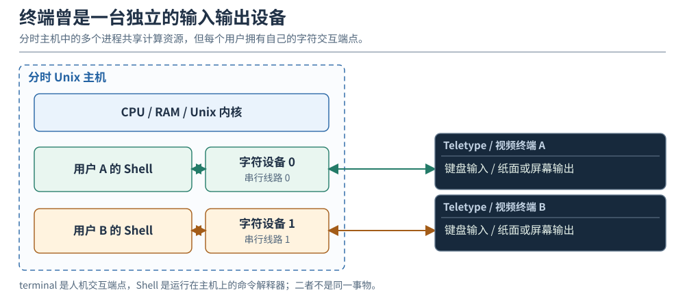

假设我们是 Unix 设计者。给每个终端一个字符设备文件，程序即可用 open/read/write 访问它。终端不是运行命令的程序，而是输入与输出的端点；Shell 才是解释命令的程序。今天 Linux 的 `/dev/ttyS0` 代表传统串口驱动提供的第一个 TTY（S = serial），`ttyS1`、`ttyS2` 等也可能存在。编号是否对应真正可用的串口要看平台与驱动，不能只凭设备节点断言硬件存在。

早期主机往往还拥有供操作员使用的控制台，有时是一块开关与指示灯面板，有时是字符终端。**console 表达的是系统管理角色，而不是一种与 terminal 互斥的设备。** 一个串口终端既能承载普通交互，也能被选作系统控制台。

## 二、先设计一种可配置的字符设备

### 2.1 谁来处理退格？

用户输入 `a`、`b`、退格、`c`、回车。应用程序到底应该收到所有字符，还是只收到处理好的 `ac\n`？前者更灵活，却要求每个程序（或公共用户态库）自己处理基本编辑；后者使最简单的 read 就能读取一行。我们不必二选一，可以让应用程序选择。

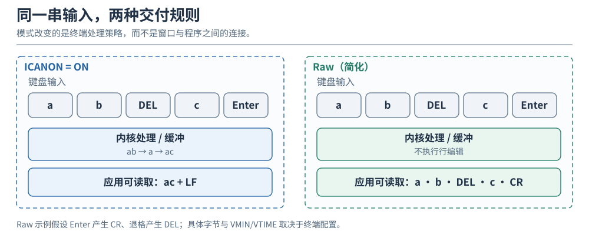

规范模式（canonical mode）允许内核处理简单的行编辑与按行读取；raw mode 则是关闭一组终端转换与编辑行为的配置。不能把 raw 误解成唯一的另一种固定状态：现代 termios 有多个可以独立调整的属性，关闭 ICANON 也不必然等于完全 raw。非规范模式下的交付时机还取决于 VMIN、VTIME 等配置。

如何让 Vim 选择自己的模式？read/write 只传输数据，不能表达修改终端设置的意图。因此使用设备控制接口 ioctl，libc 提供 `tcgetattr()`、`tcsetattr()` 这样的封装。编辑器可保存原配置、设置适合自己的模式、退出时恢复。

### 2.2 把通用逻辑从驱动中抽离

若每一种终端硬件都要实现退格、输入缓冲、回显、控制字符，就产生大量重复。抽取公共机制后，底层驱动只需提供设备相关的字符收发及配置能力。

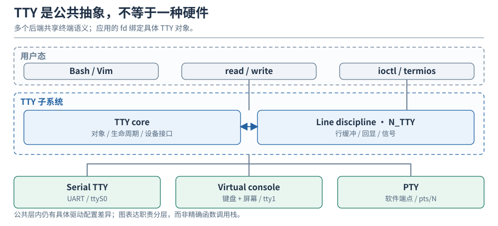

Linux TTY 子系统便可以从这一需求理解。具体的输入处理主要由 line discipline（线路规程）完成，通常是 N_TTY；TTY core 管理终端对象、生命周期及公共接口。这里的 TTY 是一种内核抽象，不等同于串口。

个人计算机普及后，可以将本地键盘与显示器组织为多个虚拟控制台（VT）。`/dev/tty1`、`/dev/tty2` 等代表各个虚拟控制台；`/dev/tty0` 是当前活动 VT 的特殊接口，并非独立的第零个登录终端。在支持 VT 的系统中，Ctrl+Alt+Fx 可用于切换。虚拟控制台与 PTY 是不同的实现。

## 三、为什么窗口程序不能直接 fork + exec 就完事？

假设现在要用一个图形窗口取代物理终端。最简单的设计是接收一行输入，解析为命令，fork 并 execve，再收集输出。执行 ls、pwd 一类程序完全可行——但这更像一个带窗口的简易 Shell。

如果用户启动命令行 Vim，接下来按下 `j`，这不是要执行名为 j 的程序，而是要把一个字节交给已经运行的 Vim。窗口属于终端模拟器，不属于 Vim；桌面窗口系统把按键事件交给获得焦点的窗口。gVim 自己创建窗口，是另一种情况。

我们自然想到两个 pipe：一个把键盘输入送给 Vim，一个收集 Vim 的输出。纯粹从 IPC 看，它完全能够传输双向字节流。

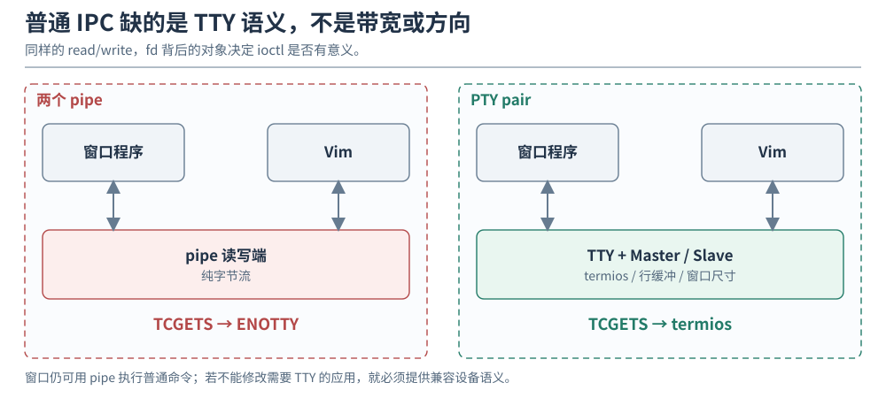

但标准 fd 只是内核对象的句柄。0 是 stdin，1 是 stdout，2 是 stderr；它们可以指向文件、pipe、socket 或 TTY。Vim 想改变终端模式，调用 tcgetattr（Linux 底层常为 TCGETS）时，pipe 不认识这个 ioctl，返回 ENOTTY。Vim 还可能需要终端尺寸、回显与控制字符设置。若不能修改已有应用程序，我们就必须提供原本的 TTY 语义，而不只是字节传输。

## 四、自己发明 tpipe：从双向 IPC 到 PTY

### 4.1 两个端点为什么不能完全对称？

设计一个特殊的双向 pipe，暂叫 `tpipe`（terminal pipe），复用已经实现的 TTY 公共层。窗口程序一端产生输入、显示输出；应用程序一端使用既有 read/write/ioctl。

乍看之下，两边只需要读写字节，完全可以对称。但考虑这段代码：

```c
char buf[128];
write(1, "Name: ", 6);
read(0, buf, sizeof(buf));
```

如果两个方向都按行缓冲，那么 `Name: ` 没有换行，用户看不到提示，程序却在等待输入。如果两个方向都强制 raw，程序又可能刚收到一个字符就返回，破坏旧程序所期待的整行输入。

因此终端设备侧写入的字符要进入应用侧的输入处理路径，应用侧的输出不需要等待输入的行编辑完成（输出仍可能有转换、流控与阻塞）。把这两个端点分别命名，就得到 PTY 的基本设计：**master（PTM）是终端提供者一侧，slave（PTS）是应用程序一侧。**

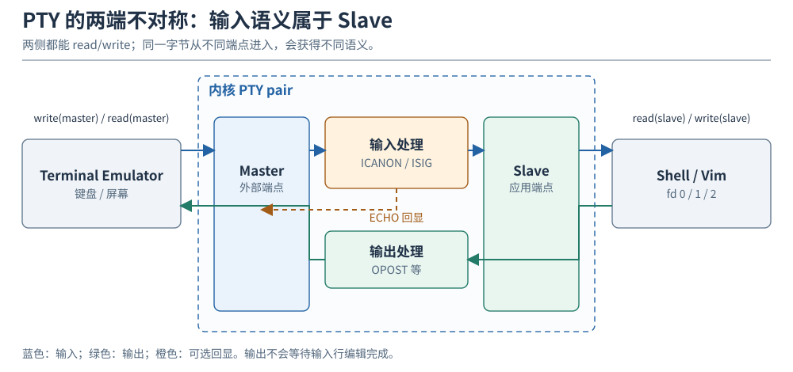

master 并不是比 slave 更高级的用户，而是模拟传统物理终端的接口；slave 使普通应用程序仍以为自己连接着传统终端。内核在中间连接二者并提供终端语义。

| 调用 | 含义 |
|---|---|
| write(master) | 注入终端输入（如键盘字符） |
| read(slave) | 应用读取处理后的输入 |
| write(slave) | 应用产生终端输出 |
| read(master) | 终端提供者获取输出（包括回显等） |

### 4.2 如何创建一对 PTY？

现代 Linux 的 Unix98 PTY 使用 `/dev/ptmx` 作为分配入口。打开它会得到新的 master fd，同时在 devpts 文件系统中创建 `/dev/pts/N`，再通过 grantpt/unlockpt（或相应接口）准备可访问的 slave。`openpty()` 是常见封装；并不存在必须与每个 pts 对应的 `/dev/ptm/N` 路径。

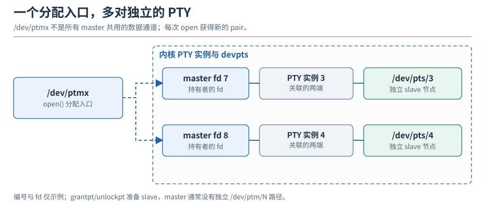

终端提供者还可以通过 master 获取 PTY 编号（TIOCGPTN）、设置窗口大小（TIOCSWINSZ，slave 侧也支持）、启用 master 专用的 packet mode（TIOCPKT）。关闭最后一个 master 引用会触发 hangup 等终端生命周期行为；这并不是把 master 当成特权进程，而是接口职责不同。

## 五、回显与控制字符：内核不仅在传输字节

### 5.1 为什么输入一半就能看见字符？

`Name: ` 出现在窗口之后，用户输入 `Ali`，尚未回车。应用的 read 仍在阻塞，但屏幕已经显示 Ali。因为内核可以一边将输入保存到行缓冲，一边把处理后的回显送回 master。窗口不必擅自显示每个按键，否则遇到密码输入就需要额外协议才能知道什么该显示。

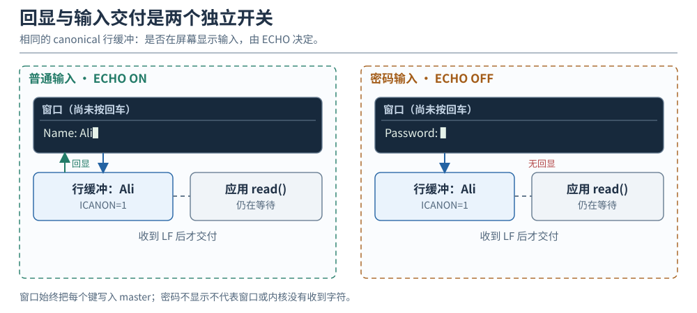

密码输入通常可以保持 canonical，关闭 ECHO（也要考虑 ECHONL 等配置）；每个字符仍从窗口立即送到内核，只是不会显示，也不会在回车前交给等待整行的程序。Vim 通常关闭 ICANON 与 ECHO，自己处理交互。是否显示输入、何时交付输入，是两个独立的决策。

### 5.2 程序根本不 read，如何响应 Ctrl+C？

假设程序在无限循环中计算，窗口向 master 写入 `0x03`。即使这个程序不读取任何数据，TTY 仍能利用内核的信号机制。在 ISIG 开启、VINTR 为默认 Ctrl+C 的情况下，N_TTY 将该字符解释为 SIGINT，向终端的前台进程组投递，而不是把它当普通数据交给 read。反方向 write(slave, 0x03) 并不会触发同样的输入语义。

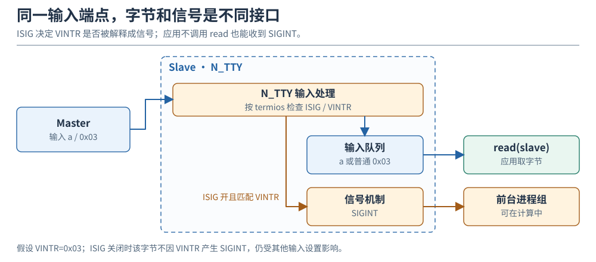

终端属性由 termios 表达。它们是终端对象的共享配置，不是每个 fd 私有的开关。

| 配置 | 职责 |
|---|---|
| ICANON | 规范模式、行编辑与按行交付 |
| ECHO | 输入回显 |
| ISIG | 识别产生信号的控制字符 |
| VINTR 等 c_cc 项 | 配置具体控制字符（默认 Ctrl+C 等） |
| VMIN / VTIME | 非规范模式下的读取条件 |

应用程序可以在已有 fd 上通过 tcgetattr/tcsetattr 操作这些属性，不必重新打开 `/dev/tty`。`isatty()` 可以判断一个 fd 是否是终端，`TIOCGWINSZ` 用于获取终端尺寸。`/dev/tty` 的特殊作用将在会话部分解释。

## 六、Shell 不必是所有进程的终端代理

### 6.1 谁应该收到 SIGINT？

一种可行的设计是 Shell 独占 slave，维护前后台程序，并自行转发数据和信号。但这样 Vim 就无法直接操作原来的 TTY；如果通过普通 pipe 连接，又重现了 ioctl 问题。Shell 也必须自行维护数据、信号和终端状态的代理逻辑。虽然可以为每个子程序创建新的 PTY，但这不是普通 Shell 必需承担的工作。

Unix 选择让 Shell 告诉内核谁在前台，子程序直接使用同一个终端。Shell 等待输入时，自己的组是前台；运行 sleep 时，Shell 把 sleep 所在组设置为前台，然后等待；sleep 结束后，Shell 收回前台。TTY 的文件描述符没有换，改变的是前台归属。

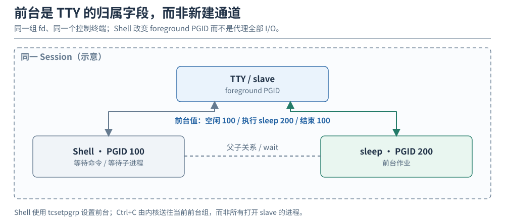

### 6.2 为什么记录 PGID 而不是 PID？

执行 `sleep 1000 | cat`，两个进程共同组成一个前台作业。TTY 若只记录单个 PID，Ctrl+C 就无法自然覆盖整个作业。不应在 TTY 内另造 PID 数组，因为多个进程作为一个管理整体是一项通用需求。

Unix 在进程管理中引入 Process Group，每组有 PGID；Shell 使用 `setpgid()` 组织作业，使用 `tcsetpgrp()` 设置 TTY 的前台进程组。TTY 只需记录 PGID，便可以通知全组。`kill(-pgid, SIGTERM)` 也是对进程组发信号的通用能力（受权限限制）。

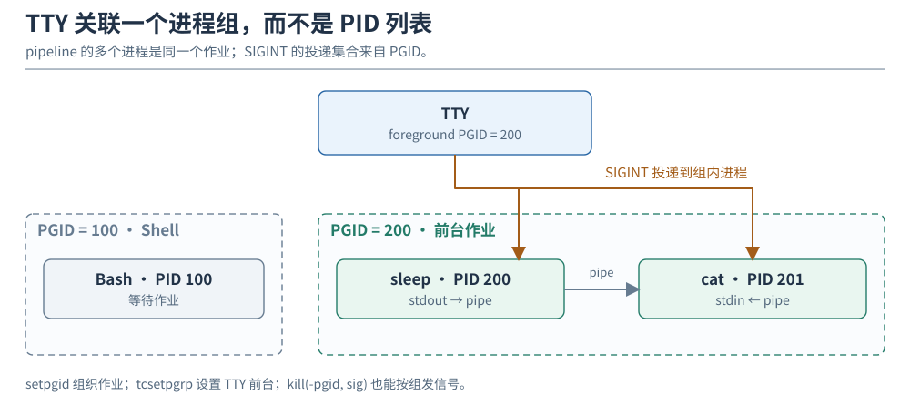

### 6.3 后台为什么还能输出，却不能抢输入？

在启用 job control 的交互式 Bash 中执行 `cat &`，后台 cat 尝试读取其控制终端时，内核通常向其进程组发送 SIGTTIN，默认动作是停止，而不是让它悄悄抢走输入。Shell 通过 wait 状态获知作业停止；执行 `fg` 时，先交还前台再发送 SIGCONT 恢复。若信号被阻塞或忽略、进程组孤儿化等，read 可能返回 EIO，这是默认行为之外的情况。

后台输出则默认允许，例如 `make -j8 &` 仍能打印编译日志；如果打开 TOSTOP，后台写控制终端通常会引发 SIGTTOU。后台修改某些终端控制属性也可能受到 SIGTTOU 约束。这里的“后台”是相对于控制终端的前台进程组，不是调度器停止分配 CPU。

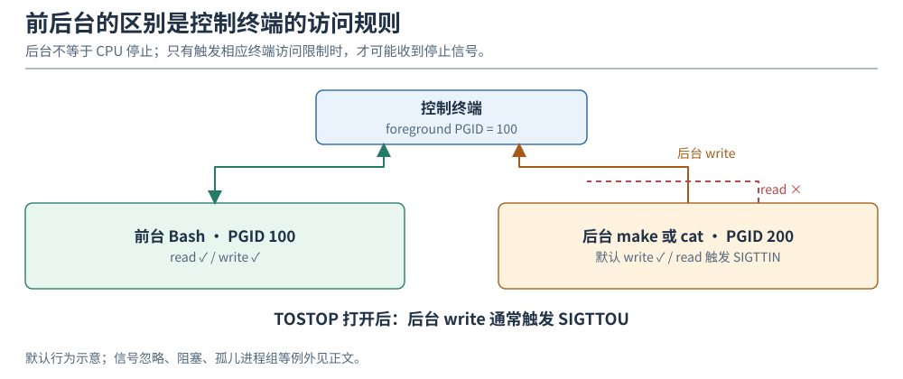

可以在交互式终端里尝试：

```bash
cat &
jobs
fg
```

随后 Ctrl+C 结束 cat。`jobs` 可能显示 `Stopped (tty input)`；若 jobs 执行得太早，可再检查一次。要丢弃后台 stdout 与 stderr，写 `make > /dev/null 2>&1 &`，因为重定向从左到右进行；写反会让 stderr 仍指向原 stdout。

### 6.4 Session 与 controlling terminal：终端归属的边界

此前只需表达一个作业包含多个进程。现在还需要表达一次登录或终端交互环境包含多个作业。Session 是由多个 process group 组成的集合，可以拥有一个 controlling terminal（控制终端）；一台 TTY 至多是一个 session 的控制终端。前台组必须属于相应 session。Session 不是 tmux session 这种用户态管理概念，也不等于 SSH 的协议 session channel。

创建新的 session 使用 `setsid()`，常见的终端创建流程是子进程创建 session，再打开 slave 或通过 TIOCSCTTY 建立控制终端，最后将其接到标准 fd。Shell 后续启动的作业通常继承 session 与控制终端关系。`/dev/tty` 是当前进程控制终端的特殊入口，即使 fd 0/1/2 被重定向，也可能通过它访问控制终端；没有控制终端时打开会失败。不能把控制终端定义为 fd 0 指向的对象。

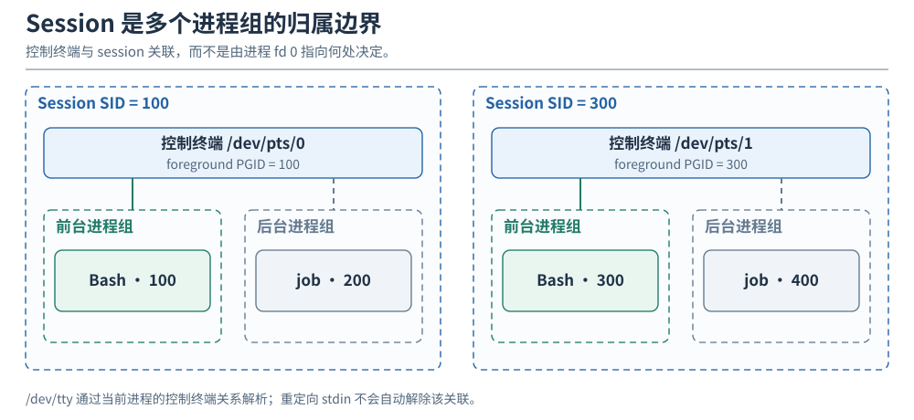

用 `ps -o pid,ppid,pgid,sid,tpgid,tty,comm -e` 可以观察这些归属。session 是控制终端与 job control 的边界，不是文件权限、用户身份等安全机制的替代品。这里仅给出足以理解终端交互的模型，不展开孤儿进程组、竞争条件与所有 ioctl 的限制。

## 七、tmux：自己是终端应用，又为别人提供终端

我们已经能够写出一个窗口程序：它持有 PTY master，把 slave 给 Shell。但如果提供终端的程序本身没有图形窗口，而是运行在另一个终端中呢？这就是理解 tmux 的入口。

对外，tmux 使用已有终端的 slave；对内，它为每个 pane 创建 PTY，并由 server 持有各个 master，pane 内的 Shell/Vim 使用各自 slave。它既是终端应用，也是终端模拟器与复用器。

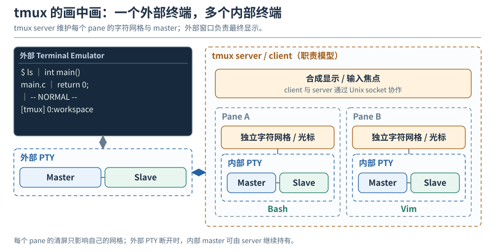

上图是职责图，而不是所有 fd 的精确持有者图：实际 tmux client 与 server 通过 Unix socket 通信，并涉及终端 fd 传递，server 也会直接操作附着客户端的 TTY。关键在于外部和内部是不同的 PTY。

为什么分屏不只是转发两个程序的输出？假设 Vim 发送清屏序列 `ESC [ 2 J` 或光标定位序列 `ESC [ 10 ; 20 H`。tmux 必须解释它们、维护每个 pane 独立的字符网格和光标，再合成外部终端的显示，不能让一个 pane 的清屏清掉整个窗口。图形终端模拟器最终还负责把字符与属性渲染成像素。TERM 与 terminfo 描述终端能力，使应用程序能够选择合适的控制序列。

当外部 TTY 开启 ISIG，Ctrl+C 可能先变成本地 SIGINT。我们讨论过为 tmux 安装 handler，再将信号重新构造为 0x03 的方案：对于单一情形可行，但信号来源不一定是键盘，而且外层 TTY 可能已清除输入。更简单的做法是使外层终端采用适于直接读取按键的模式，关闭外部的 ISIG、ICANON、ECHO 等相关处理，由 tmux 解析快捷键并向选中的 pane 写入对应字节，让内层 TTY 决定是否产生信号。

关闭外部窗口时，若 tmux server 仍存活并保持内部 master 引用，pane 的 PTY 就仍存在。`tmux attach` 只是重新附着外部终端。这也是为什么不能简单地后台运行 Bash，再打开它的 `/dev/pts/N` 实现重连：那个路径是 slave，向它 write 是应用侧输出，并非注入键盘输入；读取它也可能与原应用竞争。持有 master 的后台进程才是持续存在的终端提供者。

## 八、SSH：把 PTY 的外部一侧延伸到网络另一端

典型交互式 SSH 登录的设计与 tmux 类似，只是中间跨了网络。SSH 客户端使用本地终端，服务器在成功认证后根据 pty-req 分配远端 PTY（包括终端类型、尺寸与模式等），令远端 Shell 使用 slave，而 sshd 一侧持有 master。网络上传输的是 SSH 协议数据，不是远程屏幕像素。

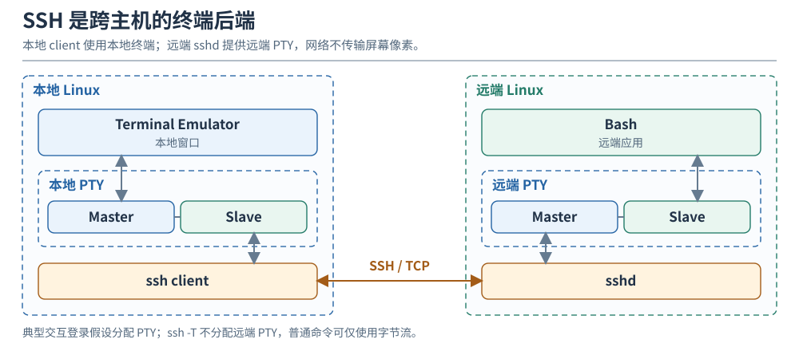

从远端转发逻辑看，收到客户端输入就写 master，从 master 读出输出就发回客户端。通常本地使用适当的终端模式避免提前解释 Ctrl+C；远端 N_TTY 根据自己的配置决定是否产生 SIGINT。尺寸改变通过 SSH 的 window-change 消息通知远端，而非普通字符。SSH 的密钥交换、认证、加密与 channel 多路复用属于另外一层协议，不是 PTY 的职责。

SSH 不是每次都需要 PTY。`ssh -T server 'tty'` 禁止分配远端 PTY，通常返回 `not a tty`；`ssh -t server 'tty'` 请求分配，通常显示 `/dev/pts/N`。如果本地 stdin 不是终端，可能要用 `-tt` 才能强制申请。非交互式远程执行可以只使用字节流。

在本地 Linux 图形终端里 SSH 到远端，再启动 tmux 并在其 pane 内运行 Vim，一共有三对 PTY：本地窗口与 ssh client、sshd 与远端 tmux 使用的终端、tmux server 与 pane 内 Vim。ssh client 和 sshd 之间是网络连接，不是第四对 PTY。

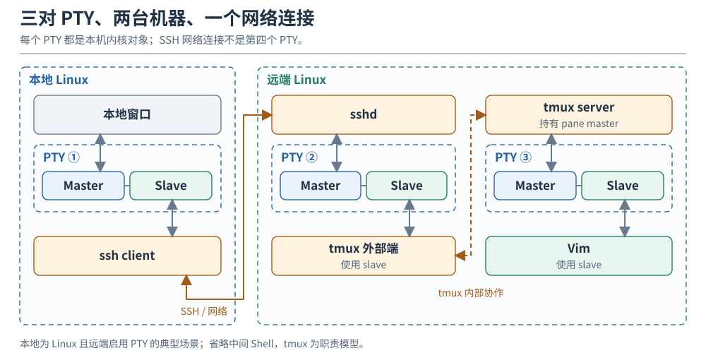

若本地是 Windows Terminal，则需要换成 Windows 原生的 ConPTY/Console 路径；Windows 并没有原生 Linux 的 `/dev/pts/N`。Windows Terminal 是终端模拟器，ConPTY 将字符流与传统 Windows Console API 的语义衔接，PowerShell/CMD 是命令解释器；WSL 内部还可能存在 Linux PTY。不要把 Windows 原生 ConPTY 与 Linux PTY 的接口和实现混为一谈。

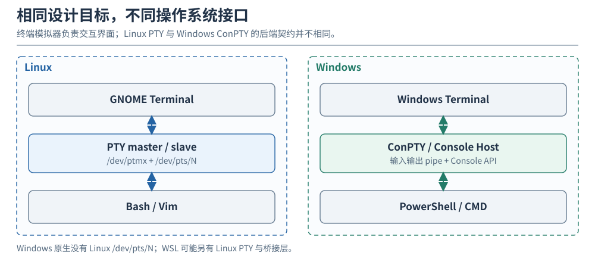

## 九、回到虚拟化：console、串口与登录

mini-vmm 模拟 UART，而不是直接在 guest 内创建 PTY。若 Host 终端本身由 Linux PTY 提供，则 mini-vmm 的字符后端可能连接 Host slave；Guest 内核通过串口驱动操作虚拟 UART，并提供 `/dev/ttyS0` 给 Guest Bash。两侧存在不同的内核对象，VMM 模拟的是硬件接口。Guest Bash 无需知道自己运行在虚拟机里。

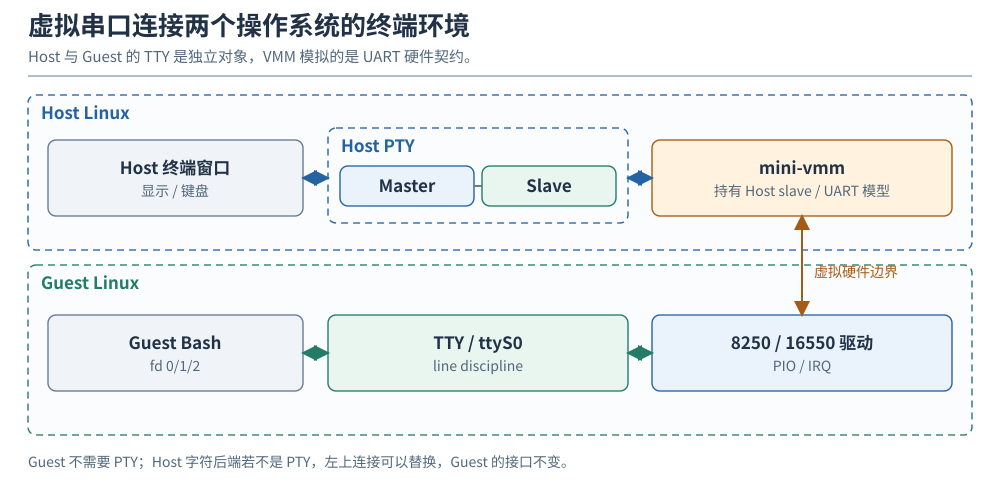

`console=ttyS0` 指定内核日志输出使用串口，`dmesg` 则读取日志缓冲区。console 与普通 TTY 读写可能共用 UART，但不是一条完全相同的调用链。`/dev/console` 是系统控制台的特殊设备接口，`/dev/tty` 是当前进程控制终端，`/dev/tty0` 是当前活动虚拟控制台，三个概念不要混用。

发行版中，systemd-getty-generator 可根据活动 console 为串口生成 `serial-getty@ttyS0.service`；本地虚拟控制台的 getty 也可由 logind 等机制按需启动。agetty 获取用户名，login 完成认证与登录环境设置，Bash 才能开始交互；Bash 退出后，登录服务可由 systemd 的 Restart=always 重新启动。具体 login 是 fork 还是 exec 取决于实现，不能将所有发行版一概而论。

如果有两个 UART，希望一个仅用于常规内核日志、另一个用于登录，可以用 `console=ttyS0`，mask S0 的自动 getty 服务，并启用 `serial-getty@ttyS1.service`（两个设备及独立后端必须真实存在）。这是角色分配，而非访问控制策略。

## 十、可在自己的 Linux 上做的观察

下面是独立命令，不是需要整体执行的脚本；假设运行于交互式 Bash、相应工具已安装。命令输出因系统不同而变化。

```bash
tty
ls -l /proc/$$/fd/{0,1,2}
stty -a
ps -o pid,ppid,pgid,sid,tpgid,tty,comm -e
cat /sys/class/tty/console/active
```

`tty` 显示 stdin 连接的终端；`stty -a` 显示 ICANON、ECHO、ISIG、rows/columns 等属性。可用 `echo 'Hello terminal' > /dev/tty` 验证控制终端入口。观察 Vim 的 ioctl 调用：

```bash
strace -o /tmp/vim.trace -e trace=ioctl,openat vim
# 退出 Vim 后再查看
 grep -E 'TCGETS|TCSETS|TIOCGWINSZ|/dev/tty' /tmp/vim.trace
```

查看真实系统的调用往往比背诵结构体更有用；这里不声称命令已在读者的机器运行，也不保证每个 Vim 构建都出现完全相同的调用序列。

## 十一、最后把概念放在各自的层次

| 概念 | 职责 |
|---|---|
| Terminal | 人机交互端点；可以是物理设备或软件模拟 |
| Terminal Emulator | 接收输入、解释输出控制序列、呈现界面 |
| TTY | 内核终端对象及其语义与接口 |
| UART / ttyS0 | 串口硬件 / 对应的 TTY 设备 |
| tty1 / tty0 | 独立虚拟控制台 / 当前活动 VT |
| PTY | 连接终端提供者和应用的虚拟终端对 |
| PTM / PTS | master（终端侧）/ slave（应用侧） |
| /dev/ptmx | 创建 Unix98 PTY master 的入口 |
| /dev/tty | 访问当前进程控制终端的入口 |
| /dev/console | 系统控制台特殊接口 |
| termios / N_TTY | 可配置终端属性 / 常用线路规程 |
| PGID / SID | 进程组 / 会话的标识 |
| Shell | 解释命令、管理作业，选择前台组 |
| Getty / login | 准备终端与登录认证环境 |
| tmux | 嵌套终端、维护 pane、复用及持久会话 |
| SSH | 通过安全网络通道转发终端或普通字节流 |

**整个体系的核心并不复杂：保留应用程序熟悉的接口，把不断变化的底层交互方式隐藏在抽象后面。** 物理串口、虚拟控制台、图形终端、tmux 和远程网络连接可以如此组合，正是因为 TTY 所代表的语义与实际收发字符的机制是可以分离的。

## 参考与进一步阅读

- [The Art of Unix Programming：Unix 历史](https://cs.petrsu.ru/~musen/shell/2025/readings/taoup/ch02s01.html)；[Linux Programming Interface：Terminals（书籍信息）](https://man7.org/tlpi/)
- [Linux kernel：设备命名](https://docs.kernel.org/admin-guide/devices.html)、[TTY Line Discipline](https://docs.kernel.org/driver-api/tty/tty_ldisc.html)、[N_TTY](https://docs.kernel.org/driver-api/tty/n_tty.html)
- [pty(7)](https://man7.org/linux/man-pages/man7/pty.7.html)、[pts(4)](https://man7.org/linux/man-pages/man4/pts.4.html)、[termios(3)](https://man7.org/linux/man-pages/man3/termios.3.html)、[tty(4)](https://man7.org/linux/man-pages/man4/tty.4.html)
- [credentials(7)](https://man7.org/linux/man-pages/man7/credentials.7.html)、[setpgid(2)](https://man7.org/linux/man-pages/man2/setpgid.2.html)、[tcsetpgrp(3)](https://man7.org/linux/man-pages/man3/tcsetpgrp.3.html)、[setsid(2)](https://man7.org/linux/man-pages/man2/setsid.2.html)
- [tmux manual](https://man.openbsd.org/tmux)、[RFC 4254：SSH Connection Protocol](https://datatracker.ietf.org/doc/html/rfc4254/)、[Microsoft：Creating a Pseudoconsole session](https://learn.microsoft.com/en-us/windows/console/creating-a-pseudoconsole-session)
- [Linux serial console](https://docs.kernel.org/admin-guide/serial-console.html)、[systemd-getty-generator](https://www.freedesktop.org/software/systemd/man/latest/systemd-getty-generator.html)
