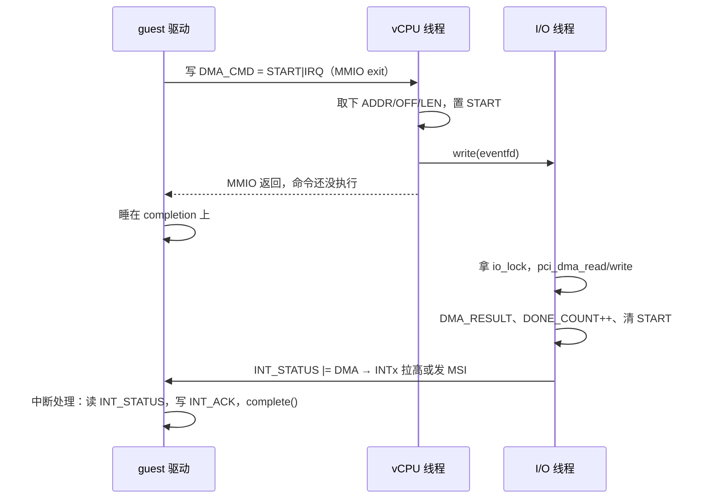

到目前为止，mini-vmm 模拟的每个设备都有现成的 guest 驱动：e1000 用 Linux 的 e1000，AHCI 用 Linux 的 ahci，pvpanic 用 Linux 的 pvpanic-mmio。现成驱动的好处是它代表真实世界，坏处是它是一个黑盒：设备模型哪里不对，只能从驱动的反应倒推，驱动本身想加一行诊断也做不到。edu 反过来：设备的寄存器规范由本项目自己定义，VMM 侧的设备模型和 guest 侧的驱动都在自己手里，任何一侧出问题都能直接加诊断。以后 MSI-X、IOMMU、SR-IOV 这些机制都可以先在这个设备上试，它就是一个试验台。

这一篇讲这个设备的规范、VMM 侧怎么实现异步完成的 DMA 引擎、guest 驱动从 probe 到 remove 的完整生命周期，以及怎么证明加载卸载很多次也不漏资源。设备是自己定义的，没有第三方规范要先讲，原理和实现放在一章里。

## 一、设备要演示什么

一个 PCI 设备驱动要做的事情，可以归成三类：

- 访问寄存器：找到 BAR，映射，读写；
- DMA：给设备一块内存的总线地址，让设备自己去读写，CPU 不参与搬运；
- 中断：设备做完了事情通知 CPU，驱动确认之后撤销。

edu 每一类都只做最小的一份：一组寄存器，一个在 guest 内存和设备内部 4 KiB 缓冲区之间搬数据的 DMA 引擎，一个由 DMA 完成或软件触发的中断。中断同时支持 INTx 和 MSI，驱动用模块参数选一种。

设计思路参考了 QEMU 的 `hw/misc/edu.c`，但规范是本项目自己写的，写在 `include/devices/edu_regs.h` 里。这个头文件只有宏、不包含任何别的头文件，VMM 的设备模型和 guest 的内核模块、用户态工具都直接包含它，常量只有一份，两边不会对不上。

## 二、规范

### 2.1 PCI 身份和 BAR

| 项 | 值 |
|---|---|
| vendor / device | 0x1234 / 0x0003 |
| class code | 0xFF0000（不属于任何已定义类别） |
| 中断 | INTA 引脚，加一个 MSI capability（单向量、64 位地址） |
| BAR0 | 32 位、不可预取的 MMIO，8 KiB |

0x1234 不在 PCI-SIG 的 vendor 分配表里，QEMU 也用它标识自己的模拟设备。Linux 里按这个 vendor 匹配的只有 bochs 显卡驱动（device 0x1111），本设备的 device ID 避开了它，不会有别的驱动抢着绑上来。class code 选 0xFF 也是同样的考虑：按类代码匹配的通用驱动（比如 ahci 按 01/06/01 匹配）不会看上一个“未分类”设备。

BAR0 分成两半：

```text
BAR0 + 0x0000 ┌────────────────────┐
              │ 寄存器             │ 只接受对齐的 4 字节访问
BAR0 + 0x1000 ├────────────────────┤
              │ 设备内部缓冲区 4K  │ 任意宽度、任意偏移
BAR0 + 0x2000 └────────────────────┘
```

缓冲区直接经 MMIO 可见，是为了验证。驱动有两条互相独立的路去读写同一块数据：CPU 经 MMIO 窗口访问，或者让设备 DMA。用 DMA 把数据写进缓冲区、再经 MMIO 读出来比对，或者反过来，验证的就是 DMA 引擎的方向和内容，不需要相信 DMA 自己报告的结果。如果只有 DMA 一条路，DMA 进去再 DMA 出来，方向写反的引擎照样能“读回一致”：两次都搬错方向，等于没搬。

### 2.2 寄存器

| 偏移 | 名字 | 访问 | 含义 |
|---|---|---|---|
| 0x000 | ID | RO | 0x31554445，按字节读是 "EDU1" |
| 0x004 | SCRATCH | RW | 写什么读回什么 |
| 0x008 | INT_STATUS | RO | 待处理的中断原因 |
| 0x00C | INT_RAISE | WO | 写 1 的位置进 INT_STATUS，只认软件位（bit 8-31） |
| 0x010 | INT_ACK | WO | 写 1 的位从 INT_STATUS 清掉 |
| 0x020 / 0x024 | DMA_ADDR_LO / HI | RW | DMA 的 guest 一侧：64 位总线地址 |
| 0x028 | DMA_OFF | RW | DMA 的设备一侧：缓冲区内的偏移 |
| 0x02C | DMA_LEN | RW | 字节数 |
| 0x030 | DMA_CMD | RW | bit 0 START，bit 1 TO_RAM，bit 2 IRQ |
| 0x034 | DMA_RESULT | RO | 最近一次完成的结果：0 OK，1 BAD_RANGE，2 BUS_ERROR |
| 0x038 | DMA_DONE_COUNT | RO | 复位以来完成的命令数（含失败的） |

寄存器区不接受非 4 字节或不对齐的访问：读回全 1，写被丢弃，VMM 记一条日志。这样驱动用错宽度会立刻读到一个明显不对的值，而不是读到半个寄存器、看起来像是对的。

INT_STATUS 的 bit 0 留给 DMA 完成，bit 8-31 留给软件经 INT_RAISE 使用，中间几位保留。软件中断的用处是不依赖 DMA 就能单独验证中断通路：DMA 出了问题时，软件中断还通，就能把范围缩到 DMA 引擎上。

### 2.3 DMA 引擎

软件填好 DMA_ADDR、DMA_OFF、DMA_LEN，再向 DMA_CMD 写带 START 的命令。规范规定了这几件事：

- 设备在写 START 的那一刻取下参数，之后再改寄存器不影响这条命令；
- DMA_CMD 读回时 START 表示“正在执行”，完成时设备清掉它；
- 执行中对 DMA 寄存器的写被丢弃，一个引擎同一时间只执行一条命令；
- 命令是异步完成的：写 START 的 MMIO 访问返回时，搬运通常还没做；
- 完成时 DMA_RESULT 给出结果。长度为 0 或者超出缓冲区是 BAD_RANGE；Bus Master 关着或者 guest 地址不在内存里是 BUS_ERROR。这两种都一个字节都不搬。不论结果如何，DMA_DONE_COUNT 加 1、START 清掉，命令带 IRQ 位时置 INT_STATUS 的 DMA 位。

失败的命令也算完成、也发中断，是为了让驱动的等待永远有一个结局：驱动等的是“设备说做完了”，做完的结果是好是坏另读寄存器，不会因为一次越界就等到超时。

### 2.4 中断语义

INT_STATUS 的每一位是一个待处理的原因，由设备或软件置位，只由软件写 INT_ACK 清除。两种中断的规则不同：

- INTx：INTA 的电平等于 `INT_STATUS != 0`。这是电平触发，驱动不清 INT_STATUS，线一直有效，IOAPIC 每次 EOI 之后都会再送一次；
- MSI：INT_STATUS 每多出一个原来为 0 的位，设备发一条消息。已经置位、还没确认的原因再次发生，不再发消息。

MSI 的规则要和驱动的确认方式配合。驱动的中断处理函数读一次 INT_STATUS，只往 INT_ACK 写读到的那些位。处理期间新到一个原因，它要么是新位（设备为它单独发了一条消息，处理函数会再进来一次），要么是已经置位的旧位（处理函数这次读 INT_STATUS 时已经看到了它）。两种情况都不丢。反过来，如果驱动写 INT_ACK 时写的是全 1，处理期间新到的那一位会被一起清掉，而 MSI 不会为它再发消息，这个原因就丢了。

打开 MSI 之后设备不再拉 INTA，这是 PCI 规范对 MSI 的要求（PCI Local Bus 3.0 第 6.8.3.3 节），由 PCI 核心统一处理，设备照样报电平。

## 三、VMM 侧：异步完成的 DMA 引擎

### 3.1 为什么不能在 vCPU 线程里直接搬

最直接的实现是：guest 写 DMA_CMD 时，在处理这次 MMIO exit 的 vCPU 线程里把数据搬完、置中断，然后返回。这样实现出来的设备“太好用了”：写 START 的那条指令还没退休，数据已经到位，中断已经挂上。驱动就算写完寄存器不等中断、马上去读结果，也总是对的。

真实设备不是这样。DMA 引擎要花时间，写寄存器只是把命令交出去。一个“写完寄存器就当数据到位”的驱动在真硬件上会读到旧数据，而在同步实现的模拟设备上永远测不出来。所以 edu 的规范明确写了异步完成，实现也必须真的异步：



vCPU 线程只做两件事：把参数拷到 `run_addr`、`run_off`、`run_len`、`run_cmd` 里（这就是“写 START 时取下参数”），然后写一个 eventfd。I/O 线程的 epoll 看到 eventfd 可读，回调 `edu_on_wake` 里拿 `vm->io_lock`，执行搬运、更新寄存器、置中断。

要做到这一点，设备在 attach 时需要拿到事件循环，把自己的 eventfd 登记上去。原来的 `vmm_device_type.attach` 只有 `vm` 和 `bus` 两个参数，现在多了一个还没启动的 `struct event_loop *`。其他设备不用它，直接忽略。

### 3.2 并发

设备的寄存器、缓冲区和执行状态只在 `vm->io_lock` 下访问：

- BAR 的读写经 exit 分发进来时，分发路径已经持着 io_lock；
- I/O 线程的完成回调先拿 io_lock 再动设备；
- 整机复位也持着 io_lock。

最后一条决定了复位和执行中的命令怎么交互。guest 写了 START、I/O 线程还没来得及执行，这时整机复位：复位回调把 DMA_CMD 清 0。之后 I/O 线程拿到锁，看到 START 已经不在了，什么都不做。如果完成回调不检查 START、直接按 `run_*` 执行，复位之后的新内核会凭空收到一次 DMA 写和一个中断。

### 3.3 范围检查

guest 完全控制 DMA_OFF 和 DMA_LEN，两个都是 32 位。检查写成：

```c
if (e->run_len == 0 || e->run_off > EDU_BUF_SIZE ||
    e->run_len > EDU_BUF_SIZE - e->run_off)
    res = EDU_DMA_RES_BAD_RANGE;
```

看起来更自然的 `run_off + run_len > EDU_BUF_SIZE` 是错的：off = 0xFFFFFFFF、len = 2 时和在 32 位里回绕成 1，检查通过，`e->buf + run_off` 指到 host 进程里缓冲区后面 4 GiB 的地方。先确认 off 不超过缓冲区，再用减法比较，就不会溢出。guest 内存一侧的地址和长度交给 `pci_dma_read` / `pci_dma_write`，它们先查 Bus Master，再经统一的 GPA 检查确认整段落在 RAM 里。

### 3.4 DMA 地址是什么地址

驱动写进 DMA_ADDR 的是 `dma_alloc_coherent` 返回的 `dma_addr_t`，也就是设备眼里的总线地址。guest 里没有 IOMMU 时，总线地址就等于 guest 物理地址，VMM 的 `pci_dma_*` 直接把它当 GPA 用。有 IOMMU 时它是 IOVA，要先经 IOMMU 的页表翻译才是 GPA。mini-vmm 目前不给 guest 提供 IOMMU，所以这里没有翻译这一步。驱动不需要知道是哪种情况，DMA API 已经把差别藏起来了；VMM 这一侧加 IOMMU 时，改的是 `pci_dma_*` 里面，设备模型不用动。

## 四、guest 侧：驱动的生命周期

驱动在 `tools/guest/edu/edu.c`，是一个标准的 PCI 驱动，用 `module_pci_driver` 注册，按 vendor/device 匹配。

### 4.1 probe 和 remove

probe 的每一步都申请一样资源，remove 按相反的顺序全部归还：

| probe | 申请的资源 | remove |
|---|---|---|
| `pci_enable_device` | 打开 decode、使能计数 | `pci_disable_device` |
| `pci_request_regions` | `/proc/iomem` 里 BAR0 的占用 | `pci_release_regions` |
| `pci_iomap` | 内核虚拟地址到 BAR0 的映射 | `pci_iounmap` |
| `dma_set_mask_and_coherent(64)` | 声明设备能访问 64 位地址 | （无） |
| `pci_set_master` | command 寄存器的 Bus Master | `pci_clear_master` |
| `dma_alloc_coherent` | 4 KiB 一致性 DMA 缓冲区 | `dma_free_coherent` |
| `pci_alloc_irq_vectors` | MSI 向量或 INTx | `pci_free_irq_vectors` |
| `request_irq` | 中断处理函数 | `free_irq` |
| `ida_alloc` | 设备编号 N | `ida_free` |
| `misc_register` | `/dev/eduN` | `misc_deregister` |

probe 中途失败时，出错路径从失败那一步往回走，只释放已经申请到的。这是内核里最常见的 goto 链写法，标签顺序和 remove 一致。

读 ID 寄存器核对 "EDU1" 放在映射 BAR 之后、打开 Bus Master 之前：万一匹配到的不是这个设备，在它能做 DMA 之前就退出。

### 4.2 一致性 DMA 缓冲区

`dma_alloc_coherent` 分配的是 CPU 和设备看到的内容始终一致的内存，不需要在每次 DMA 前后调用 sync 函数（Linux `Documentation/core-api/dma-api.rst` 第一部分）。缓冲区在 probe 时分配一次，以后每次 DMA 都用它：用户数据先 `copy_from_user` 到这块缓冲区，再让设备从这里读；或者反过来，设备写进来，驱动再 `copy_to_user`。

这比每次把用户页 pin 住、建 scatter-gather 映射要简单得多，代价是多一次拷贝，单次 DMA 最多 4 KiB。对演示 DMA 机制来说足够了。

### 4.3 中断：只申请选中的那一种

```c
flags = !strcmp(irq_mode, "msi") ? PCI_IRQ_MSI : PCI_IRQ_INTX;
r = pci_alloc_irq_vectors(pdev, 1, 1, flags);
```

真实驱动一般写 `PCI_IRQ_MSI | PCI_IRQ_INTX`，MSI 申请不到就退回 INTx。这里故意只给一种：验收要确认的正是“这一种中断能走通”，悄悄退回会把 MSI 的失败藏起来，测试看到的是 INTx 在工作。

INTx 可能和别的设备共用一根线，所以 INTx 模式下 `request_irq` 带 `IRQF_SHARED`，中断处理函数读到 INT_STATUS 为 0 时返回 `IRQ_NONE`，告诉内核这次不是自己的中断。

### 4.4 中断处理函数

```c
status = ioread32(e->regs + EDU_REG_INT_STATUS);
if (!status)
    return IRQ_NONE;
iowrite32(status, e->regs + EDU_REG_INT_ACK);
ioread32(e->regs + EDU_REG_INT_STATUS);
```

两处要注意。第一，只往 INT_ACK 写读到的位，理由在规范一节讲过：写全 1 会把处理期间新到的原因一起清掉。

第二，写 INT_ACK 之后又读了一次寄存器。PCI 上的 MMIO 写是 posted 的：CPU 发出写就继续往下走，写可能还在桥的缓冲里，没到设备。处理函数返回后 IOAPIC 收到 EOI，如果这时设备还没收到 ACK，INTx 线还高着，IOAPIC 立刻再送一次中断，处理函数进来读到 0，返回 `IRQ_NONE`。偶尔一次不要紧，次数多了内核会以“nobody cared”为由把这根线关掉。读同一个设备的寄存器会强制前面的写先到达（PCI 的排序规则：读请求不能越过之前的 posted 写），读回之后再返回就没有这个窗口。在 mini-vmm 里 MMIO 写是同步处理完才返回的，不读回也测不出问题，但驱动要按真实总线的规则写。

### 4.5 等待完成

一次 DMA 在驱动里是这样的：

```c
reinit_completion(&e->dma_done);
iowrite32(...DMA_ADDR_LO/HI, DMA_OFF, DMA_LEN...);
iowrite32(EDU_DMA_CMD_START | EDU_DMA_CMD_IRQ | dir, e->regs + EDU_REG_DMA_CMD);
wait_for_completion_timeout(&e->dma_done, msecs_to_jiffies(EDU_WAIT_MS));
```

中断处理函数看到 DMA 位就 `complete`。`reinit_completion` 必须在写 START 之前：放在后面的话，设备很快完成、中断在 reinit 之前到达，这次 complete 就被 reinit 清掉，驱动一直等到超时。超时只兜底设备再也不完成命令的情况，正常路径上醒来靠的是中断。

### 4.6 用户态接口

驱动注册一个 misc 字符设备 `/dev/eduN`，接口定义在 `tools/guest/edu/edu_ioctl.h`：

- `read` / `write` / `lseek`：CPU 经 MMIO 窗口直接读写设备缓冲区，文件偏移就是缓冲区内的偏移；
- `EDU_IOC_DMA`：用设备的 DMA 引擎在用户缓冲区和设备缓冲区之间搬运，等完成中断后返回；设备报 BAD_RANGE 返回 `EINVAL`，BUS_ERROR 返回 `EIO`；
- `EDU_IOC_RAISE`：触发软件中断，等中断处理函数看到这些位后返回；
- `EDU_IOC_INFO`：中断方式、驱动认领的中断数、设备的 DMA 完成计数。

DMA 的偏移原样交给设备，驱动自己不检查：越界的组合正好用来验证设备的 BAD_RANGE 判定，以及驱动把它翻译成 `EINVAL`。

## 五、在 guest 里编译

外部模块要对着正在运行的内核的构建树编译，`make -C /lib/modules/$(uname -r)/build M=$PWD modules`。发行版把这棵树打成单独的包，Arch 叫 `linux-headers`，Debian 系叫 `linux-headers-$(uname -r)`。构建镜像的脚本 `tools/build_arch_image.sh` 把 `linux-headers`、`gcc`、`make` 和 `linux` 一起装进去，它们来自同一个软件源快照，版本必然一致。

版本一致之所以重要，是因为模块里记着 vermagic（内核版本加几个关键配置），`insmod` 时内核逐字比对，不一致就拒绝加载。检查自己机器上是否一致：

```sh
modinfo -F vermagic edu.ko | cut -d' ' -f1
uname -r
```

加载时内核会打两行：一行说加载了树外模块、内核被标记为 tainted，另一行说模块没有签名。发行版内核开了模块签名（`CONFIG_MODULE_SIG=y`），但没有强制（`CONFIG_MODULE_SIG_FORCE` 没开），未签名的模块照样能加载，只是打上标记。读 `/proc/config.gz` 或 `/boot` 下的配置能知道自己的内核是哪种；如果强制签名打开了，要用内核构建时的密钥给模块签名才能加载。

## 六、实际观察到的执行流

加载驱动（默认 MSI），VMM 的日志里先出现 guest 写进 MSI capability 的消息：

```text
[INFO] pci 00:01.0 edu: MSI enabled, address 0xfee00000 data 0x00XX
```

guest 的 dmesg：

```text
edu 0000:00:01.0: /dev/edu0, irq N (MSI), BAR0 [mem 0xc0000000-0xc0001fff]
```

BAR0 的地址是 VMM 在注册设备时分配的，edu 是第一个 PCI 设备，所以拿到 MMIO 窗口的起点。`/proc/interrupts` 里这一行是 `PCI-MSI-0000:00:01.0 0-edge edu`。

换成 `insmod edu.ko irq_mode=intx`，VMM 日志里出现 `MSI disabled, interrupts go to INTA`，`/proc/interrupts` 变成 `IO-APIC 17-fasteoi edu`。17 是 VMM 的接线决定的：slot s 的 INTA 接 IOAPIC 引脚 `16 + ((s + 1 - 1) & 3)`，edu 在 slot 1。fasteoi 说明这是电平触发的引脚。

`eductl selftest N` 每轮做四件事：DMA 进设备再经 MMIO 读回比对，经 MMIO 写进设备再 DMA 出来比对，一次越界的 DMA（期望 `EINVAL`），一次软件中断。每一步都等中断才返回，所以计数的增量是精确可算的：每轮两次成功的 DMA 加一次越界的 DMA 是 3 次完成，再加软件中断一共 4 个中断。selftest 最后核对驱动认领的中断数恰好增加 4N、设备的完成计数恰好增加 3N、INT_STATUS 清零。每轮的偏移和长度在整块、单字节、不对齐的短块、贴着缓冲区末尾几种形状之间轮换。

## 七、怎么证明卸载不漏资源

“重复加载卸载 100 次行为一致、没有资源泄漏”要转成看得见的判据。分两类资源。

第一类是有名字的资源：模块本身、字符设备、中断号、`/proc/iomem` 里的占用、PCI 设备的 enable 计数、command 寄存器的 Bus Master 位、MSI capability 的 Enable 位。它们都能从 `/proc` 和 sysfs 读出来，配置空间可以经 `/sys/bus/pci/devices/<BDF>/config` 读。测试在加载状态下读一遍（证明这些检查看得见资源），卸载后再读一遍（证明全部归还）。

第二类是内存。一致性 DMA 缓冲区泄漏一页，从空闲页数上看不出来：页缓存、slab、per-cpu 页列表都会让空闲页数随时上下浮动，一页的差别淹没在浮动里，前后两次读数相减可以是任意符号。换成数事件：内核在 `dma_alloc_coherent` 和 `dma_free_coherent` 里各有一个 tracepoint（`dma:dma_alloc`、`dma:dma_free`，定义在 `include/trace/events/dma.h`），事件里带设备名。按设备名过滤之后，计数只和这一个设备有关，没有任何噪声：

```sh
T=/sys/kernel/tracing
echo 'device == "0000:00:01.0"' > $T/events/dma/dma_alloc/filter
echo 'device == "0000:00:01.0"' > $T/events/dma/dma_free/filter
echo 1 > $T/events/dma/dma_alloc/enable
echo 1 > $T/events/dma/dma_free/enable
# ...加载卸载若干次...
grep -c ' dma_alloc: ' $T/trace; grep -c ' dma_free: ' $T/trace
```

加载卸载 100 次（MSI 和 INTx 交替），分配和释放各 100 次。这个判据能不能抓到泄漏，要用对照组证明：测试另编一份 remove 里漏掉 `dma_free_coherent` 的驱动，同样加载卸载，分配次数照涨、释放次数是 0。只有看到判据在故意写错的驱动上变红，它在正确驱动上的“配平”才有意义。

tracepoint 需要内核开了 `CONFIG_EVENT_TRACING`，tracefs 挂在 `/sys/kernel/tracing`；`ls /sys/kernel/tracing/events/dma` 能看到这两个事件就说明可用。

## 八、最容易弄错的地方

- **同步完成的设备会掩盖驱动错误。** 设备模型在 vCPU 线程里把 DMA 做完，驱动不等中断也总能读到正确结果。异步完成不是为了性能，是为了让这一类驱动错误能被测出来。
- **驱动确认中断时只清读到的位。** 写全 1 在 INTx 下看不出问题（电平会再拉起来），在 MSI 下会丢掉处理期间新到的原因，因为 MSI 只在位由 0 变 1 时发。
- **复位和执行中的命令。** 完成回调必须在锁内重新检查 START，否则复位丢弃的命令会在新内核里完成。
- **32 位的偏移加长度会回绕。** 先比偏移、再用减法比长度。
- **`reinit_completion` 放在写 START 之前。** 放在后面会吃掉一次很快到达的完成。
- **posted write。** 中断处理函数写 ACK 之后读一次设备寄存器，在真实总线上避免 EOI 先于 ACK 到达设备。

## 九、验证

单元测试 `tests/unit/edu_test.c` 链接真实的 `src/devices/edu.c`，把 PCI 核心和事件循环换成桩：DMA 落在一块假内存上，INTx 电平和 MSI 消息被记录下来，事件循环只记下设备登记的回调，由用例决定 I/O 线程什么时候“醒来”。这样可以停在“写了 START、还没执行”的那一刻检查：START 读回 1、DMA 层一次都没被调用、中断还没挂。判据全部来自规范：寄存器访问语义，DMA 的三种结果，执行中写寄存器被丢弃，MSI 只在新位出现时发，复位丢弃执行中的命令，以及偏移加长度回绕的那组输入。DMA 桩还检查设备交下来的 host 缓冲区整段落在设备自己的 4 KiB 缓冲区里，范围检查写错时测试报出断言失败，而不是越界写 host 内存。

e2e suite `tests/e2e/edu-dev.sh` 用 debugfs 把驱动源码写进 Arch 镜像的一份副本，启动 guest，在 guest 里编译、加载，依次检查：vermagic 一致；探测后七样资源都在；MSI 和 INTx 下各跑 20 轮 selftest；卸载后七样资源全部归还；加载卸载 100 次，探测结果 MSI 和 INTx 各 50 次、DMA 分配释放配平、dmesg 没有警告；漏掉 `dma_free_coherent` 的对照驱动配不平。

测试能不能挡住回归，靠 `tests/mutants/edu-dev.py` 里的源码变异体证明：故意把 MSI 规则写成每次更新都发、INT_RAISE 不屏蔽保留位、执行中的写不丢弃、范围检查用加法、复位不清命令，单元测试都变红；故意让设备不发 MSI、不拉 INTx、DMA 方向反了、不加完成计数，以及让驱动在 remove 里漏掉 `pci_disable_device`（卸载后 sysfs 的 `enable` 仍是 1），e2e 里对应的用例都变红。运行：

```sh
make test unit edu-dev
tests/mutate.py edu-dev
```

## 十、限制

- MSI 只有一个向量，没有 per-vector masking，也没有 MSI-X。多向量要等设备有了需要分别通知的多个事件源。
- DMA 只能用驱动的一致性缓冲区，单次最多 4 KiB，没有 scatter-gather。
- guest 里没有 IOMMU，DMA 地址就是 GPA。
- 设备的 DMA 引擎一次只执行一条命令，没有队列。

## 附录：参考

- PCI Local Bus Specification 3.0：第 6.2.2 节（command 寄存器、Bus Master）、第 6.2.5 节（BAR）、第 6.8 节（MSI），第 3.2.5 节（posted write 与读的排序）
- Linux `include/uapi/linux/pci_regs.h`
- Linux `Documentation/PCI/pci.rst`（驱动的 probe/remove 次序）
- Linux `Documentation/core-api/dma-api.rst`（`dma_alloc_coherent`、`dma_set_mask_and_coherent`）
- Linux `include/trace/events/dma.h`（`dma_alloc`、`dma_free` tracepoint）
- Linux `include/linux/pci.h`（`pci_alloc_irq_vectors`、`PCI_IRQ_MSI`、`PCI_IRQ_INTX`）
- QEMU `hw/misc/edu.c`（设计思路参考，不是规范）
