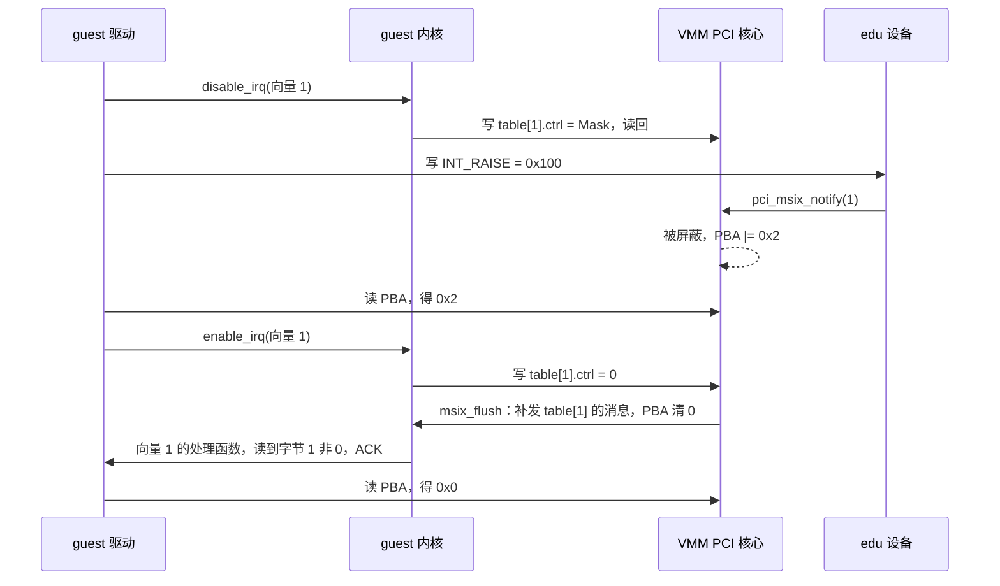

# 从零入门虚拟化：MSI-X 中断

## 一、MSI 不够用在哪里

MSI 让设备用一次内存写代替拉中断线：配置空间里有一个地址和一个数据，设备要中断时就往这个地址写这个数据，中断控制器把这次写翻译成某个 CPU 上的某个向量。一个设备只要一种中断原因时，这样就够了。

设备有好几种中断原因，比如网卡的每个收发队列、NVMe 的每个完成队列，事情就变了。驱动希望每种原因有自己的向量，各自绑到不同的 CPU 上，各自的处理函数只看自己那部分状态。MSI 在这里有三处卡住：

- 向量数最多 32 个，必须是 2 的幂，而且在中断控制器里连续分配。
- 所有向量共用一个地址，只是数据的低几位不同，所以它们只能送到同一个目标，没法一个向量一个 CPU。
- 按向量屏蔽是可选功能，很多设备没有，驱动想暂时关掉某一个向量时只能关掉整个 MSI。

MSI-X 把每个向量做成独立的一项：每项有自己的地址、数据和屏蔽位，这些项放在设备某个 BAR 的内存里，叫 MSI-X table，最多 2048 项。另有一张 Pending Bit Array（PBA），每项一位，记着"这一项有消息要发，但被屏蔽了"。配置空间里只留一个小小的 capability，告诉软件 table 和 PBA 在哪个 BAR、哪个偏移。

本篇的里程碑在 VMM 的 PCI 核心里实现通用的 MSI-X，让 edu 教学设备有 4 个向量，由 guest 里的 Linux 驱动申请这 4 个向量，并在真实 guest 里观察屏蔽和补发。

## 二、规范

下面的内容出自 PCI Local Bus Specification 3.0 第 6.8.2 节（capability 和 table 结构）和第 6.8.3 节（MSI 与 MSI-X 的运作规则）。Linux 的 `include/uapi/linux/pci_regs.h` 里有对应的宏，名字都以 `PCI_MSIX_` 开头。

### 2.1 capability

capability ID 是 0x11，结构有 12 字节：

```text
偏移  宽度  字段
+0    1    Capability ID = 0x11
+1    1    Next Pointer
+2    2    Message Control
             bit 10:0  Table Size，编码为项数减 1，只读
             bit 14    Function Mask
             bit 15    MSI-X Enable
+4    4    Table Offset / Table BIR
             bit 2:0   BIR：table 在哪个 BAR（0 到 5）
             bit 31:3  table 在这个 BAR 里的偏移，8 字节对齐
+8    4    PBA Offset / PBA BIR，格式同上
```

MSI-X Enable 置 1 后，设备只用 MSI-X 发中断，INTx 线不再拉起，MSI 也不再用。Function Mask 置 1 时，所有项都按屏蔽处理，不论各自的屏蔽位是什么；它和各项的屏蔽位互相独立，清掉 Function Mask 不会改动任何一项自己的屏蔽位。

### 2.2 table 和 PBA

table 每项 16 字节：

```text
+0x0  Message Address（低 32 位，bit 1:0 为 0）
+0x4  Message Upper Address
+0x8  Message Data
+0xC  Vector Control，bit 0 是 Mask，其余保留
```

复位后每一项的 Mask 都是 1，地址和数据是 0。PBA 是一串 qword，第 n 位对应第 n 项，只读。

规范对软件访问 table 和 PBA 的方式有要求：只用对齐的 4 字节或 8 字节访问，其他访问的结果未定义。8 字节写有一个专门的用法：一项已经被屏蔽时，软件可以用一次 8 字节写同时填 Message Data 和 Vector Control，因此数据必须先于屏蔽位生效。

### 2.3 屏蔽和 pending

第 6.8.3.5 节规定了屏蔽的语义：

- 一项被屏蔽时，设备有消息要从这一项发，就不发，改为置 PBA 里它的 pending 位。
- 屏蔽解除时（清这一项的 Mask，或清 Function Mask），pending 的项要立刻用 table 里此刻的地址和数据补发一条，并清 pending。
- 屏蔽期间中断原因已经被软件处理掉了（比如驱动轮询发现并清掉了状态），设备应当清掉 pending 位，解除屏蔽后不再补发。

规范允许设备缓存未屏蔽表项的值，但要求屏蔽解除时用最新的值。这条规则是为了让驱动能安全地改一项的地址：先屏蔽，改地址和数据，再解除屏蔽。屏蔽期间攒下的消息要送到新地址，而不是旧地址。

## 三、Linux 怎么打开 MSI-X

驱动调用 `pci_alloc_irq_vectors(pdev, min, max, PCI_IRQ_MSIX)` 时，PCI 核心按下面的顺序配置设备（`drivers/pci/msi/msi.c` 的 `msix_capability_init`）：

1. 写 Message Control，把 MSI-X Enable 和 Function Mask 同时置 1。先打开 MSI-X 是为了让设备不再拉 INTx，同时用 Function Mask 挡住所有消息。
2. 从 capability 读 Table BIR 和偏移，`ioremap` 这段 table。
3. 为每个向量在中断控制器里分配向量号，把地址和数据写进 table 对应的项。
4. 把所有项的 Mask 置 1（`msix_mask_all`），再清 Function Mask。

之后各项保持屏蔽，直到驱动 `request_irq` 时内核解除这一项的屏蔽。屏蔽和解除走 `pci_msix_mask`/`pci_msix_unmask`：写 Vector Control，然后读回一次，确保这次写真的到达设备。

驱动侧还有一个容易误解的地方：`disable_irq` 默认是"懒"的。它只在中断描述符上记一个"已禁用"，不去碰设备。之后真有中断到达时，边沿中断的处理流程（`kernel/irq/chip.c` 的 `handle_edge_irq`）看到描述符已禁用，才去屏蔽这一项，并在描述符上记一个 pending；`enable_irq` 时由内核自己重放这次中断。这样设计是因为屏蔽要访问设备，代价比在内存里置一位大，而大多数 disable 期间根本没有中断到来。给中断设上 `IRQ_DISABLE_UNLAZY` 标志，`disable_irq` 才会立刻屏蔽设备上的那一项。

## 四、VMM 侧：屏蔽规则全部放进 PCI 核心

### 4.1 设备只说"第 n 项要发一条"

`include/pci/pci.h` 里，设备在 `struct pci_device` 上声明两个字段：

- `msix_vectors`：项数，0 表示没有 MSI-X；
- `msix_bar`：一个空着的 BAR 号。

注册时 PCI 核心（`src/pci/pci.c` 的 `msix_bar_claim`）把这个 BAR 整个拿过来，设成 4 KiB 的 32 位 MMIO，读写回调指向核心自己的 `msix_bar_read`/`msix_bar_write`。table 放在 BAR 内偏移 0，PBA 放在 0x800。设备之后只调用三个函数：

- `pci_msix_enabled(dev)`：guest 是否打开了 MSI-X；
- `pci_msix_notify(dev, n)`：第 n 项有消息要发；
- `pci_msix_clear_pending(dev, n)`：第 n 项的中断原因已经没有了。

table 的格式、访问宽度、屏蔽、pending 和补发，设备都不用管。用独占的 BAR 是规范实现注记推荐的做法：table 不和设备自己的寄存器共用一个 4 KiB 页，操作系统可以单独保护它；对 VMM 来说，设备的 BAR 回调也不用划出一段地址再转交给核心。

capability 由核心在注册时排进链表：从配置空间 0x40 开始，有 MSI 时 MSI 在前，然后是 MSI-X。偏移记在 `msi_cap`、`msix_cap` 里。guest 按链表找 capability，不依赖具体位置。

### 4.2 发送、屏蔽和补发

核心里的逻辑很短：

```c
/* src/pci/pci.c */
static bool msix_masked(const struct pci_device *d, unsigned n)
{
    return msix_func_masked(d) || (d->msix_table[n].ctrl & PCI_MSIX_ENTRY_CTRL_MASKBIT);
}

void pci_msix_notify(struct pci_device *d, unsigned n)
{
    ...
    if (msix_masked(d, n)) {
        d->msix_pba |= 1ULL << n;
        return;
    }
    msix_send(d, n);
}
```

`msix_flush` 负责补发：遍历 PBA，凡是 pending 且现在没被屏蔽的项，按 table 里此刻的地址和数据发一条，然后清 pending。屏蔽可能被解除的地方有三处，每处之后都调用它：

- guest 写某一项的 Vector Control；
- guest 写配置空间的 Message Control（清 Function Mask）；
- guest 写 Message Control 打开 MSI-X Enable：MSI-X 关着时 notify 只记 pending，打开后补发。

核心不缓存表项，每次发送都现读 table，所以"解除屏蔽时用最新值"自然成立。

发送和 MSI 走同一个函数 `msi_deliver`：检查 Bus Master，检查地址和数据是否合法，交给 KVM（`KVM_SIGNAL_MSI`）。发不出去时记日志，带 BDF、"MSI-X entry n"、地址、数据和原因。

### 4.3 table 的读写

`msix_bar_read`/`msix_bar_write` 只接受对齐的 4 字节或 8 字节访问。其他访问读回全 1、写被丢弃，第一次时记一条日志。8 字节访问拆成先低后高两次 4 字节：一次 8 字节写同时填 Message Data 和 Vector Control 时，数据先写进去，然后才清屏蔽位并可能触发补发，补发出去的是新数据。

字段的读写属性按规范：

- Message Address 的 bit 1:0 只读为 0；
- Vector Control 只有 Mask 位可写，保留位读 0；
- PBA 只读，写被丢弃。

### 4.4 INTx 和复位

`pci_set_irq` 决定 INTx 线电平时，要求 MSI 和 MSI-X 都没打开。复位（VM 启动时和 `pci_bus_reset`）把每一项恢复成"屏蔽、地址数据为 0"，PBA 清零。

## 五、edu 设备：一个状态寄存器怎么分给 4 个向量

edu 原来只有一个 32 位的 INT_STATUS：bit 0 是 DMA 完成，bit 8 到 31 留给软件经 INT_RAISE 自己触发。有了 4 个 MSI-X 项后，规范头文件 `include/devices/edu_regs.h` 规定按字节分：

```text
INT_STATUS  31......24 23......16 15.......8 7........0
             向量 3     向量 2     向量 1     向量 0
                                              bit 0 = DMA 完成
```

`EDU_INT_VEC_MASK(n)` 就是第 n 个字节的掩码。某个字节里多出一个原来为 0 的位，设备就用这个字节对应的项发一条消息。`src/devices/edu.c` 的 `edu_update_irq` 每次 INT_STATUS 变化都会走一遍：

```c
for (n = 0; n < EDU_MSIX_VECTORS; n++)
    if (!(e->int_status & EDU_INT_VEC_MASK(n)))
        pci_msix_clear_pending(&e->pci, n);
if (pci_msix_enabled(&e->pci)) {
    for (n = 0; n < EDU_MSIX_VECTORS; n++)
        if (rise & EDU_INT_VEC_MASK(n))
            pci_msix_notify(&e->pci, n);
} else if (rise && pci_msi_enabled(&e->pci)) {
    pci_msi_notify(&e->pci);
}
```

第一段对应第 6.8.3.5 节的"原因没了就清 pending"：某个字节被 INT_ACK 清成 0，这一项就没有理由再补发了。按字节而不是按位分，是为了让每个向量的处理函数只读、只清自己那个字节，几个向量的处理函数在不同 CPU 上同时跑时互不干扰。

edu 把 BAR1 交给核心放 MSI-X（`EDU_MSIX_BAR`），BAR0 的寄存器和缓冲区布局不变。

## 六、guest 驱动

驱动 `tools/guest/edu/edu.c` 的模块参数 `irq_mode` 多了 `msix`，此时申请 4 个向量：

```c
r = pci_alloc_irq_vectors(pdev, 4, 4, PCI_IRQ_MSIX);
```

最少和最多都写 4：edu 的向量和 INT_STATUS 的字节一一对应，少给一个就有一个字节的中断没有人收。每个向量有一个 `struct edu_vec`，记着它的掩码（第 n 个字节）、处理函数被调用的次数，以及认领的次数（读到自己的字节非 0）。

处理函数对所有模式都是同一个：读 INT_STATUS，与上自己的掩码。是 0 就返回 `IRQ_NONE`；不是 0 就只把读到的那些位写进 INT_ACK，再读回一次，把这次写推到设备上。

驱动为了观察屏蔽，做了两件普通驱动不需要做的事：

- 每个 MSI-X 向量设上 `IRQ_DISABLE_UNLAZY`，让 `disable_irq` 立刻写设备上那一项的 Mask。不设的话，`disable_irq` 期间设备根本不知道自己被屏蔽了，消息照发，由内核在软件里挡住再重放，PBA 永远是 0，测不到设备的屏蔽语义。
- 按 capability 里的 PBA BIR 和偏移，用 `pci_iomap_range` 映射 PBA，让测试能读到 pending 位。

`EDU_IOC_MASKTEST` 这个 ioctl 做三种测试：

- **单个向量**：`disable_irq` 屏蔽这个向量，触发它的软件中断，读 PBA；再 `enable_irq`，等处理函数把这个原因认领掉，再读 PBA。
- **Function Mask**：直接写配置空间 Message Control 的 Function Mask，同时触发向量 1、2、3 的软件中断，读 PBA；清掉 Function Mask，等三个都被认领。
- **屏蔽期间确认**：屏蔽，触发，读 PBA；驱动直接写 INT_ACK 清掉这个原因，再读 PBA；解除屏蔽后再触发一次，作为"前面的消息都已送到"的分界。

用户态工具 `eductl masktest` 把结果打印成一行。

## 七、实际观察到的执行流

以单个向量 1 的屏蔽测试为例：



`eductl` 打印的这一行就是上面这个过程的记录：

```text
masktest vector 1: masked pba 0x2 calls +0 +0 +0 +0; after pba 0x0 calls +0 +1 +0 +0
```

`calls` 是 4 个向量的处理函数各被调用了多少次。屏蔽期间 4 个都是 +0，说明消息确实没发出来；解除屏蔽后只有向量 1 是 +1，说明补发的正好是一条，走的是向量 1 那一项。

屏蔽期间确认的情形里，写 INT_ACK 后 PBA 立刻变成 0；解除屏蔽后向量 1 的 +1 来自分界那次触发，没有多出一条补发：

```text
masktest acked 1: masked pba 0x2 calls +0 +0 +0 +0; acked pba 0x0; after pba 0x0 calls +0 +1 +0 +0
```

VMM 自己的日志里能看到 Linux 打开 MSI-X 的顺序：先是 `MSI-X enabled, 4 entries, function mask on`，各项写完、Function Mask 清掉之后，消息才开始走。

## 八、最容易弄错的地方

**Linux 的 disable_irq 不碰设备。** 用 `disable_irq`/`enable_irq` 测屏蔽，测到的往往是内核的软件屏蔽：中断次数都对，PBA 却始终是 0。要观察设备侧的屏蔽，要么设 `IRQ_DISABLE_UNLAZY`，要么直接写 table 或 Function Mask；判据要看 PBA，光看中断次数分不出是设备屏蔽了，还是内核挡住了再重放。

**pending 要跟着原因走。** 只实现"屏蔽时置 pending、解除时补发"，没实现"原因没了清 pending"，在驱动轮询处理的场景下会多出一条没有原因的中断。edu 的处理函数遇到这种中断返回 `IRQ_NONE`，内核会在大量 `IRQ_NONE` 之后把这个中断当成坏掉的关掉。

**补发用的是最新的表项。** 驱动改一项的目标 CPU 时，就是先屏蔽、再改地址和数据、再解除屏蔽。设备要是在屏蔽那一刻缓存了旧值，补发的消息会送到旧 CPU 上。

**Function Mask 和各项的 Mask 互相独立。** 清 Function Mask 不改各项的 Mask；某一项自己还屏蔽着，它的 pending 就继续留着。Function Mask 测试最后检查 MSI-X Enable 仍是 1、Function Mask 已是 0，三个向量也确实各收到一条。

**8 字节写的顺序。** 规范允许在一项已屏蔽时用一次 8 字节写同时填数据和清屏蔽。VMM 把 8 字节拆开处理时，先处理高 4 字节就会先清屏蔽、补发旧数据。

## 九、验证

单元测试 `tests/unit/pci_bus_test.c` 用一个带 4 项 MSI-X 的假设备，逐条检查核心的行为：

- capability 的格式和可写位；
- table 和 PBA 的读写属性，以及非法宽度和不对齐的访问；
- 打开 Enable 之前和之后 notify 的结果；
- 单项屏蔽和 Function Mask 下的 pending 与补发、补发使用的地址和数据；
- `pci_msix_clear_pending`；
- MSI-X 打开后 INTx 不再拉起；
- 复位。

`tests/unit/edu_test.c` 检查 edu 按字节分项、只对新出现的位发消息、字节清零时清 pending。

e2e suite `tests/e2e/pci-msix.sh` 在 Arch guest 里编译驱动，以 `irq_mode=msix` 加载：

- `/proc/interrupts` 里出现 4 行 PCI-MSIX；配置空间 0x50 处是 MSI-X capability，Enable 为 1。
- `eductl selftest 20`：每轮 3 次 DMA 完成都在向量 0，一次软件中断按所在字节落在向量 1 到 3。各向量的次数可以按轮数算出来，实际值要和算出来的精确相等。
- 三种 masktest 的输出逐字匹配，PBA 的值和每个向量的次数都在里面。
- 换成 `irq_mode=intx` 加载，VMM 日志出现 `MSI-X disabled, interrupts go to INTA`，INTx 下 selftest 通过。卸载后 MSI-X Enable 和 Function Mask 都是 0，中断都已归还。
- 加载卸载 20 次，每次都拿到 4 个向量，计数和屏蔽测试都通过，dmesg 没有告警。
- VMM 日志里没有发不出去的消息，没有非法的 table 访问。

这些判据都是精确值，不靠"中断数大于 0"这类宽松条件。屏蔽是否生效看 PBA，补发了几条看每个向量的次数，两样都对上才算通过。

`tests/mutants/pci-msix.py` 把核心和 edu 里的规则逐条改坏，例如：

- 屏蔽时照发，或者 Function Mask 不算屏蔽；
- 解除屏蔽不补发，或者补发后不清 pending；
- 原因没了不清 pending；
- MSI-X 打开时 INTx 照拉；
- 8 字节写先处理高 4 字节；
- 复位后 table 保持原样；
- edu 的所有字节都走第 0 项。

改坏的规则有的单元测试就能抓到，有的只有真实 guest 驱动才看得出来，后一类由 pci-msix suite 去抓。跑 `tests/mutate.py pci-msix` 时每一个都要让某条测试变红。

## 十、限制

- 核心最多支持 64 项，PBA 正好是一个 qword。规范允许 2048 项，edu 只用 4 项，更大的表要等有设备需要时再扩。
- table 和 PBA 必须独占一个 BAR。规范也允许它们和设备寄存器放在同一个 BAR 里，那需要 BAR 回调按偏移把访问转交给核心。
- 消息经 `KVM_SIGNAL_MSI` 从 VMM 的线程发出，每条都要一次系统调用。用 irqfd 让 KVM 直接注入是另一个机制。
- 目前只有 edu 用 MSI-X，AHCI 和 e1000 仍用 MSI 或 INTx。

## 附录：参考

- PCI Local Bus Specification Revision 3.0：第 6.8.2 节 MSI-X Capability and Table Structures，第 6.8.3 节 MSI and MSI-X Operation（屏蔽和 pending 在第 6.8.3.5 节）
- Linux `include/uapi/linux/pci_regs.h`：`PCI_MSIX_FLAGS_*`、`PCI_MSIX_TABLE`、`PCI_MSIX_PBA`、`PCI_MSIX_ENTRY_*`
- Linux `drivers/pci/msi/msi.c`：`msix_capability_init`、`msix_mask_all`；`drivers/pci/msi/msi.h`：`pci_msix_mask`
- Linux `kernel/irq/chip.c`：`handle_edge_irq`、`__irq_disable`；`include/linux/irq.h`：`IRQ_DISABLE_UNLAZY`
- Linux `Documentation/PCI/msi-howto.rst`：`pci_alloc_irq_vectors` 的用法
